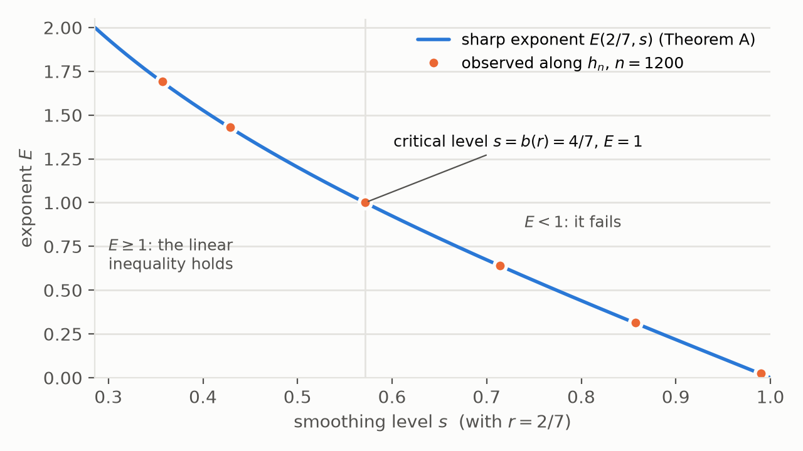
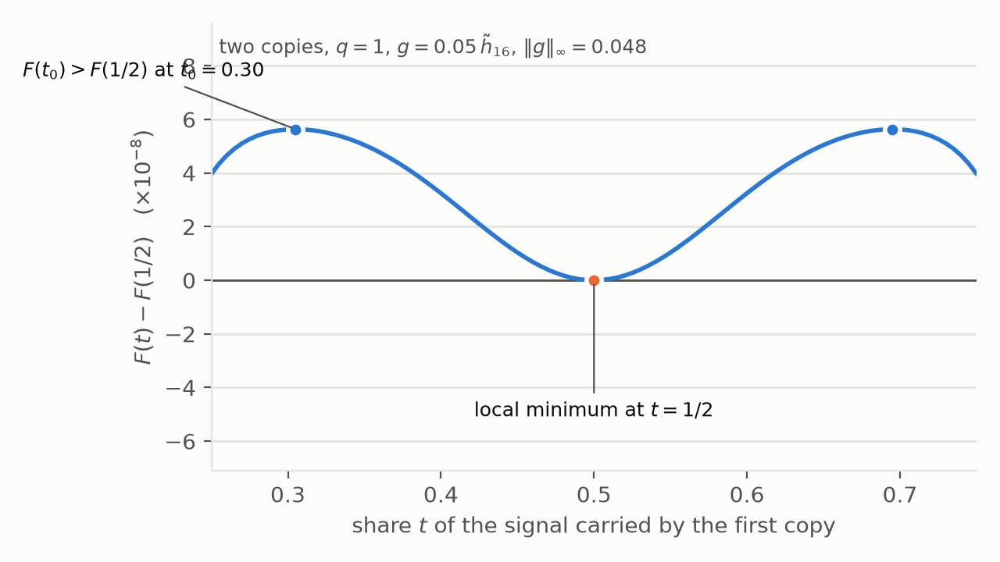

# Abstract

Take two independent copies $X,Y$ of a symmetric real random variable, mix them with weights $\sqrt t$ and $\sqrt{1-t}$, and add Gaussian noise. Is the entropy of the result concave in $t$? Luo (2026) showed that for inputs close to the Gaussian this can fail when the signal carries more than four sevenths of the output variance. Two earlier unrefereed 2026 preprints showed that it holds near the Gaussian when the signal carries less than one half (Schubr) and less than four sevenths (an Evidence Press release). We re-prove that whole range and add the endpoint: local concavity holds at four sevenths, in a neighbourhood of the Gaussian whose size does not shrink as the threshold is approached; an explicit radius is $10^{-8}$ in the relative supremum norm. The set of signal fractions with local concavity is therefore exactly $(0,4/7]$, and it stays the same when the supremum norm is replaced by any relative $C^m_b$ norm. Section 1.4 explains in elementary terms where four sevenths comes from.

The proof rests on an inequality for bounded functions on the real line with Gaussian measure. For Ornstein--Uhlenbeck smoothing $T_\rho$ and every pair of levels $r<s$ we determine the largest exponent $E$ in
$$\norm{T_{\sqrt s}\,g}_2^2\le C\,\norm g_\infty^{\,2-E}\,\norm{T_{\sqrt r}\,g}_2^{\,E}.$$
It is explicit, decreases from two to zero, and is at least one exactly when $s\le\sqrt{2r(1+r)}-r$, the critical level found by Luo for the $L^2(dx)$ form of the inequality. At the critical level the supremum-norm inequality holds with a logarithmic gain.

For three or more copies we show that a fourth-cumulant obstruction of Madiman, Nayar and Tkocz (2020), known for many summands without noise, is already present for three summands with noise: for each signal fraction in $(0,1)$ there are symmetric densities arbitrarily close to the Gaussian whose entropy is not concave on the simplex of weights. The failure sits near the faces of the simplex, in a region that shrinks with the size of the perturbation. Combined with Luo's theorem on an edge of the simplex, it shows that for three or more copies no signal fraction in $(0,1]$ gives local concavity on the whole simplex. The new range is $q\le4/7$, where two copies are locally concave and three are not.

Appendix A lists what was computed to test each proof, Appendix B how the work was produced and checked, Appendix C the priority search, and Appendix D a proof of Luo's theorem in the notation of this paper.

# In plain terms

*The question.* Take two independent random quantities with the same symmetric distribution, add them with a slider $t$ that decides how much each one contributes, and add ordinary Gaussian noise. Entropy measures how unpredictable the total is. As the slider moves from one end to the other, does the entropy follow a curve that only bends downwards, with no dip in the middle? That property is called concavity. The answer depends on one number, the *signal fraction* $q$: the share of the total variance that comes from the two inputs rather than from the noise.

*A communication reading.* The same question can be asked about a channel in which two users send signals of the same kind, with received powers $qt$ and $q(1-t)$, through noise of power $1-q$. The entropy of the output minus the entropy of the noise is the total rate at which the two users can jointly get information through (the sum-rate of a two-user Gaussian multiple-access channel). Concavity in $t$ means that this total rate is a concave function of how the power is split. The threshold $q=4/7$ corresponds to a total signal-to-noise ratio $q/(1-q)=4/3$.

*The answer.* When the inputs are symmetric and very close to Gaussian, the entropy of two copies is concave exactly when $q\le4/7$. With three or more copies it is not concave on the whole range of weights at any signal fraction. At signal fractions up to 4/7 the failures found here sit very close to weightings in which one copy carries almost all the weight; whether concavity holds away from such weightings is not known.

*The tool.* The proof rests on an inequality about how Gaussian smoothing acts on bounded functions (Theorem A). It says, with the best possible exponent, how much of a function survives light smoothing given how much survives heavier smoothing.

*How large the effects are.* "Very close to Gaussian" is meant literally: the neighbourhood proved here allows the input density to differ from the Gaussian density by a factor of at most $1\pm10^{-8}$. The failures on the other side are also tiny: in the computations of Section 8 the largest entropy change that signals a failure is about $6\times10^{-8}$ nats, and near four sevenths the changes are far below what double-precision arithmetic resolves. No statistical estimate from samples, Monte Carlo simulation or engineering measurement could detect either side of the threshold; only exact computations from the formulas, as in Section 8, resolve it. The interest of the result is structural; it is not design guidance about signal-to-noise ratios.

*Symmetry matters.* For inputs that are not symmetric, concavity fails near the Gaussian at every signal fraction (Luo 2026, Theorem 1.1). Everything said here about four sevenths concerns symmetric inputs.

```{=latex}
\Needspace{22\baselineskip}
```

**Results at a glance.** "Yes" means that there is a fixed neighbourhood of the Gaussian in which every symmetric input gives a concave entropy. "No" means that arbitrarily close to the Gaussian there are symmetric inputs for which concavity fails.

| Copies | Signal fraction $q$ | Concave near the Gaussian? | Where it is proved |
|:--------|:-------------------|:-------------------------|:--------------------------|
| two | below $1/2$ | yes | Schubr (2026); re-proved here (Theorem C) |
| two | from $1/2$ to just below $4/7$ | yes | the release (2026); re-proved here (Theorem C) |
| two | exactly $4/7$ | yes | new (Theorem C) |
| two | above $4/7$, up to $1$ | no | Luo (2026); proof in Appendix D (Theorem D) |
| three or more | up to $4/7$ | no; the failures found occur when one copy carries almost all the weight | new (Theorem E) |
| three or more | above $4/7$, up to $1$ | no | Luo's theorem applied to two of the copies (Corollary E$'$) |

# 1. Introduction

## 1.1 The question

Let $X$ and $Y$ be independent real random variables with the same even density $f$, of mean zero and variance one, and let $G$ be an independent standard Gaussian. Fix a *signal fraction* $q\in(0,1]$ and consider
$$Z_t=\sqrt{qt}\,X+\sqrt{q(1-t)}\,Y+\sqrt{1-q}\,G,\qquad F_{q,f}(t)=h(Z_t),\qquad 0\le t\le1,$$
where $h$ is differential entropy, with natural logarithms (so entropies are in nats). Everything in this paper is one-dimensional: functions on $\mathbb R$ and the standard Gaussian measure on $\mathbb R$. The variance of $Z_t$ is one for every $t$; only the way the signal is shared between the two copies changes. At $t=0$ or $1$ one copy carries all the signal, at $t=\frac12$ they share it equally. By the entropy power inequality $F(t)\ge F(0)=F(1)$ for every $t$. Concavity of $F$ on the whole interval is a much stronger statement.

For $q=1$ (no noise) and log-concave $f$, concavity of $F$ is a conjecture of Ball, Nayar and Tkocz (2016). If $f$ is Gaussian, $F$ is constant. The question studied here is local: does concavity hold for all $f$ in a neighbourhood of the Gaussian, and how does the answer depend on $q$?

To make "neighbourhood" precise, write $f=\varphi(1+g)$ with $\varphi$ the standard Gaussian density. Call $g$ *admissible* if it is real, even and bounded with $\int g\varphi=\int x^2g\varphi=0$ (so that $f$ has mass one and variance one). The *local-concavity set* is
$$\mathcal C=\bigl\{q\in(0,1]:\ \exists\,\delta>0\ \text{such that }F_{q,\varphi(1+g)}\text{ is concave for every admissible }g\text{ with }\norm g_\infty\le\delta\bigr\}.$$

## 1.2 What was known

- **Gaussian mixtures.** For independent Gaussian mixtures the conjecture is true: Eskenazis and Gavalakis (2024, Theorems 1 and 2) proved concavity on the simplex of weights for any number of summands, strengthening the Schur-concavity for i.i.d. Gaussian mixtures of Eskenazis, Nayar and Tkocz (2018, Theorem 8).
- **Luo's counterexamples.** Luo (2026) disproved the conjecture. For asymmetric inputs concavity fails near the Gaussian at every $q\in(0,1]$ (his Theorem 1.1). For symmetric inputs it fails near the Gaussian at every $q\in(4/7,1]$ (his Theorem 1.2), on smooth strongly log-concave densities built from the oscillator functions $h_{n,a}$ of Section 2; one sequence of densities serves every $q\in(4/7,1]$, it approaches the Gaussian in every relative $C^m_b$ norm, and it matches any prescribed finite number of Gaussian moments. His Appendix G gives a fully explicit instance at $q=23/40$. So $\mathcal C\subseteq(0,4/7]$. Luo states that the symmetric range $0<q\le4/7$ is unresolved (his Problems 10.1 and 10.2) and that $4/7$ is the boundary of an auxiliary estimate, not an established critical value.
- **Luo's interpolation inequality.** That auxiliary estimate is Luo's Theorem F.1: for $g\in L^2(dx)$, the inequality $\norm{T_{\sqrt s}g}_2^2\le C_{r,s}\norm g_{L^2(dx)}\norm{T_{\sqrt r}g}_2$ holds if and only if $s\le b(r)=\sqrt{2r(1+r)}-r$, the endpoint included. The proof diagonalises the level $r$ in the basis $h_{n,a}$ and compares two Gaussian kernels in a Fock space; the necessity is shown on $h_{n,a}$.
- **Concavity below $1/2$.** Schubr (2026, Theorem 1.1) proved that for each $Q<\frac12$ there is an explicit $\delta_Q>0$ such that $F''\le-\frac1{16}\norm{NL_t}_2^2$ for every $q\le Q$ and every admissible $g$ with $\norm g_\infty\le\delta_Q$; $\delta_Q\to0$ as $Q\uparrow\frac12$. His Corollary 1.2 states this as a negative answer to Luo's Problem 10.2 for $q<\frac12$. His entropy--energy argument is the scheme used in Section 6 below.
- **Towards the global problem.** Schubr (2026) also proves results that are not local. Every fixed symmetric non-Gaussian input of variance one with all moments finite has concave $F_{q,f}$ for all $q$ below a threshold $q_X>0$ that depends on the input, with an explicit expansion as $q\to0$ (his Theorem 1.5); a family with a common moment envelope and a uniformly positive finite Hermite discrepancy has a common threshold (Theorem 1.3 and Corollary 1.4); and for every symmetric log-concave input of variance one the second derivative at the endpoints $t=0,1$ is nonpositive when $q\le\frac1{20}$, and strictly negative unless the input is Gaussian (Theorem 1.6). Abu-Ajamieh (2026) proves an exact formula for that endpoint curvature (see the next item but one).
- **Concavity below $4/7$.** The Evidence Press release *The critical signal fraction for local entropy concavity* (Anonymous, 2026; "the release" below) proved $(0,4/7)\subseteq\mathcal C$, with a radius $\delta_Q$ for all $q\le Q<\frac47$ that tends to zero like $(4/7-Q)^{9/4}$. Its key step (Lemma I.2) is a supremum-norm version of Luo's inequality, valid for $s<b(r)$; its Proposition S shows that the supremum-norm version fails for $s>b(r)$.
- **The endpoint identity and a fixed direction.** Abu-Ajamieh (2026) works with the same two-copy noisy mixture. His Theorem 3.1 is an exact identity for the curvature at the endpoint: for a smooth even density $f$ of variance one with score $\rho=(\log f)'$ and fourth cumulant $\kappa_4$,
$$F''(0^+)=-\tfrac12A-\tfrac1{12}\,\kappa_4B,\qquad A=\mathbb E[(\rho'+1)^2],\quad B=\int f''''\log f=\mathbb E[(\rho')^2]-\tfrac13\mathbb E[\rho^4],$$
so that the endpoint curvature is nonpositive if and only if $\kappa_4B+6A\ge0$ (his (3.15)--(3.16)). The identity is stated for any sufficiently smooth density, so it applies to the noisy densities and, for smooth inputs, to the noiseless case $q=1$. His Theorem 5.1 shows that at $q=\frac12$, for symmetric log-concave inputs, any endpoint counterexample must lie in one of two explicit near-Gaussian "sign-mismatch" sectors, where $\kappa_4B<0$; his Theorem 7.1 proves an auxiliary inequality $\mathbb E[(s')^2]\ge2\,\mathbb E[s^2]$ for the relative score $s$ whenever $\norm{p/\varphi-1}_\infty\le\eta_*$, where $\eta_*\approx0.1884695$ is the root in $(0,1)$ of $2\eta^3-2\eta^2-5\eta+1$; and his Theorem 8.1 proves concavity for the explicit family $\varphi(1+a\,\mathrm{He}_4)$, $0<a\le10^{-2}$, for every $t$ and every $q\le\frac58$. That family is unbounded relative to the Gaussian and is one direction, not a neighbourhood. The quantity $B$ reappears in Theorem E below (Section 7, "What is owed").
- **The endpoint.** The release lists $q=4/7$ as its first open problem and explains why its method stops there (Section 1.4 below).
- **More copies.** Madiman, Nayar and Tkocz (2020, Theorem 1; preprint 2019) constructed a symmetric log-concave $X$, a small perturbation of the Gaussian, with $h(X_0+n^{-1/2}\sum_{i\le n}X_i)>h(X_0+Z)$ for all large $n$, where $Z$ is Gaussian. Hence $a\mapsto h(\sum_i\sqrt{a_i}X_i)$ is not Schur-concave on the simplex for $n$ large, and so not concave. Their proof expands the entropy in the fourth cumulant of $X$ (Section 7 below), using the Edgeworth-type expansion of entropy of Bobkov, Chistyakov and Götze (2013). The release asks whether mixtures of three or more noisy copies have a threshold of their own.

## 1.3 Results

Throughout, $T_\rho$ is the Ornstein--Uhlenbeck operator $T_\rho g(x)=\mathbb E\,g(\rho x+\sqrt{1-\rho^2}\,G)$, $N$ is the number operator ($N\mathrm{He}_n=n\mathrm{He}_n$, so $T_\rho=\rho^N$), and $\norm\cdot_2$ is the norm of $L^2(\varphi)$. For $0<r<1$ put
$$a_r=\frac1{\sqrt{1-r^2}},\qquad\lambda_r=\frac r{1+\sqrt{1-r^2}},\qquad b(r)=\sqrt{2r(1+r)}-r,\qquad\tau_r(s)=\frac{1-a_r(1-s)}{1+a_r(1-s)} .$$

**Theorem A (smoothing inequality for bounded functions, sharp exponent).** Let $0<r<s<1$ and
$$E(r,s)=\frac{2\log\tau_r(s)}{\log\lambda_r}.$$

(a) $E(r,\cdot)$ is continuous and strictly decreasing on $(r,1)$, from $2$ at $s=r$ to $0$ at $s=1$, and $E(r,s)\ge1$ if and only if $s\le b(r)$.

(b) There is $C=C(r,s)<\infty$, bounded for $s$ in compact subsets of $(r,1)$, such that every real bounded measurable $g$ satisfies
$$\norm{T_{\sqrt s}\,g}_2^2\le C\,\norm g_\infty^{\,2-E(r,s)}\,\norm{T_{\sqrt r}\,g}_2^{\,E(r,s)} .$$

(c) The exponent is optimal: if the inequality in (b) holds for all bounded $g$ with some exponent $E'$ in place of $E(r,s)$, then $E'\le E(r,s)$.

(d) At the critical level $s=b(r)$, where $E=1$, there is a logarithmic gain: for $g\ne0$ (both sides vanish when $g=0$),
$$\norm{T_{\sqrt s}\,g}_2^2\le J_r\,\norm g_\infty\norm{T_{\sqrt r}\,g}_2\,\Bigl(1+\log\frac{\norm g_\infty}{\norm{T_{\sqrt r}g}_2}\Bigr)^{-1/4}.$$

Since $\norm{T_{\sqrt r}g}_2\le\norm g_\infty$, a larger exponent is a stronger statement. In particular the *linear* inequality $\norm{T_{\sqrt s}g}_2^2\le J\norm g_\infty\norm{T_{\sqrt r}g}_2$ holds with a finite constant if and only if $s\le b(r)$.

The critical level $b(r)$ is Luo's: his Theorem F.1 is the linear inequality with $\norm g_{L^2(dx)}$ in place of $\norm g_\infty$, on exactly this range. The release has the supremum-norm form for $s<b(r)$ and its failure for $s>b(r)$. New here are the supremum-norm inequality at $s=b(r)$, the exponent for all pairs, and Theorem B. A bounded function need not belong to $L^2(dx)$, so (d) does not follow from Luo's endpoint case. Remark 5.4 records what the method gives in higher dimensions.

The formula has a simple reading. The form $g\mapsto\norm{T_{\sqrt r}g}_2^2$ is diagonal for a harmonic oscillator, with eigenvalues $\lambda_r^k$; on its most favourable functions the form at level $s$ behaves like the same oscillator semigroup with eigenvalues $\tau_r(s)^k$; and $\norm g_\infty$ plays the role of the norm at time zero. Theorem A is then Hölder interpolation in the oscillator's time variable, and $E/2=\log\tau_r(s)/\log\lambda_r$ is the interpolation parameter.

*Remark 1.1 (noise stability and the square-integrable baseline).* For standard Gaussians $X,Y$ of correlation $u$, $\norm{T_{\sqrt u}g}_2^2=\mathbb E[g(X)g(Y)]$ is the Gaussian noise stability $\mathrm{Stab}_u(g)$ (O'Donnell 2014, Section 11.1), so Theorem A compares the noise stability of a bounded function at two correlations. For every $g\in L^2(\varphi)$ there is an elementary comparison. Since $\mathrm{Stab}_u(g)=\sum_n\hat g_n^2u^n$ and $s^n=(r^n)^\theta$ with $\theta=\log s/\log r\in(0,1)$, Hölder's inequality with exponents $1/\theta$ and $1/(1-\theta)$ gives
$$\norm{T_{\sqrt s}g}_2^2\le\norm{T_{\sqrt r}g}_2^{2\theta}\,\norm g_2^{2(1-\theta)}\le\norm g_\infty^{\,2-E_2}\,\norm{T_{\sqrt r}g}_2^{\,E_2},\qquad E_2(r,s)=\frac{2\log s}{\log r}.$$
For square-integrable $g$ the exponent $E_2$ cannot be improved (take $g=e_n$ and let $n\to\infty$), and $E_2\ge1$ if and only if $s\le\sqrt r$. For bounded $g$ the baseline is a valid inequality, so the optimality in Theorem A(c) gives $E\ge E_2$; the table, from `baseline.py`, shows the size of the gap.

```{=latex}
\Needspace{8\baselineskip}
```

| $r$ | $s$ | $E(r,s)$, bounded $g$ | $E_2(r,s)$, square-integrable $g$ |
|:----|:----|:----|:----|
| $0.01$ | $b(r)=0.1321$ | $1$ | $0.879$ |
| $2/7$ | $3/7$ | $1.428$ | $1.353$ |
| $2/7$ | $b(r)=4/7$ | $1$ | $0.893$ |
| $2/7$ | $5/7$ | $0.639$ | $0.537$ |
| $0.8$ | $b(r)=0.8971$ | $1$ | $0.974$ |

On a grid of $99\times50$ pairs $r<s<1$ the difference $E-E_2$ is positive at every grid point, with smallest value $6.6\times10^{-5}$ on that grid. Strict inequality $E>E_2$ is computed, not proved, and the margin tends to zero as $r\to1$. On the discrete cube the analogous baseline is sharp for bounded functions, because the Walsh characters, which play the part of the Hermite polynomials there, are themselves bounded by one. In Gauss space the Hermite polynomials are unbounded, and the bounded functions that come closest to a single level, the oscillator functions $h_k$ of Section 2, spread over many levels. That difference is what Theorem A measures.

{width=82%}

**Theorem B (weighted form at the critical level).** Let $0<r<1$ and $s=b(r)$. There is $C_r<\infty$ such that every real bounded measurable $g$ satisfies
$$\norm{N\,T_{\sqrt s}\,g}_2\,\norm{T_{\sqrt s}\,g}_2\le C_r\,\norm g_\infty\,\norm{(N+1)\,T_{\sqrt r}\,g}_2 .$$

**Theorem C (concavity at and below four sevenths, with one radius).** There is $\delta_*>0$ such that for every $q\in(0,4/7]$, every admissible $g$ with $\norm g_\infty\le\delta_*$, and every $t\in[0,1]$,
$$F''_{q,\varphi(1+g)}(t)\le-\frac1{16}\,\bigl\lVert N\bigl(T_{\sqrt{qt}}\,g+T_{\sqrt{q(1-t)}}\,g\bigr)\bigr\rVert_2^2 .$$
In particular $F$ is strictly concave unless $g=0$.

The conclusion has the form of Schubr's Theorem 1.1 ($q\le Q<\frac12$) and of Theorem A of the release ($q\le Q<\frac47$), whose radii depend on $Q$ and tend to zero at the upper end. The new points are the endpoint $q=\frac47$ and the single radius. Three statements about the radius should be kept apart. Theorem C asserts that a positive $\delta_*$ exists. Proposition 6.6 proves that $\delta_*=10^{-8}$ is admissible, by crude bounds valid for all oscillator levels. A numerical evaluation of the same constants suggests $\delta_*\approx1.5\times10^{-3}$ (Section 8); that value is indicative and not certified.

**Theorem D (a form of Luo's Theorem 1.2: failure above four sevenths).** Let $q\in(4/7,1]$. For every $\delta>0$ there are an admissible $g$ with $\norm g_\infty\le\delta$, smooth and such that $\varphi(1+g)$ is strongly log-concave, and a point $t_0\in(\frac12,1)$ with
$$F_{q,\varphi(1+g)}(t_0)=F_{q,\varphi(1+g)}(1-t_0)>F_{q,\varphi(1+g)}(\tfrac12).$$
In particular $F_{q,\varphi(1+g)}$ is not concave. One may take $g$ to be a small multiple of the oscillator function $h_N$ of Section 2, with $N$ large and even, corrected in its Hermite coefficients of degree zero and two.

Both the theorem and its proof are Luo's, and his Theorem 1.2 is stronger than the form stated here: his densities are small in every relative $C^m_b$ norm, match any prescribed finite number of Gaussian moments, and one sequence serves every $q\in(4/7,1]$, whereas the sequence above depends on $q$. Appendix D writes the proof out in the notation of this paper, with two steps changed, so that the Corollary is proved here in full.

**Corollary.** $\mathcal C=(0,4/7]$. The same holds when $\norm g_\infty$ is replaced in the definition of $\mathcal C$ by any relative $C^m_b$ norm $\sum_{i\le m}\norm{g^{(i)}}_\infty$ (Remark 6.9).

The inclusion $\supseteq$ is Theorem C and the inclusion $\subseteq$ is Theorem D.

**Theorem E (three or more copies: no local concavity at any signal fraction in $(0,1)$).** Let $k\ge3$ and $q\in(0,1)$. For i.i.d. $X_1,\dots,X_k$ with density $\varphi(1+g)$ and weights $t=(t_1,\dots,t_k)$ in the simplex, let $F(t)=h\bigl(\sum_i\sqrt{qt_i}\,X_i+\sqrt{1-q}\,G\bigr)$. For every $\delta>0$ there is an admissible $g$, smooth, with $\norm g_\infty\le\delta$ and with $\varphi(1+g)$ strongly log-concave, such that $F$ is not concave on the simplex: for all sufficiently small $\varepsilon>0$ it is strictly convex on the segment
$$t(\tau)=(\varepsilon+\tau,\ \varepsilon-\tau,\ 1-2\varepsilon,\ 0,\dots,0),\qquad|\tau|\le\varepsilon .$$
More precisely, for every admissible $g$ with $\norm g_\infty\le\frac1{12}$, with $h=T_{\sqrt q}\,g$,
$$\sup_{|\tau|\le\varepsilon}\Bigl|\frac{d^2}{d\tau^2}F(t(\tau))+4\,\hat h_4\,\mathcal K_4(h)\Bigr|\longrightarrow0\quad(\varepsilon\to0),\qquad\mathcal K_4(h)=\frac1{\sqrt{24}}\,\mathbb E_\varphi\bigl[(1+h)\,\partial_x^4\log(1+h)\bigr],$$
and there are admissible $g$ of arbitrarily small supremum with $\hat h_4\,\mathcal K_4(h)<0$.

The obstruction $\hat h_4\,\mathcal K_4(h)<0$ is that of Madiman, Nayar and Tkocz (2020), who found it for a large number of summands without noise (Section 7). For $p=\varphi(1+h)$ one has $\sqrt{24}\,\mathcal K_4(h)=\int p''''\log p$, which is the quantity $B$ in Abu-Ajamieh's endpoint identity (Section 1.2), so the criterion is his sign condition $\kappa_4B\ge0$, read at a face of the simplex where his restoring term $A$ is absent. Theorem E adds that three summands suffice, that Gaussian noise does not remove the obstruction, and that the limit holds for every admissible $g$, so that $\hat h_4\,\mathcal K_4(h)\ge0$ is necessary for concavity near a face. The quantifiers matter: for each fixed $q\in(0,1)$ there are counterexamples of arbitrarily small supremum norm. The theorem does not say that every input fails, or that one input fails for all $q$. And the failure is located near a face: for a given $g$ the segment must lie within a distance $\varepsilon_0(g)$ of the face, and $\varepsilon_0(g)\to0$ as the amplitude of $g$ tends to zero (Remark 7.4(1)).

For $q\in(4/7,1)$ Theorem E adds nothing to Luo's theorem, because the $k$-copy function contains the two-copy function on an edge of the simplex. Its new content is the range $q\le4/7$, where two copies are locally concave (Theorem C) and three are not. The edge also settles $q=1$. For $k\ge2$ let $\mathcal C_k$ be the set of $q\in(0,1]$ for which there is $\delta>0$ such that $F$ is concave on the whole simplex for every admissible $g$ with $\norm g_\infty\le\delta$; thus $\mathcal C_2=\mathcal C$.

**Corollary E$'$.** $\mathcal C_k=\varnothing$ for every $k\ge3$.

*Proof.* Let $k\ge3$. For $q\in(0,1)$, Theorem E gives, for every $\delta>0$, an admissible $g$ with $\norm g_\infty\le\delta$ for which $F$ is not concave on the simplex. For $q\in(4/7,1]$ there is a second argument, which also covers $q=1$. On the edge $\{t_3=\dots=t_k=0\}$ the weight vector is $(t,1-t,0,\dots,0)$, the copies $X_3,\dots,X_k$ receive weight zero, and $F(t,1-t,0,\dots,0)=F_{q,\varphi(1+g)}(t)$ is the two-copy function. A function concave on the simplex is concave on each edge. Theorem D gives, for every $\delta>0$, an admissible $g$ with $\norm g_\infty\le\delta$ for which $F_{q,\varphi(1+g)}$ is not concave. So no $q\in(0,1]$ belongs to $\mathcal C_k$. $\square$

Concavity on the whole simplex includes the region near its faces. Whether, for a fixed $\eta>0$, there is a neighbourhood of the Gaussian in which concavity holds on the interior region $\{\min_it_i\ge\eta\}$ is not settled here, for any $q$ (Section 9.3). In the examples of Theorem E the more balanced weight vector $(\varepsilon,\varepsilon,1-2\varepsilon)$ has *smaller* entropy than its neighbours on the segment, so Schur-concavity in the weights fails as well. For $q>4/7$ that already follows from Luo's two-copy examples, which satisfy $F(t_0)>F(\frac12)$; the new range is again $q\le4/7$.

**Proposition F (the constant in Theorem A is not one).** For the single test function $g=\operatorname{sign}$ and $s=b(r)$ the ratio $\norm{T_{\sqrt s}g}_2^2/(\norm g_\infty\norm{T_{\sqrt r}g}_2)$ equals $\frac2\pi\arcsin b(r)\big/\sqrt{\frac2\pi\arcsin r}$, which is $1.057$ at $r=0.01$ and tends to $2/\sqrt\pi\approx1.128$ as $r\to0$. Other test functions give larger values for small $r$ (Remark 5.3).

## 1.4 Why four sevenths, and why the endpoint was the hard case

The output density of $Z_t$ is $\varphi(1+L_t+M_t)$, where $L_t$ is linear in $g$ and $M_t$ is quadratic. Up to higher-order terms the entropy is $h(\varphi)-\frac12\norm{L_t+M_t}_2^2$.

*The linear term helps.* In the Hermite basis, $L_t$ multiplies the degree-$n$ coefficient of $g$ by $q^{n/2}(t^{n/2}+(1-t)^{n/2})$. This is a convex function of $t$, so $-\frac12\norm{L_t}_2^2$ is concave. The multiplier is smallest at $t=\frac12$, where it equals $2(q/2)^{n/2}$: each copy carries half the signal, and the linear term sees $g$ *smoothed at level $r=q/2$*.

*The quadratic term can hurt.* $M_t$ combines a degree-$j$ and a degree-$k$ component of $g$ into degree $j+k$ with multiplier $q^{(j+k)/2}$ times a binomial weight. It sees $g$ *smoothed at level $s=q$*, which is less smoothing than level $q/2$.

So concavity near the Gaussian comes down to this: for bounded $g$ of small supremum, is a quantity quadratic in $T_{\sqrt q}g$ controlled by a small multiple of a quantity linear in $T_{\sqrt{q/2}}g$? That is an inequality of the form in Theorem A with $r=q/2$, $s=q$, and it is useful exactly when the exponent is at least one: only then is the quadratic term at most $C\delta\norm{T_{\sqrt r}g}_2$, which the linear term beats for small $\delta$. By Theorem A(a) this happens iff $q\le b(q/2)$, that is $\sqrt{q(1+q/2)}\ge\frac32q$, that is $q\le\frac47$. For $q>\frac47$ the exponent drops below one: on the oscillator functions $h_N$ the quadratic term is then exponentially larger than the linear one, and Theorem D turns this into a failure of concavity.

*Why boundedness matters.* For general $g\in L^2(\varphi)$ the best one can do is $s\le\sqrt r$ (test on a single Hermite polynomial), which gives only $q\le\frac12$. Bounded functions cannot concentrate on one Hermite degree. The functions that come closest are eigenfunctions of a harmonic oscillator, and they move the threshold from $\sqrt r$ out to $b(r)$.

*Why the endpoint resisted.* For $g\in L^2(dx)$ the linear inequality does hold at the endpoint: that is Luo's Theorem F.1, proved by comparing two Gaussian kernels. But an admissible $g$ is only bounded. The release adapts Luo's comparison to bounded functions by inserting a weight $e^{-\varepsilon x^2}$ that makes a bounded function square-integrable. The comparison needs a strict margin, which the weight consumes, and the margin vanishes as $s\uparrow b(r)$. Separately, the release differentiates $M_t$ twice in $t$ by a Cauchy estimate on a disc whose radius is the gap $s-q$; at $q=\frac47$ that gap is zero. Both difficulties are artefacts of method, and neither appears below.

*Why three copies are different.* With two copies, every admissible change of weights moves weight to or from a copy that carries at least half the signal, so the linear term always has curvature at the full strength of the heavy copy. With three copies one can hold a heavy copy fixed and shift weight between two light ones. The linear curvature in that direction is tiny: to leading order it is the square of the fourth Hermite coefficient of the input. The competing term is not tiny: the heavy copy acts as non-Gaussian noise $W$, and the entropy of $W$ plus a small independent symmetric perturbation $S$ of variance $\theta$ is
$$h(W+\sqrt\theta\,S)=h(W)+\tfrac\theta2J(W)-\frac{\theta^2}{24}\,\kappa_4(S)\,\mathbb E\bigl[(\log p_W)''''(W)\bigr]+\dots$$
up to terms that do not depend on how $S$ is split between the two light copies. The fourth cumulant $\kappa_4(S)$ is a convex function of the split. So concavity needs $\kappa_4(X)\,\mathbb E[(\log p_W)''''(W)]\ge0$. For Gaussian $W$ the expectation vanishes. For $W$ built from a third copy of $X$ it equals a multiple of $\kappa_4(X)$ plus a quadratic expression in the higher Hermite coefficients, and when $\kappa_4(X)$ is small the quadratic part decides the sign. Choosing the sign of $\kappa_4(X)$ against it breaks concavity, whatever the signal fraction $q\in(0,1)$. This is the mechanism of Madiman, Nayar and Tkocz (2020), who let the light part be a normalised sum of many copies; here it is two copies of small weight.

## 1.5 The idea of the proof

**Theorem A.** For the level $r$ there is one harmonic oscillator, with ground state $e^{-a_rx^2/2}$, whose eigenfunctions $h_0,h_1,\dots$ diagonalise the quadratic form $g\mapsto\norm{T_{\sqrt r}g}_2^2$, with eigenvalues proportional to $\lambda_r^k$. Write $c_k$ for the coefficient of a bounded $g$ on $h_k$. Then:

1. $|c_k|\lesssim k^{1/4}\norm g_\infty$, because the $L^1$ norm of $h_k$ grows like $k^{1/4}$;
2. $|c_k|\lesssim\lambda_r^{-k/2}\norm{T_{\sqrt r}g}_2$, because the form is diagonal;
3. $\norm{T_{\sqrt s}h_k}_2\lesssim k^{-1/4}\tau_r(s)^{k/2}$, by an exact formula.

By the triangle inequality $\norm{T_{\sqrt s}g}_2\le\sum_k|c_k|\norm{T_{\sqrt s}h_k}_2$. Use bound 2 for small $k$ and bound 1 for large $k$. At the critical level $\tau_r(s)=\sqrt{\lambda_r}$, the first part of the sum grows geometrically, the second decays geometrically, and both are dominated by the crossover term, of size $\sqrt{\norm g_\infty\norm{T_{\sqrt r}g}_2}$. The factors $k^{1/4}$ and $k^{-1/4}$ cancel. Squaring gives the inequality. For other $s$ the two geometric rates differ, the same sum gives the exponent $E(r,s)$, and the functions $h_k$ themselves show that it cannot be improved.

**Theorem B** is the same computation with one power of $N$ on each side; the only new ingredient is a version of bound 2 that gains a factor $1/k$.

**Theorem C.** The scheme is Schubr's: write $F''$ as a pairing with $\log(1+\mathcal R_t)$, bound the linear term from below by $\frac18\norm{NL_t}_2^2$, and absorb everything else. With Theorem B in hand, two short coefficient estimates for $M_t$, valid for all $t\in[0,1]$ and needing no smoothing margin, bound every error term in $F''$ by a multiple of $\delta\norm{NL_t}_2^2$, while the linear term contributes $-\frac18\norm{NL_t}_2^2$.

**Theorem D** (after Luo). Take $g$ to be a small multiple of $h_N$ with $N$ large. At $t=\frac12$ the linear term of the output density has size $\lambda^{N/2}$ and the quadratic term has size about $\tau^N$, where $\tau=\tau_{q/2}(q)$; and $\tau>\sqrt\lambda$ exactly when $q>\frac47$. So at the midpoint the quadratic term dominates and pushes the entropy down by about half its squared norm. Away from the midpoint the quadratic term collapses: at a fixed $t_0\ne\frac12$ it is smaller by a factor exponentially small in $N$. Hence $F(t_0)>F(\frac12)$, which a concave symmetric function cannot satisfy. Both sizes are read off from one Gaussian generating function in four variables: the lower bound from a sum of squares whose terms all have the same sign, the upper bound from a power series with nonnegative coefficients.

**Theorem E** (after Madiman, Nayar and Tkocz). On the segment $t(\tau)$ the output density is a product, in the algebra of Hermite coefficients, of two light factors and one heavy factor. As $\varepsilon\to0$ the second $\tau$-derivative of the light part converges to $4\hat h_4e_4$ and its first derivative to zero, so $F''$ converges to an explicit pairing of $e_4$ with the heavy factor. Expanding that pairing to second order in $g$ and choosing a small fourth coefficient of the right sign finishes the proof.

## 1.6 How to read this paper

| Section | Purpose | Status |
|---|---|---|
| 2 | Notation; one table | |
| 3 | The oscillator basis: four explicit facts | due to Luo (also in the release); proofs included |
| 4 | Three bounds on the coefficients $c_k$, the expansion lemma, the sizes $\norm{N^pT_{\sqrt s}h_k}_2$ | new |
| 5 | Two summation lemmas; proofs of Theorems A and B and of Proposition F | new; the optimality argument uses Luo's test functions |
| 6 | Two copies at and below $4/7$: proof of Theorem C | Schubr's scheme; Lemma 6.4 and the use of Theorem B are new |
| 7 | Three or more copies: proof of Theorem E | the obstruction of Madiman, Nayar and Tkocz; the three-summand criterion with noise is new |
| 8 | Numerical checks of every ingredient and of the final statements | diagnostics |
| 9 | What is settled, what is not | |
| A, B, C | Verification ledger; how the work was produced and checked; priority report | |
| D | Two copies above $4/7$: proof of Theorem D | Luo's theorem and Luo's proof, with two steps changed |

A reader who wants only the inequality can read Sections 2--5. A reader who wants only the two-copy entropy statement can take Theorem B as a black box and read Section 6. Section 7 on three copies is independent of Sections 3--5 and uses only Lemmas 2.1, 6.1 and 6.2. Appendix D uses Section 3 and one paragraph of Section 6. A reader who wants to check the paper rather than read it should begin with Appendix B, which lists the steps that no computation can test. Constants are tracked but not optimised; Section 8 reports their numerical values.

# 2. Notation

Inner products and norms without subscript are those of $L^2(\varphi)$. Subscripts $dx$ refer to Lebesgue measure on $\mathbb R$.

| Symbol | Meaning |
|---|---|
| $\varphi$ | standard Gaussian density |
| $e_n=\mathrm{He}_n/\sqrt{n!}$ | orthonormal Hermite basis of $L^2(\varphi)$; $\hat f_n=\ip f{e_n}$ |
| $N$, $T_\rho=\rho^N$ | number operator, Ornstein--Uhlenbeck operator |
| $r<s$ | two smoothing levels; in the application $r=q/2$, $s=q$ |
| $a=a_r$, $\lambda=\lambda_r$, $b(r)$, $\tau_r(s)$ | as in Section 1.3 |
| $h_k=h_{k,a}$ | $h_k(x)=\sqrt2\,e^{-ax^2/2}\,\mathrm{He}_k(\sqrt{2a}\,x)/\sqrt{k!}$ |
| $\tau_a(u),\ \nu_a(u)$ | $\dfrac{1-a+au}{1+a-au},\ \dfrac{a-1+au}{1+a+au}$ |
| $\Pi_a(u)$, $c_m$ | $(1+a)^2-a^2u^2$; $\ 4^{-m}\binom{2m}m$, the coefficients of $(1-x)^{-1/2}$ |
| $S_k(u)$ | $\norm{T_{\sqrt u}h_k}^2$ |
| $c_k(g)$ | $\ip g{h_k}_{dx}/\norm{h_k}_{dx}^2$ |

Two identities are used constantly: $\norm{T_{\sqrt u}f}^2=\ip f{u^Nf}=\mathbb E[f(X)f(Y)]$ for standard Gaussians of correlation $u$; and $\ip{T_{\sqrt u}f_1}{T_{\sqrt u}f_2}=\ip{f_1}{A_uf_2}_{dx}$, where $(A_uf)(x)=\varphi(x)\,T_uf(x)$ is the integral operator whose kernel is the bivariate standard Gaussian density with correlation $u$.

Admissible functions must have vanishing Hermite coefficients of degree zero and two. The following device, used in Section 7 and in Appendix D, arranges this without leaving the class of bounded smooth functions.

**Lemma 2.1 (correcting low Hermite coefficients).** Let $m\ge0$. There are functions $\psi_0,\psi_2,\dots,\psi_{2m}$, each an even polynomial of degree at most $2m$ times $e^{-x^2/2}$, such that $\ip{\psi_{2i}}{e_{2j}}=\delta_{ij}$ for $0\le i,j\le m$. Consequently, for every bounded even $f$ the function $\tilde f=f-\sum_{i\le m}\hat f_{2i}\,\psi_{2i}$ is bounded and even, its Hermite coefficients of degrees $0,2,\dots,2m$ vanish, and $\norm{\tilde f-f}_\infty+\norm{\tilde f-f}\le C_m\max_{i\le m}|\hat f_{2i}|$.

*Proof.* Let $P$ be an even polynomial of degree at most $2m$ with $\ip{Pe^{-x^2/2}}{e_{2j}}=0$ for all $j\le m$. Then $Pe^{-x^2/2}$ is orthogonal in $L^2(\varphi)$ to every even polynomial of degree at most $2m$, in particular to $P$: $\int P^2e^{-x^2}dx=0$, so $P=0$. The linear map $P\mapsto(\ip{Pe^{-x^2/2}}{e_{2j}})_{j\le m}$ between spaces of dimension $m+1$ is therefore a bijection. $\square$

# 3. The oscillator basis

*Purpose.* Fix $0<r<1$ and $a=a_r$ for the rest of Sections 3--5. This section records four explicit facts about the functions $h_k$. The first is a Gaussian integral; the others are algebra. They are due to Luo (2026): Fact 3.1 is his Lemmas 2.3 and 2.4, Fact 3.2 is the eigen-relation (F.3) of his Appendix F, and the identity $\tau_a(b(r))=\sqrt\lambda$ of Fact 3.3 is equivalent to the range condition of his Theorem F.1. The release restates them (its Lemmas S.1 and S.2). Proofs are included to keep the paper self-contained; the proof of Fact 3.1 is as in the release, Lemma S.1.

**Fact 3.1 (Gram generating function).** For any $a>0$, $0\le u\le1$, and standard Gaussians $X,Y$ of correlation $u$,
$$\sum_{j,k\ge0}\mathbb E[h_j(X)h_k(Y)]\frac{z^jw^k}{\sqrt{j!\,k!}}=\frac2{\sqrt{\Pi_a(u)}}\exp\Bigl(\tfrac14\bigl[\nu_a(u)(z+w)^2-\tau_a(u)(z-w)^2\bigr]\Bigr).$$
Consequently
$$S_k(u)=\frac2{\sqrt{\Pi_a(u)}}\,P_k(u),\qquad P_k(u)=\sum_{j+l=k}c_jc_l\,\tau_a(u)^j\,\nu_a(u)^l,\qquad|P_k(u)|\le\max(|\tau_a(u)|,|\nu_a(u)|)^k .$$

*Proof.* The Hermite generating function gives $\sum_kh_k(x)z^k/\sqrt{k!}=\sqrt2\exp(-ax^2/2+\sqrt{2a}\,xz-z^2/2)$. For a centred Gaussian vector $V$ with covariance $\Sigma$, $\mathbb E\exp(-\frac a2|V|^2+\ell^{\mathsf T}V)=\det(I+a\Sigma)^{-1/2}\exp(\frac12\ell^{\mathsf T}\Sigma(I+a\Sigma)^{-1}\ell)$. Here $\det(I+a\Sigma)=\Pi_a(u)$ and $\Sigma(I+a\Sigma)^{-1}$ has eigenvalues $(1\pm u)/(1+a(1\pm u))$ on $(1,\pm1)/\sqrt2$. With $\ell=\sqrt{2a}(z,w)$ and the factor $e^{-(z^2+w^2)/2}$ the exponent becomes the one displayed. For the diagonal coefficients let $W=U+iV$ with $U,V$ independent real Gaussians of variance $\frac12$, so that $\mathbb E[W^j\overline W^k]=k!\,\delta_{jk}$. Write $\Gamma(z,w)$ for the exponential on the right. Substituting $z=\sqrt\zeta\,W$, $w=\sqrt\zeta\,\overline W$ and using $(W+\overline W)^2=4U^2$, $(W-\overline W)^2=-4V^2$,
$$\sum_n\zeta^n\,n!\,[z^nw^n]\Gamma=\mathbb E\,e^{\zeta(\nu U^2+\tau V^2)}=(1-\zeta\nu)^{-1/2}(1-\zeta\tau)^{-1/2},$$
and the coefficient of $\zeta^n$ on the right is $P_n$. The bound on $|P_k|$ follows from $c_j>0$ and $\sum_{j+l=k}c_jc_l=1$. $\square$

(Section 8 checks the formula for $S_k$ against direct quadrature.)

**Fact 3.2 (the level $r$ is diagonal).** With $a=a_r$: $\tau_a(r)=\nu_a(r)=\lambda$ and $\Pi_a(r)=2(1+a)$. Hence the exponent in Fact 3.1 at $u=r$ is $\lambda zw$, and
$$\ip{T_{\sqrt r}h_j}{T_{\sqrt r}h_k}=\delta_{jk}\,S_k(r),\qquad S_k(r)=\sqrt{\tfrac2{1+a}}\;\lambda^k .$$

*Proof.* $\tau_a(r)=\nu_a(r)$ is equivalent to $a^2(1-r^2)=1$. With $r=\sin\theta$ one has $a=1/\cos\theta$ and both rates equal $\tan(\theta/2)=\lambda$. $\square$

**Fact 3.3 (the level $s$).** For $r<u<1$: $0<\nu_a(u)<\tau_a(u)<1$, and $\tau_a$ is increasing. Moreover $\tau_a(b(r))=\sqrt\lambda$. Since $\tau_a(r)=\lambda$ and $\tau_a(1)=1$, this proves Theorem A(a): $E(r,s)=2\log\tau_a(s)/\log\lambda$ decreases from $2$ to $0$, and $E(r,s)\ge1$ iff $\tau_a(s)\le\sqrt\lambda$ iff $s\le b(r)$.

*Proof.* $\nu_a>0$ because $a>1$; $\tau_a(u)<1$ iff $u<1$; $\tau_a'=2a/(1+a-au)^2>2a/(1+a+au)^2=\nu_a'$ and the two agree at $u=r$. For the identity put $w=\sqrt\lambda$. Then $r=2w^2/(1+w^4)$ and $a=(1+w^4)/(1-w^4)$. The equation $\tau_a(s)=w$ reads $a(1-s)=(1-w)/(1+w)$, that is $1-s=(1-w)^2(1+w^2)/(1+w^4)$, that is $s=2w(1-w+w^2)/(1+w^4)$. On the other hand $2r(1+r)=4w^2(1+w^2)^2/(1+w^4)^2$, so $b(r)=[2w(1+w^2)-2w^2]/(1+w^4)$, the same number. $\square$

**Fact 3.4 (below the level $r$).** For $0\le u\le r$: $|\tau_a(u)|\le\nu_a(u)$, and $\nu_a$ is increasing with elasticity $\epsilon(u)=u\nu_a'(u)/\nu_a(u)=2au/(a^2(1+u)^2-1)$, which is increasing on $[0,r]$.

*Proof.* $|\tau_a(u)|=\tanh(\frac12|\log(a(1-u))|)$ and $\nu_a(u)=\tanh(\frac12\log(a(1+u)))$. If $a(1-u)\le1$ the claim is $1/(a(1-u))\le a(1+u)$, that is $a^2(1-u^2)\ge1$, true for $u\le r$; otherwise it is $a(1-u)\le a(1+u)$. The derivative of $u/(a^2(1+u)^2-1)$ has the sign of $a^2(1-u^2)-1\ge0$. $\square$

At $(r,s)=(2/7,4/7)$, the case used for entropy: $a=7/(3\sqrt5)$, $\lambda=\kappa^2$ and $\tau_r(s)=\kappa$ with $\kappa=(3-\sqrt5)/2$.

# 4. Bounds on the coefficients

*Purpose.* The functions $h_k$ form an orthogonal basis of $L^2(dx)$ with $\norm{h_k}^2_{dx}=2\sqrt{\pi/a}$. A bounded $g$ need not lie in $L^2(dx)$, but its coefficients $c_k(g)=\ip g{h_k}_{dx}/\norm{h_k}_{dx}^2$ are defined. This section bounds them in three ways and shows that they control smoothed norms of $g$.

**Lemma 4.1 (supremum bound).** $|c_k(g)|\le B_a\,(k+1)^{1/4}\norm g_\infty$ with $B_a=(\pi a)^{1/4}\bigl((1+1/a)/2\bigr)^{1/2}$.

*Proof.* $|c_k|\le\norm g_\infty\norm{h_k}_{L^1(dx)}/\norm{h_k}_{dx}^2$. By Cauchy--Schwarz,
$$\norm{h_k}_{L^1(dx)}^2\le\int\frac{dx}{1+x^2/(k+1)}\int\Bigl(1+\frac{x^2}{k+1}\Bigr)h_k^2\,dx=\pi\sqrt{k+1}\,\norm{h_k}^2_{dx}\Bigl(1+\frac{2k+1}{2a(k+1)}\Bigr),$$
because $\int x^2h_k^2\,dx=\frac{2k+1}{2a}\norm{h_k}_{dx}^2$ (the position variance of the oscillator in level $k$). $\square$

**Lemma 4.2 (energy bounds).** For every bounded measurable $g$ and every $k$,
$$c_k(g)\,S_k(r)=\ip{T_{\sqrt r}h_k}{T_{\sqrt r}g}.\tag{4.1}$$
Consequently
$$|c_k(g)|\le S_k(r)^{-1/2}\,\norm{T_{\sqrt r}g},\tag{4.2}$$
and there is $C_L=C_L(r)$ such that
$$|c_k(g)|\le C_L\,(k+1)^{-1}\,S_k(r)^{-1/2}\,\norm{(N+1)T_{\sqrt r}g}.\tag{4.3}$$

*Proof.* The operator $A_r$ of Section 2 is bounded and self-adjoint on $L^2(dx)$. By Fact 3.2 and completeness of $(h_k)$, $A_rh_k=\mu_kh_k$ with $\mu_k=S_k(r)/\norm{h_k}_{dx}^2$. For bounded $g$, Fubini's theorem gives $\ip{T_{\sqrt r}h_k}{T_{\sqrt r}g}=\int(A_rh_k)\,g\,dx=\mu_k\ip{h_k}g_{dx}=c_kS_k(r)$. This is (4.1); Cauchy--Schwarz and $\norm{T_{\sqrt r}h_k}=S_k(r)^{1/2}$ give (4.2).

For (4.3) write the right side of (4.1) as $\ip{(N+1)^{-1}T_{\sqrt r}h_k}{(N+1)T_{\sqrt r}g}$. Since $S_k(u)=\sum_n\hat h_{k,n}^2u^n$ and $\int_0^1v^n\log(1/v)\,dv=(n+1)^{-2}$,
$$\norm{(N+1)^{-1}T_{\sqrt r}h_k}^2=\int_0^1S_k(rv)\log(1/v)\,dv .$$
By Facts 3.1 and 3.4, and because $\Pi_a$ is decreasing, $S_k(rv)/S_k(r)\le(\nu_a(rv)/\nu_a(r))^k$. Let $\epsilon_0=\epsilon(r/2)>0$. For $v\in[\frac12,1]$, $\log(\nu_a(r)/\nu_a(rv))=\int_{rv}^r\epsilon(u)\,du/u\ge\epsilon_0\log(1/v)$, so the ratio is at most $v^{k\epsilon_0}$; for $v<\frac12$ it is at most $2^{-k\epsilon_0}$. Since $\int_0^{1/2}\log(1/v)\,dv<1$,
$$\int_0^1\frac{S_k(rv)}{S_k(r)}\log\frac1v\,dv\le\frac1{(k\epsilon_0+1)^2}+2^{-k\epsilon_0}\le\frac{C_L^2}{(k+1)^2}.\qquad\square$$

The gain of $1/(k+1)$ in (4.3) says that $T_{\sqrt r}h_k$ lives on Hermite degrees of order $k$.

**Lemma 4.3 (expansion).** Let $0<u<1$ and $p\in\{0,1\}$. For bounded measurable $g$,
$$\norm{N^pT_{\sqrt u}\,g}\le\sum_{k\ge0}|c_k(g)|\,\norm{N^pT_{\sqrt u}\,h_k} .$$

*Proof.* First, $N^pT_{\sqrt u}g\in L^2(\varphi)$: $g$ is bounded, hence in $L^2(\varphi)$, and $\sum_nn^{2p}u^n\hat g_n^2\le\sup_nn^{2p}u^n\,\norm g^2<\infty$ because $u<1$. So both sides are finite, and it suffices to bound the pairing of $N^pT_{\sqrt u}g$ with a dense set of test functions. Let $f$ be a polynomial. Then $\ip f{N^pT_{\sqrt u}g}=\int\Phi\,g\,dx$ with $\Phi=\varphi\cdot N^pT_{\sqrt u}f$, a polynomial times $e^{-x^2/2}$. Expand $\Phi=\sum_kd_kh_k$ in $L^2(dx)$. Since $\int e^{-x^2/2}x^me^{-ax^2/2+\sqrt{2a}xz-z^2/2}\,dx$ is a polynomial in $z$ times $e^{b_az^2/2}$ with $b_a=(a-1)/(a+1)$, the coefficients satisfy $d_k=O(k^m|b_a|^{k/2})$. With Lemma 4.1 the series also converges in $L^1(dx)$, so it may be integrated against the bounded function $g$: $\int\Phi g=\sum_kd_k\ip{h_k}g_{dx}=\sum_kc_k(g)\ip f{N^pT_{\sqrt u}h_k}$. Hence $|\ip f{N^pT_{\sqrt u}g}|\le\norm f\sum_k|c_k|\norm{N^pT_{\sqrt u}h_k}$, and polynomials are dense in $L^2(\varphi)$. $\square$

**Lemma 4.4 (sizes above the level $r$).** Let $r<s<1$ and $\sigma=\tau_r(s)$. There is $C_U=C_U(r,s)$ such that for $p\in\{0,1\}$ and all $k$,
$$\norm{N^pT_{\sqrt s}\,h_k}\le C_U\,(k+1)^{p-1/4}\,\sigma^{k/2},$$
and $C_U$ is bounded for $s$ in compact subsets of $(r,1)$.

*Proof.* For $u\in(r,1]$ put $\theta(u)=\nu_a(u)/\tau_a(u)<1$ (Fact 3.3). Split $P_k(u)$ at $j=k/2$, and use $c_j\le(2j+1)^{-1/2}$ and $\sum_lc_lx^l=(1-x)^{-1/2}$:
$$P_k(u)\le\tau_a(u)^k\Bigl[(k+1)^{-1/2}(1-\theta(u))^{-1/2}+k\,\theta(u)^{k/2}\Bigr].\tag{4.4}$$
At $u=s$ this is the case $p=0$. For $p=1$ use $n^2\le2(k+1)^2e^{n/(k+1)}$:
$$\norm{NT_{\sqrt s}h_k}^2=\sum_nn^2\hat h_{k,n}^2s^n\le2(k+1)^2\,S_k\bigl(se^{1/(k+1)}\bigr).$$
Let $s_1=(1+s)/2$ and choose $k_0$ with $se^{1/k_0}\le s_1$. For $k+1\ge k_0$ the point $u=se^{1/(k+1)}$ lies in $[s,s_1]$; there $\theta$ is bounded away from one, $\Pi_a\ge1+2a$, and $\tau_a(u)^k\le\sigma^k\exp(2s\max_{[s,s_1]}\tau_a'/\tau_a)$ because $u-s\le2s/(k+1)$. With (4.4) this proves the claim for $k+1\ge k_0$; the finitely many smaller $k$ only change the constant. $\square$

The factor $(k+1)^{-1/4}$ comes from $c_k\approx(\pi k)^{-1/2}$: in phase space, the form at level $s$ sees only an arc of angular width $k^{-1/2}$ of the level-$k$ orbit of the oscillator.

# 5. Proofs of Theorems A and B

*Purpose.* Two summation lemmas turn the bounds of Section 4 into the theorems.

**Lemma 5.1 (two-sided summation, critical case).** Let $0<\tau<1$, $X,Y>0$, and $(\mu,p)\in\{(0,0),(1,0),(1,1)\}$. Put
$$\Sigma^{(\mu)}_p=\sum_{k\ge0}\min\Bigl(X(k+1)^{-\mu}\tau^{-k},\ Y(k+1)^{1/4}\Bigr)(k+1)^{p-1/4}\,\tau^{k/2},$$
and let $K\ge0$ be the least integer with $(K+1)^{\mu+1/4}\tau^K\le X/Y$. Then
$$\Sigma^{(\mu)}_p\le C_\tau\,Y\,(K+1)^p\,\tau^{K/2},\qquad C_\tau=\tau^{-1/2}\sum_{j\ge0}(1+j)^{5/4}\tau^{j/2}+(1-\sqrt\tau)^{-2}.$$
Consequently
$$\bigl(\Sigma^{(0)}_0\bigr)^2\le C_\tau^2\,XY\,(K+1)^{-1/4},\qquad\Sigma^{(1)}_0\,\Sigma^{(1)}_1\le C_\tau^2\,XY\,(K+1)^{-1/4},\tag{5.1}$$
and $K\ge\log(Y/X)/\log(1/\tau)$.

*Proof.* For $k\ge K$ use the second entry of the minimum. The terms are $Y(k+1)^p\tau^{k/2}$, and $(K+1+j)^p\le(K+1)^p(1+j)$, so this part is at most $Y(K+1)^p\tau^{K/2}(1-\sqrt\tau)^{-2}$. For $k<K$ (if $K\ge1$) use the first entry. The terms are $X(k+1)^{p-\mu-1/4}\tau^{-k/2}$ with $p-\mu-\frac14\le0$. Writing $k=K-1-j$ and using $K/(K-j)\le1+j$ for $0\le j<K$,
$$\sum_{k<K}(k+1)^{p-\mu-1/4}\tau^{-k/2}\le K^{p-\mu-1/4}\,\tau^{-(K-1)/2}\sum_{j\ge0}(1+j)^{5/4}\tau^{j/2}.$$
By minimality of $K$, $X<YK^{\mu+1/4}\tau^{K-1}$, so this part is at most $YK^p\tau^{(K-1)/2}\sum_j(1+j)^{5/4}\tau^{j/2}$. Adding the two parts gives the bound on $\Sigma^{(\mu)}_p$. Then $(\Sigma_0^{(0)})^2\le C_\tau^2Y^2\tau^K$ and $\Sigma^{(1)}_0\Sigma^{(1)}_1\le C_\tau^2Y^2(K+1)\tau^K$, and in both cases the defining inequality of $K$ gives (5.1). Finally $\tau^K\le X/Y$. $\square$

**Lemma 5.2 (two-sided summation, general case).** Let $0<\lambda<\sigma<1$ and $0<X\le Y$. Then
$$\sum_{k\ge0}\min\bigl(X\lambda^{-k/2},\ Y(k+1)^{1/4}\bigr)(k+1)^{-1/4}\sigma^{k/2}\le\Bigl[\frac{\sigma^{-1/2}}{1-\sqrt{\lambda/\sigma}}+\frac1{1-\sqrt\sigma}\Bigr]\,Y\Bigl(\frac XY\Bigr)^{\vartheta},\qquad\vartheta=\frac{\log\sigma}{\log\lambda}\in(0,1).$$

*Proof.* The $k$-th term is at most $\min(X(\sigma/\lambda)^{k/2},Y\sigma^{k/2})$. Let $K$ be the least integer with $\lambda^{K/2}\le X/Y$. Then $\sigma^{K/2}=(\lambda^{K/2})^\vartheta\le(X/Y)^\vartheta$, so $\sum_{k\ge K}Y\sigma^{k/2}\le Y(X/Y)^\vartheta/(1-\sqrt\sigma)$. For $k<K$ the terms $X(\sigma/\lambda)^{k/2}$ increase geometrically with ratio $\sqrt{\sigma/\lambda}>1$, and $X\lambda^{-(K-1)/2}<Y$, so their sum is at most $Y\sigma^{(K-1)/2}/(1-\sqrt{\lambda/\sigma})\le Y\sigma^{-1/2}(X/Y)^\vartheta/(1-\sqrt{\lambda/\sigma})$. $\square$

**Proof of Theorem A.** Part (a) is Fact 3.3. Let $g$ be bounded, $\delta=\norm g_\infty$, $D_0=\norm{T_{\sqrt r}g}$. By Fact 3.2, $S_k(r)^{-1/2}=\varsigma\lambda^{-k/2}$ with $\varsigma=((1+a)/2)^{1/4}$. By Lemma 4.1 and (4.2),
$$|c_k(g)|\le\min\bigl(X\lambda^{-k/2},\ Y(k+1)^{1/4}\bigr),\qquad X=\varsigma D_0,\quad Y=B_a\delta,$$
and $X<Y$ because $D_0\le\delta$ and $\varsigma/B_a=(2a/(\pi(1+a)))^{1/4}<1$.

*(b).* Let $r<s<1$ and $\sigma=\tau_r(s)\in(\lambda,1)$. By Lemma 4.3 with $p=0$, Lemma 4.4 and Lemma 5.2,
$$\norm{T_{\sqrt s}g}\le C_U\sum_k|c_k|(k+1)^{-1/4}\sigma^{k/2}\le C\,Y\Bigl(\frac XY\Bigr)^{\vartheta},\qquad2\vartheta=\frac{2\log\tau_r(s)}{\log\lambda}=E(r,s),$$
so $\norm{T_{\sqrt s}g}^2\le C^2\,\varsigma^{E}B_a^{2-E}\,\delta^{2-E}D_0^{E}$. All constants are bounded for $s$ in compact subsets of $(r,1)$.

*(d).* Let $s=b(r)$, so that $\sigma=\sqrt\lambda=:\tau$ and $\lambda^{-k/2}=\tau^{-k}$. Then $\norm{T_{\sqrt s}g}\le C_U\Sigma^{(0)}_0$, and (5.1) gives
$$\norm{T_{\sqrt s}g}^2\le C_U^2C_\tau^2\,\varsigma B_a\,\delta D_0\,(K+1)^{-1/4},\qquad K\ge\frac{\log(Y/X)}{\log(1/\tau)}\ge\frac{\log(\delta/D_0)}{\log(1/\tau)} .$$
Put $L=\log(\delta/D_0)\ge0$ and $\ell=\log(1/\tau)=\log(1/\sqrt\lambda)$. Then $K+1\ge1+L/\ell\ge\min(1,1/\ell)(1+L)$, so $(K+1)^{-1/4}\le\max(1,\ell)^{1/4}(1+L)^{-1/4}$. This gives (d) with $J_r=C_U^2C_\tau^2\varsigma B_a\max(1,\ell)^{1/4}$; the factor $\max(1,\ell)^{1/4}$ differs from one only when $\lambda<e^{-2}$, that is, for small $r$.

*(c).* This is Luo's necessity argument for his Theorem F.1, run with a general exponent. Take $g=h_n$. All terms of $P_n(s)$ are positive (Fact 3.3), so $\norm{T_{\sqrt s}h_n}^2\ge2\Pi_a(s)^{-1/2}c_n\tau_r(s)^n\ge c\,n^{-1/2}\tau_r(s)^n$. By Fact 3.2, $\norm{T_{\sqrt r}h_n}=C\lambda^{n/2}$. By Mehler's formula on the diagonal, $\sum_m\rho^m\mathrm{He}_m(y)^2/m!=(1-\rho^2)^{-1/2}e^{\rho y^2/(1+\rho)}$, applied with $\rho=n/(n+1)$, one gets $\norm{h_n}_\infty\le\sqrt{2e}\,(n+1)^{1/4}$ (Luo 2026, Lemma 2.2). Also $\norm{h_n}_\infty\ge\norm{h_n}_2\ge c\,n^{-1/4}$. So $\norm{h_n}_\infty^{2-E'}\le C\,n^{|2-E'|/4}$ for every real $E'$, and an inequality with exponent $E'$ would give $c\,n^{-1/2}\tau_r(s)^n\le C\,n^{|2-E'|/4}\lambda^{nE'/2}$ for all $n$. This forces $\tau_r(s)\le\lambda^{E'/2}$, that is $E'\le E(r,s)$. $\square$

**Proof of Theorem B.** Let $s=b(r)$ and $\tau=\sqrt\lambda$, so that $S_k(r)^{-1/2}=\varsigma\tau^{-k}$. By (4.3) and Lemma 4.1,
$$|c_k(g)|\le\min\bigl(X(k+1)^{-1}\tau^{-k},\ Y(k+1)^{1/4}\bigr),\qquad X=C_L\varsigma\,\norm{(N+1)T_{\sqrt r}g},\quad Y=B_a\norm g_\infty .$$
By Lemmas 4.3 and 4.4, $\norm{N^pT_{\sqrt s}g}\le C_U\Sigma^{(1)}_p$ for $p\in\{0,1\}$, and (5.1) gives
$$\norm{NT_{\sqrt s}g}\,\norm{T_{\sqrt s}g}\le C_U^2C_\tau^2C_L\varsigma B_a\,\norm g_\infty\,\norm{(N+1)T_{\sqrt r}g}\,(K+1)^{-1/4}.\qquad\square$$

**Proof of Proposition F.** For standard Gaussians of correlation $u$, $\mathbb E[\operatorname{sign}(X)\operatorname{sign}(Y)]=\frac2\pi\arcsin u$ (Sheppard's formula), so $\norm{T_{\sqrt u}\operatorname{sign}}^2=\frac2\pi\arcsin u$. At $s=b(r)$ the exponent is one, and the ratio is as stated. As $r\to0$, $b(r)\sim\sqrt{2r}$, so the ratio tends to $\frac2\pi\sqrt2/\sqrt{2/\pi}=2/\sqrt\pi$. $\square$

*Remark 5.3 (the constant elsewhere, and as $r\to0$).* For $s\le\sqrt r$ the linear inequality holds with constant one, by $\norm{T_{\sqrt s}g}^2=\ip{T_{\sqrt r}g}{T_{s/\sqrt r}g}\le\norm{T_{\sqrt r}g}\norm g_2$. Proposition F shows that this does not persist up to $s=b(r)$ when $r$ is small. At the pair $(\frac27,\frac47)$ used for entropy, and at the ten other pairs with $r\ge0.1$ tested in Section 8, no tested function exceeded the value one, which constants attain.

For small $r$ much larger ratios occur. Write $J^{\mathrm{lin}}_r$ for the best constant in the linear inequality $\norm{T_{\sqrt s}g}^2\le J\norm g_\infty\norm{T_{\sqrt r}g}$ at $s=b(r)$ (it is at most the constant $J_r$ of Theorem A(d), since the logarithmic factor there is at most one). Let $g$ be bounded, with $\hat g_j=0$ for $j<n$ and $\hat g_n\ne0$. Then $\norm{T_{\sqrt u}g}^2=\sum_{m\ge n}\hat g_m^2u^m=\hat g_n^2u^n(1+O(u))$ as $u\to0$, and $b(r)/\sqrt r\to\sqrt2$, so
$$\frac{\norm{T_{\sqrt{b(r)}}g}^2}{\norm g_\infty\norm{T_{\sqrt r}g}}\longrightarrow\frac{(\sqrt2)^n\,|\hat g_n|}{\norm g_\infty}\qquad(r\to0).$$
Hence $\liminf_{r\to0}J^{\mathrm{lin}}_r\ge(\sqrt2)^n\,d_n$ for every $n$, where $d_n=\sup\{|\hat g_n|:\norm g_\infty\le1,\ \hat g_j=0\text{ for }j<n\}$. By the duality between $L^1(\varphi)$ and $L^\infty(\varphi)$ (Hahn--Banach), $d_n$ is the $L^1(\varphi)$-distance from $e_n$ to the polynomials of degree less than $n$. Explicit $\pm1$-valued functions give lower bounds for $d_n$: take $g_n=\operatorname{sign}P_n$, where $P_n$ is a polynomial of degree $n$ with the parity of $n$ whose positive roots are chosen so that every Hermite coefficient of $g_n$ below degree $n$ vanishes. For $n=1$ this is $\operatorname{sign}x$ of Proposition F; for $n=2$ it is $\operatorname{sign}(x^2-c^2)$ with $c$ the median of $|X|$, which gives $1.068$ at $r=0.01$. The script `best_constant.py` computes these functions at 50 digits. The limits $(\sqrt2)^n|\hat g_{n,n}|$ are $1.128$, $1.212$, $1.331$, $1.417$, $1.487$ for $n=1,2,4,6,8$, and the ratios at $r=10^{-8}$ are $1.128$, $1.212$, $1.330$, $1.417$, $1.487$. The case $n=4$ has vanishing coefficients of degrees $0$ and $2$, so a small multiple of it is admissible in the sense of Section 1.1. The switching points are computed numerically (all lower coefficients vanish to $10^{-50}$), so the limits are computed values; the direct evaluation at $r=10^{-8}$ does not depend on exact vanishing. So, by computation, $J^{\mathrm{lin}}_r$ exceeds $1.48$ for small $r$. These sign-polynomial test functions, indicators of Gaussian sets, give lower bounds for $J^{\mathrm{lin}}_r$; we do not know the extremal functions. Whether $\sup_rJ^{\mathrm{lin}}_r$ is finite is open (Section 9.3).

*Remark 5.4 (higher dimensions; a sketch).* The results of this paper are one-dimensional. We record what the method appears to give in $\mathbb R^d$ with the standard Gaussian measure; this is a sketch, not a proved statement, because the weighted form of Lemma 5.2 that it needs is not written out. For bounded $g$ and $0<r<s<1$ it suggests
$$\norm{T_{\sqrt s}\,g}_2^2\le C_d\,\norm g_\infty^{\,2-E(r,s)}\,\norm{T_{\sqrt r}\,g}_2^{\,E(r,s)}\Bigl(1+\log\frac{\norm g_\infty}{\norm{T_{\sqrt r}g}_2}\Bigr)^{2(d-1)},$$
with some constant $C_d$; and no exponent larger than $E(r,s)$ is possible (this part is proved: test on $g(x)=h_n(x_1)$ as in Theorem A(c)). The outline is as follows. The products $h_\alpha(x)=\prod_ih_{\alpha_i}(x_i)$ form an orthogonal basis of $L^2(\mathbb R^d,dx)$, and $T_\rho$ and both quadratic forms factor over the coordinates. So Lemmas 4.1--4.4 hold for $p=0$ with $|c_\alpha(g)|\le\min\bigl(\varsigma^d\lambda^{-|\alpha|/2}\norm{T_{\sqrt r}g},\ B_a^d\prod_i(\alpha_i+1)^{1/4}\norm g_\infty\bigr)$ and $\norm{T_{\sqrt s}h_\alpha}\le C_U^d\prod_i(\alpha_i+1)^{-1/4}\sigma^{|\alpha|/2}$, by the same proofs. The factors $(\alpha_i+1)^{\pm1/4}$ cancel as before, and the sum over the $\binom{m+d-1}{d-1}\le(m+1)^{d-1}$ multi-indices with $|\alpha|=m$ is handled as in Lemma 5.2, at the cost of the factor $(K+1)^{d-1}$ at the crossover level $K\approx\log(Y/X)/\log(1/\sqrt\lambda)$. For $d\ge2$ the count of multi-indices outweighs the gain $(K+1)^{-1/4}$ of Lemma 5.1, so this argument does not give the linear inequality at the critical level; whether it holds there is not known to us. The polylogarithmic loss is probably an artefact of counting multi-indices one by one with the triangle inequality: for products $g=\prod_ig_i(x_i)$ the one-dimensional inequality tensorises with no loss.

One entropy consequence in $\mathbb R^d$ needs no new inequality. Define $\mathcal C_d$ as in Section 1.1, with $X,Y$ i.i.d. in $\mathbb R^d$ of density $\varphi_d(1+g)$, $\varphi_d$ the standard Gaussian density on $\mathbb R^d$, and $g$ real, even ($g(-x)=g(x)$), bounded, with $\int g\varphi_d=0$ and $\int x_ix_jg\varphi_d=0$ for all $i,j$. Then $\mathcal C_d\subseteq(0,4/7]$. Indeed, let $q\in(4/7,1]$, let $g_1$ be one of the one-dimensional perturbations of Theorem D, and put $g(x)=g_1(x_1)$. Then $g$ satisfies the conditions above with $\norm g_\infty=\norm{g_1}_\infty$, the first coordinates of $X,Y$ have density $\varphi(1+g_1)$, the other coordinates are standard Gaussian and independent of them, and the last $d-1$ coordinates of $\sqrt{qt}X+\sqrt{q(1-t)}Y+\sqrt{1-q}G$ form a standard Gaussian vector independent of the first. So the entropy splits: $F_d(t)=F_{q,\varphi(1+g_1)}(t)+h(\varphi_{d-1})$, which is not concave. Whether $(0,4/7]\subseteq\mathcal C_d$ for $d\ge2$ is open. We expect it to follow from a $d$-dimensional Theorem B together with $d$-dimensional forms of Lemmas 6.1--6.5, which we have not checked.

# 6. Two copies: proof of Theorem C

*Purpose.* This section proves Theorem C at $q=4/7$ for all $t\in[0,1]$ at once, then deduces all $q<4/7$ and the Corollary. Sections 6.1--6.4 prepare four lemmas; Section 6.5 assembles them. Only Lemma 6.4 uses Theorem B.

*What is owed.* The scheme is Schubr's (2026, Section 2), which the release also follows (its Sections I.5 and I.6). The coefficient formula of Lemma 6.1 is Schubr's equation (11), which he derives from Gaussian--Hermite coordinates. The entropy formula of Lemma 6.2, the bounds on the linear term in Lemma 6.3, the treatment of the logarithm in Lemma 6.5 and the assembly of Section 6.5, with its constants $\frac18$ and $\frac1{16}$, are his; they are reproduced with proofs. The reduction of Section 6.6 is the release's. What is new is Lemma 6.4. Schubr and the release bound $\partial_t^2M_t$ by a Cauchy estimate on a complex disc around $t$, which costs a margin in the smoothing level, and they bound $M_t$ itself by an inequality that needs $s<\sqrt r$ (Schubr) or $s<b(r)$ (the release). Lemma 6.4 is a real-variable estimate valid on all of $[0,1]$ with no margin, and Theorem B supplies the inequality at $s=b(r)$.

Fix $q\in(0,1)$, an admissible $g$ with $\delta=\norm g_\infty\le\frac1{12}$, and write $\hat g_n$ for its Hermite coefficients; they vanish unless $n$ is even and $n\ge4$.

## 6.1 The output density and the entropy formula

**Lemma 6.1.** $Z_t$ has density $\varphi(1+\mathcal R_t)$ with $\mathcal R_t=L_t+M_t$,
$$\hat L_n(t)=\hat g_n\,\ell_n(t),\quad\ell_n(t)=q^{n/2}\bigl(t^{n/2}+(1-t)^{n/2}\bigr),\qquad\hat M_n(t)=\sum_{j+k=n}\hat h_j\hat h_k\sqrt{\beta_n(j;t)},$$
where $\hat h_j=q^{j/2}\hat g_j$ are the coefficients of $h=T_{\sqrt q}\,g$ and $\beta_n(j;t)=\binom njt^j(1-t)^{n-j}$. Moreover $|\mathcal R_t|\le3\delta\le\frac14$, and $\mathcal R_t$ is a smooth function of $x$ with bounded derivatives of every order.

*Proof.* For a test function $f$, $\mathbb Ef(\sqrt tX+\sqrt{1-t}Y)=\mathbb E[f(\sqrt tG_1+\sqrt{1-t}G_2)(1+g(G_1))(1+g(G_2))]$ with independent standard Gaussians $G_1,G_2$. So $\sqrt tX+\sqrt{1-t}Y$ has density $\varphi(1+u_t)$, where $1+u_t(x)=\mathbb E[(1+g(G_1))(1+g(G_2))\mid\sqrt tG_1+\sqrt{1-t}G_2=x]$ lies between $(1-\delta)^2$ and $(1+\delta)^2$. Adding independent Gaussian noise applies $T_{\sqrt q}$ to the density ratio, so $\mathcal R_t=T_{\sqrt q}u_t$; it is bounded by $2\delta+\delta^2\le3\delta$ and smooth with bounded derivatives because $q<1$. The coefficients follow from $\mathbb E[e_j(G_1)e_k(G_2)\mid\sqrt tG_1+\sqrt{1-t}G_2]=\binom{j+k}j^{1/2}t^{j/2}(1-t)^{k/2}e_{j+k}$, a consequence of the Hermite generating function. $\square$

**Lemma 6.2 (Schubr).** The map $t\mapsto\mathcal R_t$ belongs to $C^2([0,1];L^2(\varphi))$, with derivatives computed coefficient by coefficient. A subscript $t$ always denotes the value at $t$; derivatives are written $\partial_t$, and the argument $t$ is dropped when no confusion can arise. Then
$$F''(t)=-\ip{\partial_t^2\mathcal R}{\log(1+\mathcal R)}-\int\frac{(\partial_t\mathcal R)^2}{1+\mathcal R}\,\varphi\ \le\ -\ip{\partial_t^2\mathcal R}{\log(1+\mathcal R)} .$$

*Proof.* Each coefficient $\hat{\mathcal R}_n(t)$ is a polynomial in $t$ of degree at most $n/2$, bounded on $[0,1]$ by $q^{n/2}(|\hat g_n|+(\sum_{j+k=n}\hat g_j^2\hat g_k^2)^{1/2})$. By Markov's inequality $\norm{p'}_\infty\le2(\deg p)^2\norm p_\infty$ on $[0,1]$, its derivatives of order $i\le3$ are bounded by $(n^2/2)^i$ times the same quantity. Since $\sum_nn^{12}q^n(\hat g_n^2+\sum_{j+k=n}\hat g_j^2\hat g_k^2)<\infty$, the coefficientwise derivatives up to order three define $L^2$-valued functions, and the first two are the derivatives of $\mathcal R$ in $L^2(\varphi)$.

Because $Z_t$ has variance one, $F(t)=h(\varphi)-\int\Phi(\mathcal R_t)\varphi$ with $\Phi(u)=(1+u)\log(1+u)$. On $[-\frac14,\frac14]$ the function $\Phi$ has bounded derivatives. A second-order Taylor expansion and the $L^2$-differentiability of $\mathcal R$ give $F'=-\ip{\Phi'(\mathcal R)}{\partial_t\mathcal R}$. Differentiating again, the difference quotient of $\Phi'(\mathcal R_t)$ is a bounded multiplier, converging in measure to $\Phi''(\mathcal R_t)$, times a difference quotient of $\mathcal R$ that converges in $L^2$; paired with $\partial_t\mathcal R$ this converges to $\int\Phi''(\mathcal R)(\partial_t\mathcal R)^2\varphi$. So $F''=-\ip{\Phi'(\mathcal R)}{\partial_t^2\mathcal R}-\int\Phi''(\mathcal R)(\partial_t\mathcal R)^2\varphi$. Finally $\Phi'(u)=1+\log(1+u)$, $\Phi''(u)=1/(1+u)$, and $\ip{\partial_t^2\mathcal R}1=0$. (The formula is Schubr's; Section I.5 of the release writes out the same argument in full.) $\square$

## 6.2 The linear term

**Lemma 6.3 (Schubr).** Let $D=D(t)=\norm{NL_t}$. For all $t\in[0,1]$:
$$\ip{\partial_t^2L}{L}\ge\tfrac18D^2,\qquad\norm{N^{-1}\partial_t^2L}\le D,\qquad D\ge2\,\norm{N\,T_{\sqrt{q/2}}\,g}\ge\tfrac85\,\norm{(N+1)\,T_{\sqrt{q/2}}\,g}.$$

*Proof.* With $m=n/2\ge2$, $\ell_n''=q^mm(m-1)(t^{m-2}+(1-t)^{m-2})$. From $x^{m-2}\ge x^m$ on $[0,1]$, $\ell_n''\ge m(m-1)\ell_n\ge\frac{n^2}8\ell_n$. By Chebyshev's sum inequality, $x^m+y^m\ge\frac12(x^{m-2}+y^{m-2})(x^2+y^2)\ge\frac14(x^{m-2}+y^{m-2})$ for $x+y=1$, so $\ell_n''\le4m(m-1)\ell_n\le n^2\ell_n$. These give the first two claims. Convexity of $x\mapsto x^m$ gives $\ell_n(t)\ge2(q/2)^m$, hence $D\ge2\norm{NT_{\sqrt{q/2}}g}$, and $n\ge\frac45(n+1)$ for $n\ge4$. $\square$

## 6.3 The quadratic term, uniformly in $t$

**Lemma 6.4 (new).** For all $t\in[0,1]$:
$$\norm{NM_t}\le2\,\norm{Nh}\,\norm h,\qquad\norm{N^{-1}\partial_t^2M_t}\le2.97\,\norm{Nh}\,\norm h .$$
At $q=4/7$, with $C_r$ the constant of Theorem B at $r=2/7$,
$$\norm{NM_t}\le C_1\,\delta D,\qquad\norm{N^{-1}\partial_t^2M_t}\le C_2\,\delta D,\qquad C_1=\tfrac54C_r,\quad C_2=2.97\cdot\tfrac58C_r .$$

*Proof.* Since $\sum_j\beta_n(j;t)=1$, Cauchy--Schwarz gives $|\hat M_n|^2\le\sum_{j+k=n}\hat h_j^2\hat h_k^2$. Then $\norm{NM}^2\le\sum_{j,k}(j+k)^2\hat h_j^2\hat h_k^2\le4\norm{Nh}^2\norm h^2$.

For the second derivative write $j=2\alpha$, $k=2\beta$ with $\alpha,\beta\ge2$, so that $\sqrt{\beta_n(j;t)}=\binom nj^{1/2}t^\alpha(1-t)^\beta$ and
$$\partial_t^2\bigl[t^\alpha(1-t)^\beta\bigr]=\alpha(\alpha-1)t^{\alpha-2}(1-t)^\beta-2\alpha\beta\,t^{\alpha-1}(1-t)^{\beta-1}+\beta(\beta-1)t^\alpha(1-t)^{\beta-2}.$$
Each of the three monomials is the square root of a binomial probability with $n-4$ trials, up to a factor: for instance $\binom nj^{1/2}t^{\alpha-2}(1-t)^\beta=\bigl[\binom nj/\binom{n-4}{j-4}\bigr]^{1/2}\sqrt{\beta_{n-4}(j-4;t)}$ and $\binom nj/\binom{n-4}{j-4}=\frac{n(n-1)(n-2)(n-3)}{j(j-1)(j-2)(j-3)}$. The resulting numerical factors are
$$\frac{\alpha(\alpha-1)}{\sqrt{j(j-1)(j-2)(j-3)}}=\frac14\sqrt{\frac{j(j-2)}{(j-1)(j-3)}}\le0.4083,$$
$$\frac{2\alpha\beta}{\sqrt{j(j-1)k(k-1)}}=\frac12\sqrt{\frac{jk}{(j-1)(k-1)}}\le\frac23,$$
for $j,k\ge4$. Applying Cauchy--Schwarz to each of the three sums,
$$|\partial_t^2\hat M_n|\le(0.4083+0.6667+0.4083)\,n^2\Bigl(\sum_{j+k=n}\hat h_j^2\hat h_k^2\Bigr)^{1/2},$$
and therefore $\norm{N^{-1}\partial_t^2M}\le1.4833\cdot2\,\norm{Nh}\norm h$. No singularity appears at $t=0$ or $t=1$, because every component of $h$ has degree at least four.

At $q=4/7$ apply Theorem B with $(r,s)=(2/7,4/7)$ to $g$: $\norm{Nh}\norm h\le C_r\delta\norm{(N+1)T_{\sqrt r}g}\le\frac58C_r\delta D$ by Lemma 6.3. $\square$

## 6.4 The logarithm

**Lemma 6.5 (Schubr).** Let $\psi(u)=\log(1+u)-u$. Then $\norm{N\psi(\mathcal R)}\le20\,\delta\,\norm{N\mathcal R}$.

*Proof.* For a smooth bounded $v$ with bounded derivatives, $\int Nv\cdot w\,\varphi=\int v_xw_x\varphi$. With $w=v\,v_x^2$ this gives $\int v_x^4\varphi=\int Nv\cdot v\,v_x^2\varphi-2\int v\,v_x^2v_{xx}\varphi$, and since $\norm{v_{xx}}\le\norm{Nv}$, Cauchy--Schwarz yields $\norm{v_x^2}\le3\norm v_\infty\norm{Nv}$. The chain rule for $N=-\partial_x^2+x\partial_x$ gives $N\psi(\mathcal R)=\psi'(\mathcal R)N\mathcal R-\psi''(\mathcal R)\mathcal R_x^2$. For $|\mathcal R|\le3\delta\le\frac14$: $|\psi'(\mathcal R)|=|\mathcal R|/(1+\mathcal R)\le4\delta$ and $|\psi''(\mathcal R)|\le\frac{16}9$. Hence $\norm{N\psi(\mathcal R)}\le4\delta\norm{N\mathcal R}+\frac{16}9\cdot3\cdot3\delta\norm{N\mathcal R}$. $\square$

## 6.5 Assembly at $q=4/7$

By Lemma 6.2, with $\log(1+\mathcal R)=L+M+\psi(\mathcal R)$,
$$F''\le-\ip{\partial_t^2L}L-\ip{\partial_t^2L}M-\ip{\partial_t^2L}{\psi(\mathcal R)}-\ip{\partial_t^2M}{\log(1+\mathcal R)} .$$
$\partial_t^2L$ and $\partial_t^2M$ have no Hermite component below degree four, and $\log(1+\mathcal R)$ and $\psi(\mathcal R)$ are in the domain of $N$ (Lemma 6.1), so one may pair $N^{-1}$ of the first factor with $N$ of the second. By Lemmas 6.3--6.5, and $\norm{N\mathcal R}\le D+\norm{NM}\le(1+C_1\delta)D$:

- $\ip{\partial_t^2L}L\ge\frac18D^2$;
- $|\ip{\partial_t^2L}M|\le\norm{N^{-1}\partial_t^2L}\norm{NM}\le C_1\delta D^2$;
- $|\ip{\partial_t^2L}{\psi(\mathcal R)}|\le D\cdot20\delta\norm{N\mathcal R}\le20(1+C_1\delta)\,\delta D^2$;
- $|\ip{\partial_t^2M}{\log(1+\mathcal R)}|\le\norm{N^{-1}\partial_t^2M}\,(1+20\delta)\norm{N\mathcal R}\le C_2(1+20\delta)(1+C_1\delta)\,\delta D^2$.

Hence
$$F''(t)\le-\tfrac18D^2+A(\delta)\,\delta\,D^2,\qquad A(\delta)=C_1+20(1+C_1\delta)+C_2(1+20\delta)(1+C_1\delta).$$
Let $\delta_*$ be the largest $\delta\le\frac1{12}$ with $A(\delta)\delta\le\frac1{16}$. For $\norm g_\infty\le\delta_*$ and every $t\in[0,1]$, $F''(t)\le-\frac1{16}D(t)^2$. This is Theorem C at $q=4/7$. $\square$

## 6.6 All $q<4/7$ with the same radius

Let $q<4/7$ and put $g_q=T_{\sqrt{7q/4}}\,g$. The semigroup $T_\rho$ preserves evenness, the two moment conditions and the bound $\norm\cdot_\infty$, so $g_q$ is admissible with $\norm{g_q}_\infty\le\norm g_\infty$. Smoothing the two inputs first and then mixing at signal fraction $4/7$ produces the same output law as mixing at signal fraction $q$: in Lemma 6.1 the coefficients of $\mathcal R_t$ depend on $g$ and $q$ only through $q^{n/2}\hat g_n$. Hence $F_{q,\varphi(1+g)}=F_{4/7,\varphi(1+g_q)}$ and $L_t$ is the same function in both descriptions, and Section 6.5 applied to $g_q$ gives Theorem C for $q$ with the same $\delta_*$. (This is the argument of Section I.6 of the release.) $\square$

## 6.7 The exact set

*Proof of the Corollary.* Theorem C gives $(0,4/7]\subseteq\mathcal C$. Theorem D, proved in Appendix D, gives for each $q\in(4/7,1]$ admissible perturbations of arbitrarily small supremum for which $F$ is not concave; so $\mathcal C\subseteq(0,4/7]$. The statement for $C^m_b$ norms is Remark 6.9. $\square$

*Remark 6.9 (other norms).* Fix $m\ge0$, put $\norm g_{C^m_b}=\sum_{i\le m}\norm{g^{(i)}}_\infty$ (equivalent to Luo's norm $\max_{i\le m}\norm{g^{(i)}}_\infty$, so the sets below are the same for either), and let $\mathcal C^{(m)}$ be defined as $\mathcal C$ in Section 1.1, but with $\norm g_{C^m_b}\le\delta$ in place of $\norm g_\infty\le\delta$ (for admissible $g$ with $m$ bounded derivatives). Then $\mathcal C^{(m)}=(0,4/7]$.

*Proof.* Since $\norm g_\infty\le\norm g_{C^m_b}$, every admissible $g$ with $\norm g_{C^m_b}\le\delta_*$ satisfies the hypothesis of Theorem C; so $(0,4/7]\subseteq\mathcal C^{(m)}$. For the converse, Luo's Theorem 1.2 applies directly: his densities converge to $\varphi$ in every relative $C^m_b$ norm, for every $q\in(4/7,1]$. Within this paper, run the proof of Theorem D in Section D.5 with the amplitude $\varepsilon=\delta(N+1)^{-2}$ replaced by $\varepsilon=\delta(N+1)^{-m-2}$. Two points need checking. (i) *Size.* From $h_k'=\sqrt{a/2}\,(\sqrt k\,h_{k-1}-\sqrt{k+1}\,h_{k+1})$ and $\norm{h_k}_\infty\le\sqrt{2e}\,(k+1)^{1/4}$, induction on $i$ gives $\norm{h_N^{(i)}}_\infty\le C_i(N+1)^{(2i+1)/4}$; and $\xi=\tilde v-v$ is a combination of the two fixed smooth functions $\psi_0,\psi_2$ with coefficients $O(\lambda^{N/2})$, so $\norm{\xi^{(i)}}_\infty\le C_i\lambda^{N/2}$. Hence $\norm g_{C^m_b}\le C_m\,\delta\,(N+1)^{-m-2+(2m+1)/4}\le\delta$ for all large $N$, because $(2m+1)/4<m+2$. (ii) *Comparison.* The lower bound for $\varepsilon\,m_N$ becomes $\delta\tau^N/(C\,N^{m+11/4})$, and each of the four error quantities is still at most $C\sqrt N\max(\sqrt\varrho,\Lambda_0)^N$; since $\max(\sqrt\varrho,\Lambda_0)<\theta\tau$, each is at most $\theta^N\varepsilon m_N$ for all large $N$. The rest of Section D.5 uses only $\norm g_\infty\le\frac16$ and $\norm{g''}_\infty\to0$, which a smaller amplitude preserves. So for every $\delta>0$ there is an admissible $g$ with $\norm g_{C^m_b}\le\delta$ for which $F$ is not concave, and $\mathcal C^{(m)}\subseteq(0,4/7]$. $\square$

*Luo's Problem 10.2.* Luo asks, for $q\in(0,4/7]$ and $K\ge1$, whether there are densities $f_n$ in his class $\mathcal A_K$ (smooth, even, strongly log-concave, with $f/\varphi-1$ bounded and the Gaussian moments matched through order $2K$) with $\norm{f_n/\varphi-1}_{C^m_b}\to0$ for every $m$ and $F_{q,f_n}$ not concave. For $f\in\mathcal A_K$ the function $g=f/\varphi-1$ is admissible, and $\norm{g_n}_\infty\le\norm{g_n}_{C^m_b}\to0$; so Theorem C makes $F_{q,f_n}$ concave for all large $n$. The answer is therefore negative for every $q\in(0,4/7]$. Schubr's Corollary 1.2 gave this answer for $q<\frac12$ and the release for $q<\frac47$; Theorem C adds the endpoint.

*Remark 6.10 (a heuristic: neighbourhoods that damp high levels).* The value $4/7$ belongs to neighbourhoods that allow a perturbation on oscillator level $N$ with an amplitude that is only polynomially small in $N$, as all the norms above do. Suppose instead that a neighbourhood damps level $N$ exponentially, for instance by allowing $g=\varepsilon h_N$ only with $\varepsilon\le\delta\rho^N$ for some fixed $\rho<1$. At the midpoint the linear term of such a $g$ has size about $\varepsilon\lambda^{N/2}$ and the quadratic term about $\varepsilon^2\tau^N$ (Section 1.5 and Proposition D.2), so their ratio is at most about $\delta(\rho\tau/\sqrt\lambda)^N$, which stays bounded when $\rho\le\sqrt\lambda/\tau$. The mechanism of Theorem D is then not available, and the threshold for such a neighbourhood could lie above $4/7$. This is consistent with Abu-Ajamieh's Theorem 8.1, by which the single fixed direction $\varphi(1+a\,\mathrm{He}_4)$ gives concavity up to $q=\frac58$. This remark is a heuristic, not a theorem: we have not identified such a neighbourhood or proved concavity in one.

## 6.8 An explicit radius

Theorem C asserts that some $\delta_*>0$ works. This section shows that $\delta_*=10^{-8}$ does. Each constant of the proof at $(r,s)=(\frac27,\frac47)$ is bounded by an elementary closed form that is valid for all oscillator levels at once; nothing is truncated and nothing is extrapolated. The bounds are crude. The script `radius_bound.py` evaluates the closed forms, and the rounded values are displayed so that each line can be checked by hand. Every displayed number that enters an upper bound is rounded up, and the script checks each displayed inequality.

Recall that here $a=7/(3\sqrt5)$, $\lambda=\kappa^2$ and $\tau_a(s)=\kappa=(3-\sqrt5)/2$, so that $\sqrt\kappa=(\sqrt5-1)/2$. Write $\vartheta=\nu_a(s)/\tau_a(s)=0.6345\ldots$

**Proposition 6.6 (explicit constants).** At $(r,s)=(\frac27,\frac47)$:

(i) $B_a<1.34$ in Lemma 4.1, and $\varsigma=((1+a)/2)^{1/4}<1.01$;

(ii) $C_\tau<54$ in Lemma 5.1 with $\tau=\kappa$;

(iii) (4.3) holds with $C_L<2.4$;

(iv) Lemma 4.4 holds with $C_U^2<64$;

(v) Theorem B holds with $C_{2/7}<6.1\times10^5$, and Theorem C holds with $\delta_*=10^{-8}$.

*Proof.* (i) Both are closed forms: $B_a=(\pi a)^{1/4}((1+1/a)/2)^{1/2}<1.3315$ and $\varsigma<1.0054$.

(ii) Let $x=\sqrt\kappa\approx0.6180$. Since $\sum_j(1+j)^{5/4}x^j\le\sum_j(1+j)^2x^j=(1+x)/(1-x)^3$, the constant of Lemma 5.1 satisfies $C_\tau\le\frac{1+x}{x(1-x)^3}+\frac1{(1-x)^2}<46.98+6.86=53.84$.

(iii) The proof of Lemma 4.2 gives $C_L^2\le\sup_{k\ge0}(k+1)^2\bigl[(k\epsilon_0+1)^{-2}+2^{-k\epsilon_0}\bigr]$, where $\epsilon_0=\epsilon(\frac17)=2a\cdot\frac17\big/\bigl(a^2(\frac87)^2-1\bigr)\approx0.7061$. Because $\epsilon_0<1$, $(k+1)/(k\epsilon_0+1)\le1/\epsilon_0$. And $\sup_{y\ge0}(y+1)^22^{-\epsilon_0y}=\bigl(2/(e\,\epsilon_0\log2)\bigr)^22^{\epsilon_0}$, attained at $y+1=2/(\epsilon_0\log2)$. Hence $C_L^2<2.006+3.687=5.693$ and $C_L<2.39$.

(iv) *The case $p=0$.* By (4.4) at $u=s$, for every $k\ge0$,
$$(k+1)^{1/2}\,S_k(s)\,\kappa^{-k}\le\frac2{\sqrt{\Pi_a(s)}}\Bigl[(1-\vartheta)^{-1/2}+k(k+1)^{1/2}\vartheta^{k/2}\Bigr].$$
Here $2/\sqrt{\Pi_a(s)}<1.0233$, $(1-\vartheta)^{-1/2}<1.6542$, and $k(k+1)^{1/2}\vartheta^{k/2}\le\sup_{y\ge0}(y+1)^{3/2}\vartheta^{y/2}=\bigl(3/(e\log(1/\vartheta))\bigr)^{3/2}\vartheta^{-1/2}<4.7441$. So the bracket is less than $1.6542+4.7441<6.399$, and the right side is less than $1.0233\times6.399<6.55$.

*The case $p=1$, $k\ge1$.* Since $n^2\le2(k+1)^2e^{n/(k+1)}$, $\norm{NT_{\sqrt s}h_k}^2\le2(k+1)^2S_k(u_k)$ with $u_k=se^{1/(k+1)}\in(s,se^{1/2}]\subset(s,1)$. Three monotonicity facts on $[s,1)$ are needed. First, $\Pi_a$ is decreasing, so $2/\sqrt{\Pi_a(u_k)}\le2/\sqrt{\Pi_a(se^{1/2})}<1.1164$. Second, $(\log\tau_a)'=2a/(1-a^2(1-u)^2)$ exceeds $(\log\nu_a)'=2a/(a^2(1+u)^2-1)$, because $a^2(1+u^2)>1$; so $\nu_a/\tau_a$ is decreasing and $\nu_a(u_k)/\tau_a(u_k)\le\vartheta$. Third, $(\log\tau_a)'$ is decreasing, and at $u=s$ it equals $2a/(1-\frac15)=\frac52a$, because $a^2(1-s)^2=\frac{49}{45}\cdot\frac9{49}=\frac15$. Moreover $k(u_k-s)=ks(e^{1/(k+1)}-1)\le s$, from $e^y-1\le y/(1-y)$. Hence $\tau_a(u_k)^k\le\kappa^k\exp(\frac52as)<4.441\,\kappa^k$. Inserting these into (4.4) at $u=u_k$,
$$\norm{NT_{\sqrt s}h_k}^2\le2\times1.1164\times4.441\times6.399\;(k+1)^{3/2}\kappa^k<63.46\,(k+1)^{3/2}\kappa^k .$$

*The case $p=1$, $k=0$.* With $c=\frac12\log(1/s)$ and $n^2\le(2/c^2)e^{cn}$, $\norm{NT_{\sqrt s}h_0}^2\le(2/c^2)\,S_0(\sqrt s)=(2/c^2)\cdot2/\sqrt{\Pi_a(\sqrt s)}<27.11$.

So Lemma 4.4 holds at $(\frac27,\frac47)$ with $C_U^2<63.46<64$.

(v) The proof of Theorem B gives $C_{2/7}=C_U^2C_\tau^2C_L\,\varsigma B_a<64\times54^2\times2.4\times1.01\times1.34<6.1\times10^5$. In Section 6.5, $C_1=\frac54C_{2/7}<7.63\times10^5$ and $C_2=2.97\cdot\frac58C_{2/7}<1.14\times10^6$. For $\delta=10^{-8}$ this gives $C_1\delta<0.0077$, $C_2\delta<0.0114$ and
$$A(\delta)\,\delta=C_1\delta+20\delta(1+C_1\delta)+C_2\delta(1+20\delta)(1+C_1\delta)<0.0077+10^{-6}+0.0115<0.02<\tfrac1{16}.\qquad\square$$

The same constants allow any $\delta$ up to $3.2\times10^{-8}$. A further factor is available but not used. The proof of Theorem B multiplies the $p=0$ and $p=1$ bounds of Lemma 4.4, so $C_U^2$ could be replaced by $\sqrt{6.55\times63.46}\approx20.4$; with that constant the same absorption step allows $\delta$ up to about $1.0\times10^{-7}$, roughly three times more. We keep $10^{-8}$ as the stated radius. The gap between these values and the indicative value $1.5\times10^{-3}$ of Section 8 is the price of the triangle inequality in Lemma 4.3 and of the crude bounds above, not a sign that the indicative value is wrong; but only the proved number is claimed.

# 7. Three or more copies: proof of Theorem E

*Purpose.* This section shows that with three or more copies concavity on the whole simplex fails near the Gaussian for every $q\in(0,1)$. The failure is located near a face of the simplex.

*What is owed.* The obstruction is that of Madiman, Nayar and Tkocz (2020, Theorem 1 and its proof). For i.i.d. symmetric $X_i$ with density $f$ they compare $h(X_0+n^{-1/2}\sum_{i\le n}X_i)$ with $h(X_0+Z)$ through the Edgeworth correction $\frac{\kappa_4(X)}{24\,n}\varphi''''$ to the density of the normalised sum, which they take from the Edgeworth-type expansion of entropy of Bobkov, Chistyakov and Götze (2013), and obtain the term $-\frac{\kappa_4(X)}{24\,n}\int(f*\varphi)''''\log(f*\varphi)$. They then take $f=\varphi+\varepsilon g$ with the moments of $g$ of orders $0,2,4$ equal to zero, for which the integral is positive of order $\varepsilon^2$, and perturb once more to make $\kappa_4(X)$ slightly negative. The quantity $\hat h_4\,\mathcal K_4(h)$ of Proposition 7.2 is the same product, with $f*\varphi$ replaced by the density of the heavy copy, and the construction of Section 7.3 has the same two stages. What this section adds is the following. The expansion is taken in the weight of two light copies, not in the number of copies, so three summands suffice, whereas their argument needs $n$ large. Gaussian noise of any variance is allowed. And the limit is proved for every admissible $g$ (Proposition 7.2), so that $\hat h_4\,\mathcal K_4(h)\ge0$ is a necessary condition for concavity near a face.

The same product appears in Abu-Ajamieh's two-copy endpoint identity (Section 1.2). For $p=\varphi(1+h)$ one has $(\log\varphi)''''=0$, so four integrations by parts give
$$\sqrt{24}\,\mathcal K_4(h)=\mathbb E_\varphi\bigl[(1+h)\,\partial_x^4\log(1+h)\bigr]=\int p\,(\log p)''''\,dx=\int p''''\log p\,dx=B(p),$$
his quantity $B$ for the density $p$. With $\hat h_4=q^2\kappa_4(X)/\sqrt{24}$ the limit in Proposition 7.2 is $-4\hat h_4\mathcal K_4(h)=-\frac16\,\kappa_4(\sqrt q\,X)\,B(p)$. Abu-Ajamieh's endpoint curvature for two copies is $-\frac12A-\frac1{12}\kappa_4B$, where the Ornstein--Uhlenbeck term $A=\mathbb E[(\rho'+1)^2]$ is of the size of the perturbation squared and restores concavity near the Gaussian. With three copies there is a direction, moving weight between two light copies beside a heavy one, in which no such term is present, and his sign-mismatch sector $\kappa_4B<0$ becomes fatal. The fourth cumulant also governs entropic convergence in other Gaussian settings; see Nourdin, Peccati and Swan (2014) for the fourth moment phenomenon in terms of relative entropy.

*Plan.* Section 7.1 records how densities of weighted sums multiply. Section 7.2 computes the limit of the second derivative on a short segment near a face of the simplex. Section 7.3 expands the limit to second order and constructs the examples. Section 7.4 comments on what the result does and does not say.

## 7.1 Densities of weighted sums

For $u,v\in L^2(\varphi)$ with finitely many nonzero Hermite coefficients define the *Wick product* by
$$(u\circledast v)\,\hat{}_{\,n}=\sum_{j+k=n}\tbinom nj^{1/2}\,\hat u_j\,\hat v_k .$$
It is commutative and associative, $1=e_0$ is its unit, and $e_j\circledast e_k=\binom{j+k}j^{1/2}e_{j+k}$.

**Lemma 7.1.** (i) Let $X_1,\dots,X_k$ be independent with density $\varphi(1+g)$, $g$ bounded, and let $w_i\ge0$ with $\sum_iw_i\le1$. Then $\sum_i\sqrt{w_i}X_i+\sqrt{1-\sum_iw_i}\,G$ has density $\varphi(1+R)$ with
$$1+R=(1+w_1^{N/2}g)\circledast\dots\circledast(1+w_k^{N/2}g),$$
the product being defined coefficient by coefficient and convergent in $L^2(\varphi)$.

(ii) Let $u=T_\rho v$ with $v$ bounded and $0<\rho<1$. Then $(e_4\circledast u)\,\varphi=(u\varphi)''''/\sqrt{24}$. Hence, if moreover $|u|\le\frac12$,
$$\mathcal K_4(u):=\ip{e_4\circledast(1+u)}{\log(1+u)}=\frac1{\sqrt{24}}\,\mathbb E_\varphi\bigl[(1+u)\,\partial_x^4\log(1+u)\bigr].$$

*Proof.* (i) As in Lemma 6.1, the density ratio is the conditional expectation of $\prod_i(1+g(G_i))$ given $\sum_i\sqrt{w_i}G_i+\sqrt{1-\sum w_i}\,G_0$, and the conditional expectation of $\prod_ie_{j_i}(G_i)$ is $\binom n{j_1,\dots,j_k}^{1/2}\prod_iw_i^{j_i/2}\,e_n$, $n=\sum j_i$. Convergence: by Cauchy--Schwarz against the multinomial law with parameters $(w_1,\dots,w_k,1-\sum w_i)$, the $n$-th coefficient is at most $(\sum_{j_1+\dots+j_k=n}\prod_i\hat g_{j_i}^2)^{1/2}$ in absolute value, with the convention $\hat g_0=1$. (ii) Since $e_k\varphi=(-1)^k\varphi^{(k)}/\sqrt{k!}$, one has $(e_k\varphi)''''=\sqrt{(k+4)!/k!}\;e_{k+4}\varphi$, which is the claim for $u=e_k$; the general case follows by expansion. The formula for $\mathcal K_4$ is four integrations by parts. $\square$

In the setting of Theorem E, $w_i=qt_i$ and $w_i^{N/2}g=t_i^{N/2}h$ with $h=T_{\sqrt q}\,g$.

## 7.2 The limit at a face

**Proposition 7.2 (boundary criterion).** Let $k\ge3$, $q\in(0,1)$, $g$ admissible with $\norm g_\infty\le\frac1{12}$, $h=T_{\sqrt q}\,g$. For $0<\varepsilon\le\frac14$ let $F_\varepsilon(\tau)=F(t(\tau))$, $|\tau|\le\varepsilon$. Then $F_\varepsilon\in C^2[-\varepsilon,\varepsilon]$ and
$$\sup_{|\tau|\le\varepsilon}\bigl|F_\varepsilon''(\tau)+4\,\hat h_4\,\mathcal K_4(h)\bigr|\longrightarrow0\qquad(\varepsilon\to0).$$

*Proof.* By Lemma 7.1, $1+R=A_1\circledast A_2\circledast W$ with
$$A_1=1+(\varepsilon+\tau)^{N/2}h,\qquad A_2=1+(\varepsilon-\tau)^{N/2}h,\qquad W=1+(1-2\varepsilon)^{N/2}h,$$
and $(1-\frac1{12})^3\le1+R\le(1+\frac1{12})^3$. Differentiating in $\tau$ (primes denote derivatives in $\tau$),
$$\partial_\tau R=(A_1'\circledast A_2+A_1\circledast A_2')\circledast W,\qquad\partial_\tau^2R=(A_1''\circledast A_2+2A_1'\circledast A_2'+A_1\circledast A_2'')\circledast W,$$
where, for instance, $A_1'=\frac N2(\varepsilon+\tau)^{N/2-1}h$ and $A_1''=\frac N2(\frac N2-1)(\varepsilon+\tau)^{N/2-2}h$. Because $h$ has no component below degree four, no negative power of $\varepsilon\pm\tau$ occurs.

*Uniform bounds.* Write $w_1=\varepsilon+\tau$, $w_2=\varepsilon-\tau$, $w_3=1-2\varepsilon$; these are nonnegative and sum to one. With the convention $\hat h_0=1$, the coefficient of degree $n\ge1$ of $R$ is
$$\hat R_n=\sum_{j+k+l=n}\binom n{j,k,l}^{1/2}w_1^{j/2}\,w_2^{k/2}\,w_3^{l/2}\;\hat h_j\hat h_k\hat h_l ,$$
the sum running over even $j,k,l$, none of them equal to two. It is a polynomial in $(\varepsilon,\tau)$. The square of the weight is the multinomial probability $p_n(j,k,l)$ with parameters $(w_1,w_2,w_3)$, so by Cauchy--Schwarz
$$|\hat R_n|\le s_n,\qquad s_n:=\Bigl(\sum_{j+k+l=n}\hat h_j^2\hat h_k^2\hat h_l^2\Bigr)^{1/2}.$$
A derivative in $\tau$ acts on $w_1^{j/2}w_2^{k/2}$ only:
$$\partial_\tau\bigl[w_1^{j/2}w_2^{k/2}\bigr]=\tfrac j2w_1^{j/2-1}w_2^{k/2}-\tfrac k2w_1^{j/2}w_2^{k/2-1},$$
$$\partial_\tau^2\bigl[w_1^{j/2}w_2^{k/2}\bigr]=\tfrac j2\bigl(\tfrac j2-1\bigr)w_1^{j/2-2}w_2^{k/2}-\tfrac{jk}2\,w_1^{j/2-1}w_2^{k/2-1}+\tfrac k2\bigl(\tfrac k2-1\bigr)w_1^{j/2}w_2^{k/2-2}.$$
Each monomial, multiplied by $\binom n{j,k,l}^{1/2}w_3^{l/2}$, is again the square root of a multinomial probability, with fewer trials, times a factor. Lowering $j$ by four,
$$\binom n{j,k,l}^{1/2}w_1^{j/2-2}w_2^{k/2}w_3^{l/2}=\Bigl[\frac{n(n-1)(n-2)(n-3)}{j(j-1)(j-2)(j-3)}\Bigr]^{1/2}p_{n-4}(j-4,k,l)^{1/2};$$
lowering $j$ and $k$ by two each gives the factor $\bigl[\frac{n(n-1)(n-2)(n-3)}{j(j-1)k(k-1)}\bigr]^{1/2}$ and the law $p_{n-4}(j-2,k-2,l)$; lowering $j$ by two gives $\bigl[\frac{n(n-1)}{j(j-1)}\bigr]^{1/2}$ and $p_{n-2}(j-2,k,l)$. A term is present only if the index being lowered is at least four, and for $j,k\ge4$
$$\frac{\frac j2(\frac j2-1)}{\sqrt{j(j-1)(j-2)(j-3)}}\le0.4083,\qquad\frac{jk/2}{\sqrt{j(j-1)k(k-1)}}\le\frac23,\qquad\frac{j/2}{\sqrt{j(j-1)}}\le\frac1{\sqrt3},$$
as in the proof of Lemma 6.4. Cauchy--Schwarz against the lower multinomial laws therefore gives, uniformly over $0\le\varepsilon\le\frac14$ and $|\tau|\le\varepsilon$,
$$|\partial_\tau\hat R_n|\le\tfrac2{\sqrt3}\,n\,s_n,\qquad|\partial_\tau^2\hat R_n|\le1.49\,n^2\,s_n .$$
These dominating sequences are square-summable. Indeed $\hat h_j^2=q^j\gamma_j^2$ with $\gamma_0=1$ and $\gamma_j=\hat g_j$ for $j\ge4$, so
$$\sum_nn^4s_n^2=\sum_nn^4q^n\sum_{j+k+l=n}\gamma_j^2\gamma_k^2\gamma_l^2\le\Bigl(\sup_{n\ge0}n^4q^n\Bigr)\Bigl(\sum_{j\ge0}\gamma_j^2\Bigr)^3=\Bigl(\sup_{n\ge0}n^4q^n\Bigr)\bigl(1+\norm g^2\bigr)^3<\infty .$$
In this proof $q<1$ is used here and for the smoothness of $R$ needed in the entropy formula below; Remark 7.4(6) lists all uses. Each coefficient of $R$, $\partial_\tau R$, $\partial_\tau^2R$ is a polynomial in $(\varepsilon,\tau)$ and is dominated on the whole region by a fixed square-summable sequence. So the three series converge in $L^2(\varphi)$ uniformly on the compact region $\{0\le\varepsilon\le\frac14,\ |\tau|\le\varepsilon\}$, their sums are continuous $L^2(\varphi)$-valued functions there, including at $\varepsilon=0$, and for fixed $\varepsilon>0$ the second and third are the first two derivatives of $\tau\mapsto R$ in $L^2(\varphi)$. As in Lemma 6.2 the entropy formula holds:
$$F_\varepsilon''=-\ip{\partial_\tau^2R}{\log(1+R)}-\int\frac{(\partial_\tau R)^2}{1+R}\varphi .$$

*The limit.* As $\varepsilon\to0$ with $|\tau|\le\varepsilon$, coefficient by coefficient: $A_i\to1$; $A_i'\to0$, because every power $(\varepsilon\pm\tau)^{j/2-1}$ has $j\ge4$; $A_i''\to2\hat h_4e_4$, because only $j=4$ survives in $(\varepsilon\pm\tau)^{j/2-2}$; and $W\to1+h$. By the uniform bounds these limits hold in $L^2(\varphi)$, uniformly in $\tau$. Hence $R\to h$, $\partial_\tau R\to0$ and $\partial_\tau^2R\to4\hat h_4\,e_4\circledast(1+h)$, and since $|R|\le\frac13$, $\log(1+R)\to\log(1+h)$ in $L^2(\varphi)$. Therefore $F_\varepsilon''\to-4\hat h_4\ip{e_4\circledast(1+h)}{\log(1+h)}$. $\square$

In terms of the input, $\hat h_4=q^2\kappa_4(X)/\sqrt{24}$, so the limit is $-\frac{q^2}6\,\kappa_4(X)\,\mathbb E_\varphi[(1+h)\,\partial_x^4\log(1+h)]$, in agreement with the expansion displayed in Section 1.4 (there $\theta=2q\varepsilon$ and $\varphi(1+h)$ is the limiting density of $W$).

## 7.3 Second-order expansion and the examples

**Lemma 7.3.** Let $g$ be bounded with $\delta=\norm g_\infty\le\frac1{12}$ and $h=T_{\sqrt q}\,g$. Then
$$\bigl|\mathcal K_4(h)-\hat h_4-Y(h)\bigr|\le C_q\,\delta^3,\qquad Y(h)=\ip{e_4\circledast h}{h}-\tfrac12\ip{e_4}{h^2}=-\frac1{\sqrt{24}}\,\mathbb E_\varphi\bigl[3(h'')^2+4h'h'''\bigr].$$
In Hermite coefficients, $Y(h)=-\frac1{\sqrt{24}}\bigl[3\sum_nn(n-1)\hat h_n^2+4\sum_nn\sqrt{(n+1)(n+2)}\,\hat h_n\hat h_{n+2}\bigr]$.

*Proof.* Write $\log(1+h)=h-\frac12h^2+\rho$ with $|\rho|\le|h|^3\le\delta^3$. Then $\mathcal K_4(h)=\ip{e_4+e_4\circledast h}{h-\frac12h^2+\rho}$. The terms of order one and two are $\hat h_4+Y(h)$. The rest is $\ip{e_4}{\rho}+\ip{e_4\circledast h}{-\frac12h^2+\rho}$, bounded by $\delta^3+\norm{e_4\circledast h}\,\delta^2$, and $\norm{e_4\circledast h}^2=\sum_n\binom n4\hat h_{n-4}^2\le\sup_n\binom{n+4}4q^n\cdot\delta^2$. For the closed form use Lemma 7.1(ii): $\sqrt{24}\,Y(h)=\mathbb E[h\,h'''']-\frac12\mathbb E[(h^2)'''']$ and $(h^2)''''=2hh''''+8h'h'''+6(h'')^2$. $\square$

**Proof of Theorem E.** Fix $k\ge3$, $q\in(0,1)$ and $\delta\in(0,\frac1{12}]$.

*Step 1: two building blocks.* By Lemma 2.1 one can subtract from any bounded smooth even $f$ a combination of the functions $x^{2j}e^{-x^2/2}$, $j=0,1,2$, with coefficients linear in $(\hat f_0,\hat f_2,\hat f_4)$, so that these three coefficients vanish; likewise for degrees $0,2$ only.

There is a bounded smooth even $\tilde g_0$ with $\hat{\tilde g}_{0,0}=\hat{\tilde g}_{0,2}=\hat{\tilde g}_{0,4}=0$ and $Y_0:=Y(T_{\sqrt q}\tilde g_0)\ne0$. Indeed, take $f_m(x)=e_6(x)\chi(x/m)$ with $\chi$ smooth, even, compactly supported and equal to one near zero. These are bounded, smooth and even, with bounded derivatives of every order, and $f_m\to e_6$ in $L^2(\varphi)$. Correct them as above; the corrected functions still converge to $e_6$, because the corrections are linear in coefficients that tend to zero. The map $f\mapsto Y(T_{\sqrt q}f)$ is continuous on $L^2(\varphi)$, since $q<1$, and $Y(T_{\sqrt q}e_6)=-\frac{90}{\sqrt{24}}q^6\ne0$. So $Y$ is nonzero on a corrected $f_m$.

Similarly there is a bounded smooth even $\tilde g_1$ with vanishing coefficients of degrees $0,2$ and $c_1:=\hat{\tilde g}_{1,4}\ne0$ (correct approximations of $e_4$ of the same kind). Both have bounded derivatives of every order, since the correctors are polynomials times $e^{-x^2/2}$. Scale both so that $\norm{\tilde g_i}_\infty\le\frac12$. Replacing $\tilde g_0$ by a smaller multiple multiplies $Y_0$ by the square of the factor, so one may also assume $|Y_0|\le2q^2|c_1|$. Put $\theta=-Y_0/(2q^2c_1)\in[-1,1]$.

*Step 2: the perturbation.* For $0<d\le\delta$ put $g=d\,\tilde g_0+\theta d^2\,\tilde g_1$. It is admissible and smooth, and $\norm g_\infty\le\frac d2+\frac{d^2}2\le d$. With $h=T_{\sqrt q}\,g$: $\hat h_4=\theta d^2q^2c_1=-\frac12Y_0d^2$, and $Y(h)=d^2Y_0+O(d^3)$ because $Y$ is a quadratic form. By Lemma 7.3, $\mathcal K_4(h)=\hat h_4+Y(h)+O(d^3)=\frac12Y_0d^2+O(d^3)$, so
$$\hat h_4\,\mathcal K_4(h)=-\tfrac14\,Y_0^2\,d^4+O(d^5),$$
which is negative for all sufficiently small $d$. Moreover $\norm{g'}_\infty+\norm{g''}_\infty\le Cd$, so
$$\bigl(\log\varphi(1+g)\bigr)''=-1+\frac{g''}{1+g}-\Bigl(\frac{g'}{1+g}\Bigr)^2\le-1+\tfrac{12}{11}\norm{g''}_\infty\le-\tfrac12$$
for all sufficiently small $d$: the density is strongly log-concave.

*Step 3: conclusion.* Fix such a $d$. By Proposition 7.2, $F_\varepsilon''(\tau)\ge-2\hat h_4\mathcal K_4(h)>0$ for all $|\tau|\le\varepsilon$ once $\varepsilon$ is small. The segment lies in the simplex, so $F$ is not concave. $\square$

## 7.4 Remarks

1. **Size and location.** The effect is of fourth order in the amplitude: $F''\approx Y_0^2d^4$. It is visible only within a distance $\varepsilon_0(g)$ of the face, because for larger $\varepsilon$ the ordinary linear curvature of the higher Hermite components, which is of order $d^2\varepsilon^{m-2}$ for degree $2m$, takes over; so $\varepsilon_0(g)\to0$ as $d\to0$. In the examples of Section 8, $\varepsilon_0$ is between $10^{-6}$ and $10^{-2}$. The size is polynomial in the amplitude, of order $d^4$, within a window that shrinks with $d$; in Luo's two-copy examples the effect is exponentially small in the oscillator level $N$. Like those, it is a statement about the exact entropy, not about anything an estimator would see.
2. **Why two copies are immune at $q\le4/7$.** On the two-copy simplex every direction changes the weight of a copy with weight at least $\frac12$, and Lemma 6.3 then gives linear curvature $D^2$ at the full strength of that copy; all error terms in Section 6.5 were bounded against it.
3. **Log-concavity.** The counterexamples are strongly log-concave (Step 2 of the proof). The failure is therefore not caused by leaving the log-concave class.
4. **Schur-concavity.** For many summands without noise the failure of Schur-concavity near the Gaussian is the theorem of Madiman, Nayar and Tkocz. For $q>4/7$ it already fails for two summands, by Luo's $F(t_0)>F(\frac12)$; the new range here is three summands, with noise, at $q\le4/7$. A symmetric concave function on the simplex is Schur-concave. In the examples $F(\varepsilon+\tau,\varepsilon-\tau,1-2\varepsilon)>F(\varepsilon,\varepsilon,1-2\varepsilon)$ for $0<|\tau|\le\varepsilon$, although $(\varepsilon,\varepsilon,1-2\varepsilon)$ is majorised by its neighbours. So Schur-concavity fails too.
5. **What is not claimed.** The theorem does not say that concavity fails everywhere on the simplex. Its counterexamples live within $\varepsilon_0(g)$ of a face of codimension two, and $\varepsilon_0(g)\to0$ with the amplitude. Whether concavity holds near the Gaussian on a fixed interior region $\{\min_it_i\ge\eta\}$, near the barycentre, or along directions that move weight to or from a heaviest copy, is not examined here; the two-copy mechanism may still give it for small $q$.
6. **The case $q=1$.** For $q=1$ the emptiness of $\mathcal C_k$ follows from the edge reduction (Corollary E$'$), so nothing more is needed there. The face mechanism of Proposition 7.2 itself uses $q<1$ in three places: the summability $\sum_nn^4s_n^2<\infty$ in Proposition 7.2 (with the smoothness of $R$ used for the entropy formula there), the finiteness of $C_q$ in Lemma 7.3, and the continuity of $f\mapsto Y(T_{\sqrt q}f)$ on $L^2(\varphi)$ in Step 1 of the proof of Theorem E. The first would survive at $q=1$ under the condition $\sum_jj^4\hat g_j^2<\infty$, since $(j+k+l)^4\le27(j^4+k^4+l^4)$; we have not checked the other two at $q=1$ and make no claim there.
7. **Gaussian mixtures.** For independent Gaussian mixtures the entropy is concave on the simplex for any number of summands (Eskenazis and Gavalakis 2024, Theorem 2), and adding a Gaussian summand stays within that class. There is no conflict with Theorem E: no non-Gaussian Gaussian mixture of variance one is an admissible perturbation. Indeed, for $X=\sqrt Y\,G$ with $Y\ge0$ independent of $G$ and $\mathbb EY=1$, the density ratio to $\varphi$ is $\mathbb E[Y^{-1/2}e^{x^2(1-1/Y)/2}]$, which is bounded only if $Y\le1$ almost surely; with $\mathbb EY=1$ that forces $Y=1$. And at the formal level the criterion agrees with their theorem: for a variance mixture $X=\sqrt Y\,G$ with $Y$ close to one, $\hat g_{2m}\propto\mathbb E(Y-1)^m$, so the coefficient $\hat h_4\propto\operatorname{Var}Y$ dominates the higher ones and $\hat h_4\,\mathcal K_4(h)=\hat h_4^2\,(1+o(1))>0$. The counterexamples need a fourth coefficient that is small compared with the higher ones and of the right sign, which such a mixture cannot have.
8. **Why comparing smoothing levels does not predict this.** The reasoning of Section 1.4 compares the level at which the linear term sees $g$ with the level at which the quadratic term sees it, and for two copies it gives the right threshold. Applied to three copies it suggests a threshold again. It fails because it accounts only for the first-order part of the entropy. The term that breaks concavity here, $-4\hat h_4\,Y(h)$, pairs a linear curvature that is itself small (of the size of $\hat h_4$) with the second-order part of the density and of the logarithm of the heavy copy. That term has no deficit in smoothing to be repaired by noise; it has only a small amplitude.
9. **Moment matching.** The limit in Proposition 7.2 is proportional to $\hat h_4=q^2\kappa_4(X)/\sqrt{24}$. Every counterexample of Theorem E therefore has $\kappa_4(X)\ne0$: its fourth moment differs from the Gaussian one, and it does not belong to Luo's class $\mathcal A_K$ for $K\ge2$, whose members match the Gaussian moments through order $2K$. For admissible $g$ with $\hat g_4=0$ the leading face obstruction vanishes. Whether three-copy local concavity fails in the moment-matched classes $\mathcal A_K$, $K\ge2$, at some $q\le4/7$ is open (Section 9.3).

![Three copies. The second derivative of the entropy at the centre of the segment $t(\tau)$, divided by the limit predicted by Proposition 7.2, against the distance $\varepsilon$ from the face, computed from truncated Hermite series at the exploratory amplitude $d=\frac14$, which is outside the hypothesis $\norm g_\infty\le\frac1{12}$ of Proposition 7.2 (Section 8). A value near one means strict convexity. Far from the face the ordinary concave curvature takes over; the range where convexity holds shrinks as $q$ decreases but is never empty.](figures/fig2_three_copies.png){width=82%}

# 8. Numerical checks

*Purpose.* Every ingredient is tested numerically, and so is each final statement. The scripts are in `code/` and their outputs in `results/`; each exits with an error if any check fails, and all passed. The command `sh run_all.sh DIR` reruns everything into a fresh directory and compares the outputs with those shipped. The shipped outputs are those of one complete run on the machine and software versions listed in `ENVIRONMENT.txt`; a second complete run there reproduced every JSON file byte for byte. On other platforms or library versions the last digits of some floating-point entries can change. The outputs of the first version were produced on Linux (x86-64, Python 3.13.18); replaying those scripts on the machine of `ENVIRONMENT.txt` changed only rounding-level entries, and every check passed on both. Appendix A arranges the same information by statement.

*What these computations are.* The coefficient identities of the paper are exact; their numerical evaluation is not. Hermite and oscillator expansions are truncated, integrals are Riemann or Gauss--Hermite sums on finite grids, supremum norms are maxima over a grid, and maxima over levels or over test functions are maxima over finite sets. Where cancellation matters the arithmetic is mpmath at 50--60 digits, elsewhere double precision. None of it is interval arithmetic, and no computation is part of a proof. The truncations are stated with each script.

**`ingredients.py`** ($(r,s)=(2/7,4/7)$; 60 digits). Algebraic identities of Section 3, and the closed form for $S_k(u)$ against two-dimensional Gauss--Hermite quadrature with 180 nodes per variable, for six values of $k\le16$ and five of $u$. The per-level quantities of Section 4 are computed for the even levels $0\le k\le400$, the levels that an even $g$ uses; the $L^1$ norms are Riemann sums on $[-70,70]$ with $280{,}001$ points. The table gives the largest value found. These are maxima over finitely many levels, not suprema over all $k$: in the second row the values increase with $k$ towards the limit $2.122$, which lies above the largest value computed. The last column gives the bound proved for all levels in Proposition 6.6.

```{=latex}
\Needspace{9\baselineskip}
```

| Quantity | Constant concerned | Largest value, even $k\le400$ | Proved for all $k$ |
|:------------------------------|:-------------|:---------------------|:------------|
| $S_k(s)\,(k+1)^{1/2}\kappa^{-k}$ | $C_U^2$, $p=0$ | $1.213$ | $6.55$ |
| $\norm{NT_{\sqrt s}h_k}^2(k+1)^{-3/2}\kappa^{-k}$ | $C_U^2$, $p=1$ | $2.113$ (limit $2.122$) | $63.46$ |
| $(k+1)\norm{(N+1)^{-1}T_{\sqrt r}h_k}/\norm{T_{\sqrt r}h_k}$ | $C_L$ | $1.022$ | $2.39$ |
| $\norm{h_k}_{L^1}\big/\bigl(\norm{h_k}^2_{dx}(k+1)^{1/4}\bigr)$ | $B_a$ | $1.000$ | $1.3315$ |

*Level sums.* The products of constants in the proofs are wasteful, so the script also evaluates the level sums of Section 5 themselves, with the computed per-level values in place of the bounds, truncated at $k\le400$, on the grid $X/Y=10^e$, $e=-120,-119.75,\dots,1$. Two kinds of sum are evaluated, and they bear on different constants.

- *All levels $0\le k\le400$, no weights.* The largest value on the grid of (sum)$^2/(XY)$ is $11.85$. It estimates the constant of the plain endpoint inequality $\norm{T_{\sqrt s}g}^2\le J\norm g_\infty\norm{T_{\sqrt r}g}$ at $(\frac27,\frac47)$, without the logarithmic gain of Theorem A(d), for an arbitrary bounded $g$. It is not an estimate of $J_{2/7}$ in Theorem A(d), which carries the factor $(1+\log(\norm g_\infty/\norm{T_{\sqrt r}g}))^{1/4}$ and is at least as large.
- *Even levels only, with weights, for admissible $g$.* Here the script uses two facts that hold for admissible $g$ but not in general: only even levels occur, and $\norm{(N+1)T_{\sqrt r}g}\le\frac54\norm{NT_{\sqrt r}g}$ because $g$ has no Hermite component below degree four. This gives the estimates $C_1\approx7.99$ and $C_2\approx11.87$ for the constants of Lemma 6.4. They are estimates for admissible functions and are much smaller than what the general constant of Theorem B gives. Solving $A(\delta)\delta=\frac1{16}$ with them gives the indicative radius $1.54\times10^{-3}$.

These three numbers are estimates and not bounds: the sums are truncated, the supremum over $X/Y$ is a maximum over a grid, and the per-level inputs are computed values. The radius proved in the paper is $10^{-8}$ (Proposition 6.6). For comparison, the release's radius is $1.7\times10^{-5}$ at $q=0.5$ and $2.4\times10^{-9}$ at $q=0.57$.

**`radius_bound.py`** (Proposition 6.6). Evaluates the closed forms of Proposition 6.6 at 50 digits: $B_a=1.3315$, $\varsigma=1.0054$, $C_\tau\le53.84$, $C_L\le2.39$, and $C_U^2\le6.55$, $63.46$, $27.11$ in the three cases (the closed forms evaluate to $\approx53.833$, $2.3858$, $6.5469$, $63.432$, $27.102$). It checks that each dominates the corresponding finite maximum above, that every rounded value displayed in the proof of Proposition 6.6 is an upper bound for the quantity it replaces, and that $A(10^{-8})\cdot10^{-8}\approx0.0190$ with the rounded constants; the largest $\delta$ those constants allow is $\approx3.25\times10^{-8}$. It also evaluates the optional sharpening noted after Proposition 6.6: $\sqrt{6.55\times63.46}\approx20.39$, which would allow $\delta$ up to $\approx1.03\times10^{-7}$.

**`baseline.py`** (Remark 1.1). The sharp exponent $E(r,s)$ against the square-integrable baseline $E_2=2\log s/\log r$ at the five pairs of the table in Remark 1.1, at 30 digits, and the sign of $E-E_2$ on a grid of $99\times50$ pairs; also $E(r,b(r))=1$ and $E_2(r,\sqrt r)=1$ to $10^{-25}$ for $r=0.01,\dots,0.99$.

**`best_constant.py`** (Remark 5.3). The $\pm1$-valued functions $g_n=\operatorname{sign}P_n$, $n\in\{1,2,4,6,8\}$, with switching points solved at 50 digits so that all Hermite coefficients below degree $n$ vanish (to $10^{-50}$). The ratio of Remark 5.3 is evaluated from exact coefficient formulas, truncated at degree $n+120$, at $r=10^{-2},10^{-5},10^{-8}$, and compared with the limit $(\sqrt2)^n|\hat g_{n,n}|$. At $n=1$ the series agrees with Sheppard's formula at $r=0.01$ and the limit is $2/\sqrt\pi$. At $r=10^{-8}$ the ratios are $1.128$, $1.212$, $1.330$, $1.417$, $1.487$, each within $10^{-3}$ of its limit; at $r=0.01$ they are $1.057$, $1.068$, $1.045$, $1.001$, $0.952$, so at that $r$ the low degrees are the strongest.

**`holder.py`** (Theorem A). The identity $\tau_r(b(r))^2=\lambda_r$ for $r=0.01,\dots,0.99$ (error below $10^{-49}$). For twenty-four pairs $(r,s)$ with $r\in\{0.1,\frac27,0.5,0.8\}$ and $s$ on both sides of $b(r)$, the observed exponent $\log\norm{T_{\sqrt s}h_n}^2/\log\norm{T_{\sqrt r}h_n}$ at $n=100,400,1200$ decreases towards $E(r,s)$; for example $(\frac27,\frac37)$ gives $1.450,\ 1.436,\ 1.431$ against $E=1.428$, and $(\frac27,\frac57)$ gives $0.664,\ 0.647,\ 0.642$ against $E=0.639$. The inequality of Theorem A(b), with the sharp exponent, was evaluated on 278 bounded functions (Hermite expansions truncated at degree 700; grid on $[-16,16]$ with $32{,}001$ points) for each of eleven pairs $(r,s)$ with $E$ between $0.18$ and $1.72$: the largest ratio found was $1.000$ in every case. Proposition F was checked by quadrature at $r=0.01$ ($1.0573$ against the formula's $1.0573$), together with the even example of Remark 5.3 ($1.068$).

**`adversarial.py`** (Theorems A and B at $(\frac27,\frac47)$). 759 bounded functions, expanded to Hermite degree 700 on the same grid: $h_k$ for several $a$, $\operatorname{sign}(h_k)$, clipped and windowed versions, cosines, chirps, spikes, Gaussian packets, random combinations, and the output of gradient ascent on each ratio. Largest ratios: $1.000$ for the plain endpoint inequality of Theorem A (estimated constant from the truncated level sum: $11.85$) and $0.824$ for Theorem B. The script also compares the Theorem B ratio with $7.99$, but that number is the estimate for admissible functions (even levels only, and the factor $\frac54$ that needs vanishing coefficients below degree four), while the family includes odd functions and functions with low-degree components; for those the comparison is only indicative. The coefficient bounds (4.2) and (4.3) were tested on every function, on the even levels $k\le120$; the worst ratio of $|c_k|$ to its bound was $1.0000$, attained by $g=h_k$. Fact 3.2 was confirmed directly: the Gram matrix of $(T_{\sqrt r}h_k)_{k\le30}$, computed by quadrature, is diagonal to $7.5\times10^{-9}$ relative to its diagonal, which is the accuracy of the quadrature.

**`bilinear.py`** (Lemmas 6.1 and 6.4). The coefficient formula for $M_t$ against the conditional-expectation definition (error $4\times10^{-16}$); the second derivative against finite differences; the three norm bounds on 400 random coefficient vectors with $t$ ranging over $[0,1]$ including $t=0$ and $t=1$: largest ratios $0.61$, $0.61$, $0.52$ against the proven $1$, $1$, $2.97$.

**`entropy_curvature.py`** (Theorem C, end to end). For twelve admissible perturbations (cosines, a square wave, $h_8,h_{20},h_{40}$, sign functions, an indicator, a chirp, a saturated combination, each corrected to have vanishing zeroth and second Hermite coefficients), four amplitudes $\delta\in\{\delta_*,0.01,0.05,\frac1{12}\}$ and $t\in\{0,0.1,0.3,0.5\}$, the script evaluates $F''(t)$ at $q=\frac47$ from the Hermite series of $\mathcal R$, $\partial_t\mathcal R$, $\partial_t^2\mathcal R$, truncated at input degree 400 and output degree 240 and integrated on $[-9,9]$ with $7{,}201$ points (input grid $[-16,16]$, $32{,}001$ points). The supremum norms are maxima over the grid. In all 192 cases $F''/D^2$ lies between $-1.001$ and $-0.440$, against the proven bound $-\frac1{16}$. This range is a quadrature on $[-9,9]$ of series truncated at output degree 240; for test functions with high-degree components ($h_{20}$, $h_{40}$, the chirp) that window under-counts the linear term (see the next paragraph), so the values may shift if the window is widened. The script was not rerun with a wider window: outside $[-9,9]$ the truncated series of a perturbation of this amplitude is not a usable approximation of $\mathcal R$. The value barely moves with $\delta$. That alone says little about the size of the true radius: a harness that could not resolve the quadratic term would give negative values for any $q$, including values above $\frac47$ where no radius exists. The next script checks that a computation of this kind can detect a failure at all, and how much the window matters.

**`positive_control.py`** (a test with power, for Theorems C and D). The midpoint curvature $F''(\frac12)$ is computed for the perturbations of Theorem D, $g=\delta\,\tilde h_N$ with $a=a_{q/2}$, $\delta=\frac1{12}$ and $N\in\{30,40,50,80\}$, for $q=\frac47$ and for $q=0.7$ and $0.8$, where Theorem D says that local concavity fails. The input coefficients are exact: the Hermite coefficients of $h_N$ and of the two correctors are computed from Gaussian generating functions at 90 digits, and the degree-0 and degree-2 coefficients are removed exactly, so there is no quadrature floor. The computation is repeated at 60 digits (the coefficients agree to $10^{-59}$ relative), and for $N=30$ the coefficients are compared with double-precision quadrature (difference at most $3.0\times10^{-14}$). With inputs up to degree 400 (the tail beyond it carries less than $10^{-52}$ of $\sum_nq^n\hat g_n^2$) all output degrees up to 800 are kept, so $M_{1/2}$ is not truncated. At $t=\frac12$ the first derivative of $\mathcal R$ vanishes by symmetry, so $F''(\frac12)=-\ip{\partial_t^2\mathcal R}{\log(1+\mathcal R)}$; the script evaluates the linear part $-\ip{\partial_t^2\mathcal R}{\mathcal R}$ as a pairing of coefficient vectors over all degrees, with no window, and adds the nonlinear correction $\ip{\partial_t^2\mathcal R}{\mathcal R-\log(1+\mathcal R)}$ by quadrature on $[-9,9]$; that correction is below $1.4\times10^{-5}$ of the pairing in every case. The results, $F''(\frac12)/D^2$, are:

```{=latex}
\Needspace{8\baselineskip}
```

| $q$ | $N=30$ | $N=40$ | $N=50$ | $N=80$ |
|:----|:----|:----|:----|:----|
| $4/7$ | $-0.939$ | $-0.954$ | $-0.963$ | $-0.977$ |
| $0.7$ | $-0.625$ | $+7.68$ | $+264$ | $+1.10\times10^7$ |
| $0.8$ | $+2.09\times10^3$ | $+1.11\times10^6$ | $+6.61\times10^8$ | $+2.01\times10^{17}$ |

At $q=0.7$ the curvature itself is $F''(\frac12)=+9.9\times10^{-28}$, $+2.1\times10^{-33}$ and $+1.2\times10^{-50}$ for $N=40,50,80$. These numbers are resolved because they are built from exact inputs by sums of products of small numbers, without cancellation between large terms; differences between values of $F$ at these sizes could not be resolved. So the computation detects the failure above $\frac47$, and at $q=\frac47$ the same functions give values at or below $-0.93$ for every $N$ tested, up to $80$. For comparison the script also evaluates the harness of `entropy_curvature.py` (outputs below degree 240, quadrature on $[-9,9]$) on the same exact inputs. At $q=0.7$ and $0.8$ it agrees with the table for $N\le50$ to within $5\%$, but at $q=\frac47$ it gives $-0.845$, $-0.744$, $-0.683$, $-0.554$: Hermite components of degree $n$ reach out to $|x|\approx2\sqrt n$, so the window under-counts their contribution, and for $N=80$ the output truncation loses the quadratic term as well. The first version of this script computed the input coefficients by double-precision quadrature; for $N=50$ at $q=\frac47$ and for $N=80$ the genuine coefficients lie below that quadrature floor, and its values there did not describe $\tilde h_N$. Two limits remain. The levels tested stop at $N=80$, while the endpoint question concerns $N\to\infty$; and all tests are at $\delta=\frac1{12}$, so they say nothing about how large the true radius is. Theorem D is a comparison of two values of $F$; positive midpoint curvature is proved by Luo (Appendix E) only for $q>2-\sqrt2$, a range that contains $0.7$ and $0.8$.

**`above_threshold.py`** (Theorem D). *Part 1* works at 60 digits with $q\in\{0.58,0.6,0.75,0.9,1\}$ and $N\in\{8,16,24\}$, and compares every formula of Appendix D with a direct computation from the Hermite coefficients of $h_N$.

- Lemma D.1(b),(c) hold at each $q$, and $\frac12\in I_q$; for instance $I_{0.58}=(0.233,0.767)$ and $I_1=(0.192,0.808)$.
- The closed form of $S_N(q)$ agrees with the coefficient sum to $10^{-49}$. The norm $\norm{M_{1/2}[h_N]}^2$ computed from the definition agrees with Lemma D.4 fed with the coefficients of Lemma D.5 to $10^{-58}$. Lemma D.4 on random coefficient vectors: $10^{-60}$.
- The lower bound of Proposition D.2(i) is between $6\%$ and $14\%$ of the true value. The upper bound of Proposition D.2(ii) holds at $t=0.5,0.53,0.56,0.6$, with the true value between $8\times10^{-5}$ and $10^{-3}$ of the bound; the loss is the polynomial factor.
- The exponential rate is exact as far as can be seen: at $t=0.6$ the ratio $\norm{M_t[h_N]}^2/\norm{M_{1/2}[h_N]}^2$ is $0.700,\ 0.485,\ 0.336$ for $N=8,16,24$ at $q=0.58$, against $(\Lambda(t)/\tau)^{2N}=0.693,\ 0.480,\ 0.333$; at $q=1$ it is $0.691,\ 0.473,\ 0.324$ against $0.685,\ 0.469,\ 0.321$.

*Part 2* computes the entropy itself in double precision for $g=\varepsilon\,\tilde h_N$ with a fixed amplitude, where the effect is large enough to resolve (input degrees below 500, output degrees below 300, the same grids):

```{=latex}
\Needspace{8\baselineskip}
```

| $q$ | $N$ | $\norm g_\infty$ | $\norm{L_{1/2}}^2$ | $\norm{M_{1/2}}^2$ | $F''(\frac12)$ | $t_0$ | $F(t_0)-F(\frac12)$ |
|:---|:---|:------|:-----------|:-----------|:-----------|:-----|:------------|
| $1$ | $12$ | $0.049$ | $1.3\times10^{-9}$ | $1.6\times10^{-7}$ | $+8.7\times10^{-6}$ | $0.650$ | $+4.6\times10^{-8}$ |
| $1$ | $16$ | $0.048$ | $6.8\times10^{-12}$ | $1.2\times10^{-7}$ | $+9.0\times10^{-6}$ | $0.695$ | $+5.6\times10^{-8}$ |
| $0.9$ | $16$ | $0.038$ | $6.5\times10^{-13}$ | $3.9\times10^{-11}$ | $+2.7\times10^{-9}$ | $0.600$ | $+6.9\times10^{-12}$ |
| $0.9$ | $20$ | $0.038$ | $2.1\times10^{-15}$ | $5.2\times10^{-12}$ | $+4.8\times10^{-10}$ | $0.640$ | $+2.0\times10^{-12}$ |

Here $L_{1/2}$ and $M_{1/2}$ are the linear and quadratic parts of the density ratio at the midpoint, amplitude included, and $t_0$ is the maximiser of $F$ over 51 equally spaced points of $[0.5,0.75]$. The column $F''(\frac12)$ is a numerical value for these parameters only: Theorem D proves the comparison $F(t_0)>F(\frac12)$, not the sign of the midpoint curvature. In the first two rows $F(t_0)-F(\frac12)$ is $56\%$ and $91\%$ of $\frac12\norm{M_{1/2}}^2$, which is the value the proof predicts once the quadratic term has collapsed at $t_0$; at $N=12$ and $t_0=0.65$ that collapse is not yet complete. Figure 3 in Section D.5 shows the whole curve for the second row. Closer to $\frac47$ the gap falls far below double precision, and no direct comparison of values of $F$ was made there; the midpoint curvature, which can be resolved, is tested at $q=0.7$ and $0.8$ by `positive_control.py` above.

**`three_copies.py`** (Theorem E). For $q\in\{0.2,0.5,\frac47,0.9\}$ and amplitudes $d\in\{\frac14,\frac1{12}\}$ the script builds $g=d(\tilde g_0+\theta\tilde g_1)$ from $\cos(2.5x)$ and $\cos(1.5x)$ with Gaussian correctors, with $\theta$ chosen by a variant of the rule in the proof ($\hat h_4=-\frac12\mathcal K_4$, where $\mathcal K_4$ is computed in full at $\theta=0$, in place of $-\frac12Y_0d^2$), and evaluates the three-copy density through Wick products of Hermite series truncated at input degree 500 and output degree 260 (the same grids as above). Three remarks on what is computed.

- *Amplitudes.* For $d=\frac1{12}$ the supremum norm of $g$ is at most $0.053$, within the hypothesis $\norm g_\infty\le\frac1{12}$ of Proposition 7.2. For $d=\frac14$ it is $0.125$ ($0.231$ at $q=0.9$), which is outside that hypothesis; those four cases are exploratory. They are included because the effect is $81$ times larger there. Both amplitudes behave in the same way.
- *The perturbation is a variant of the one in the proof.* The numerical $\tilde g_0$ has no Hermite component below degree eight, whereas the existence proof approximates $e_6$. Step 1 of the proof needs only a bounded smooth even $\tilde g_0$ without components of degree $0,2,4$ and with $Y_0\ne0$, and the script checks $Y_0\ne0$ for its choice. Removing degree six as well weakens the competing concave curvature and widens the range of $\varepsilon$ in which convexity is visible.
- *Sampling.* On each segment the second derivative is evaluated at the three points $\tau=0,\pm\varepsilon/2$. The proof gives convexity on the whole segment; the samples test it.

*Results.*

- The two expressions for $Y$ in Lemma 7.3 agree to $10^{-6}$, and the two expressions for $\mathcal K_4$ in Lemma 7.1 to $10^{-3}$ (the second uses a numerical fourth derivative). In all eight cases $\hat h_4\mathcal K_4<0$.
- $F_\varepsilon''(0)$, divided by the predicted limit $-4\hat h_4\mathcal K_4$, for $\varepsilon=10^{-2},10^{-3},10^{-4},10^{-6},10^{-8}$: at $q=\frac47$, $d=\frac14$ the values are $-2.64,\ 0.921,\ 0.995,\ 1.000,\ 1.000$; at $q=0.5$, $d=\frac14$ they are $-31.8,\ 0.613,\ 0.992,\ 1.000,\ 1.000$; at $q=0.9$ they are $0.590,\ 0.953,\ 0.995,\ 1.000,\ 1.000$; at $q=0.2$ the limit is reached below $\varepsilon=10^{-6}$. Figure 2 in Section 7.4 shows these ratios on a finer grid of $\varepsilon$. So the computed ratios agree with the limit of Proposition 7.2 to three digits in every case, and $F''$ is positive at $\tau=0,\pm\varepsilon/2$ for $\varepsilon\le10^{-3}$ at $q=\frac47$ and $q=0.5$ ($d=\frac14$), for $\varepsilon\le10^{-2}$ at $q=0.9$, and for $\varepsilon\le10^{-6}$ at $q=0.2$.
- Independently of the formula for $F''$: the first derivative $F_\varepsilon'(\varepsilon/2)$ is positive and $F_\varepsilon'(-\varepsilon/2)$ negative wherever $F''>0$ was found, so $F$ increases away from the symmetric point; and at $q=0.9$, where the effect ($F''\approx4\times10^{-5}$ at $d=\frac14$) is large enough to resolve in double precision, directly computed values satisfy $F(0)<\frac12(F(\tau)+F(-\tau))$ with the gap within $20\%$ of $\frac12F''\tau^2$.
- For the same perturbations the two-copy curvature stays negative: $F''/D^2\le-0.44$ at every tested $q$ and $t$.

*Convergence.* The script was run again with finer parameters: input degrees below 600, output degrees below 320, grids on $[-18,18]$ with $72{,}001$ points and on $[-10,10]$ with $16{,}001$ points, so that both meshes are halved. All eight cases pass under both settings.

```{=latex}
\Needspace{12\baselineskip}
```

| $q$ | $d$ | $\norm g_\infty$ | predicted limit $-4\hat h_4\mathcal K_4$ | relative change under refinement |
|:----|:----|:------|:----------------|:----------------|
| $0.2$ | $1/4$ | $0.125$ | $4.33\times10^{-19}$ | $1.1\times10^{-8}$ |
| $0.2$ | $1/12$ | $0.042$ | $5.33\times10^{-21}$ | $3.3\times10^{-8}$ |
| $0.5$ | $1/4$ | $0.125$ | $5.36\times10^{-12}$ | $1.2\times10^{-11}$ |
| $0.5$ | $1/12$ | $0.042$ | $6.64\times10^{-14}$ | $2.4\times10^{-11}$ |
| $4/7$ | $1/4$ | $0.125$ | $1.53\times10^{-10}$ | $6.4\times10^{-12}$ |
| $4/7$ | $1/12$ | $0.042$ | $1.89\times10^{-12}$ | $6.6\times10^{-12}$ |
| $0.9$ | $1/4$ | $0.231$ | $4.29\times10^{-5}$ | $6.5\times10^{-12}$ |
| $0.9$ | $1/12$ | $0.053$ | $4.20\times10^{-7}$ | $6.4\times10^{-12}$ |

The predicted limits are small, down to $5\times10^{-21}$. Each is a product of two computed factors, $\hat h_4$ and $\mathcal K_4$, and it is stable under the refinement. That supports the computed signs; it is not an error bound and does not certify them. The sign in Theorem E rests on the proof. The direct chord test resolves the effect only at $q=0.9$.

# 9. Discussion

## 9.1 What is settled

New in this paper, as far as the search of Appendix C can tell:

1. **Two copies, the boundary case.** $4/7\in\mathcal C$. With Luo's theorem, $\mathcal C=(0,4/7]$, and the same holds in every relative $C^m_b$ norm (Remark 6.9). This answers the first open problem in Section D.5 of the release. It also completes the negative answer to Luo's Problem 10.2: Schubr gave it for $q<\frac12$ and the release for $q<\frac47$, and Theorem C gives it for every $q\le\frac47$, since densities that are small in a relative $C^m_b$ norm are small in the relative supremum norm.
2. **Two copies, a uniform radius.** One $\delta_*$ serves every $q\le4/7$, and $\delta_*=10^{-8}$ is admissible (Proposition 6.6). The radii of Schubr and of the release tend to zero at the upper end of their ranges; that decay belongs to their methods.
3. **The inequality.** For bounded functions the sharp exponent in Theorem A is $2\log\tau_r(s)/\log\lambda_r$ for every pair of levels. On Luo's critical curve $s=b(r)$ the supremum-norm inequality holds, with a logarithmic gain, and so does its weighted form (Theorem B). Its best constant is not one (Proposition F).
4. **Three summands, with noise.** The fourth-cumulant obstruction of Madiman, Nayar and Tkocz already breaks concavity on the whole simplex for three summands: at each signal fraction in $(0,1)$ there are counterexamples arbitrarily close to the Gaussian, located within a distance of a face that shrinks with the amplitude, and $\hat h_4\,\mathcal K_4(h)\ge0$ is necessary for concavity near a face (Theorem E, Proposition 7.2). The new range is $q\le\frac47$, where two copies are locally concave; for $q>\frac47$ Luo's theorem applied on an edge already gives failure, and together they give $\mathcal C_k=\varnothing$ for $k\ge3$, $q=1$ included (Corollary E$'$). This answers the release's question about three or more copies for concavity on the whole simplex. For concavity on a fixed interior region of the simplex the question stays open (Section 9.3). For many copies without noise the failure was already contained in the theorem of Madiman, Nayar and Tkocz.

Not new, but obtained here by a shorter route:

5. **Below the threshold.** Sections 3--6 prove two-copy local concavity for all $q\le4/7$ by Schubr's scheme, without the weighted kernel comparison, the Fock-space composition operators or the complex-disc Cauchy estimates of the release.
6. **Above the threshold.** Appendix D is Luo's proof with a shorter lower bound and a sharper rate. On the functions $h_N$ the linear and quadratic terms have the rates $\lambda^{N/2}$, $\tau^N$ at the midpoint and $\Lambda(t)^N$ elsewhere. One family of functions thus accounts for both sides of the threshold: it is extremal for Theorem A, harmless for $q\le\frac47$, and fatal for $q>\frac47$.

The picture for small bounded symmetric perturbations of the Gaussian, with smallness measured relative to the Gaussian density, is now: with two copies, local concavity holds exactly when the signal fraction is at most $4/7$; with three or more, local concavity on the whole simplex, faces included, holds at no signal fraction in $(0,1]$.

## 9.2 What is not

- **The larger radius is not certified.** What is proved is $\delta_*=10^{-8}$. The value $1.5\times10^{-3}$ comes from truncated floating-point sums and is indicative only. The end-to-end experiments do not measure the radius: the positive control of Section 8 shows, with exact inputs, that the midpoint curvature detects failure above $\frac47$ on oscillator levels up to $80$, but it does not reach the limit $N\to\infty$ on which the endpoint question turns, and it says nothing about the size of the radius.
- **The topology matters beyond polynomial weights.** The value $\frac47$ is the same for every relative $C^m_b$ norm (Remark 6.9). For neighbourhoods that damp high Hermite levels exponentially it may move (Remark 6.10, a heuristic).
- **Priority rests on a bounded search.** Appendix C gives its boundary. The four 2026 sources on which the paper builds (Luo, Schubr, Abu-Ajamieh, the release) are themselves unrefereed.
- **Refereeing.** The paper has not been refereed by a journal, and no formal (proof-assistant) verification has been made. Appendix B says what the checking consisted of and which steps it cannot reach.

## 9.3 Questions left

These are refinements of results proved here, not gaps in them.

1. *Where on the simplex does three-copy concavity survive?* Theorem E locates a failure within a shrinking distance of faces of codimension two. Is there, for fixed $\eta>0$ and some $q>0$, a neighbourhood of the Gaussian in which concavity holds on the interior region $\{\min_it_i\ge\eta\}$, perhaps with a threshold $q_*(\eta)$? Does concavity hold near the barycentre for small $q$, or along directions that move weight to or from a heaviest copy? And does three-copy local concavity fail at some $q\le\frac47$ for inputs that match the Gaussian fourth moment, such as Luo's classes $\mathcal A_K$ with $K\ge2$, where the obstruction of Theorem E vanishes (Remark 7.4(9))?
2. *The best constant in Theorem A.* It exceeds one for small $r$, and exceeds $1.48$ as $r\to0$ (computed; Remark 5.3), and was never observed above one for $r\ge0.1$. Is $\sup_rJ^{\mathrm{lin}}_r$ finite? Is the exponent $\frac14$ of the logarithmic gain optimal? (Along $g=h_n$ the gain is of order $n^{-5/12}$, by the classical $n^{-1/12}$ size of Hermite functions, so the extremal functions at the critical level are not oscillator eigenfunctions unless $\frac14$ can be improved.)
3. *The global problem.* The noiseless conjecture of Ball, Nayar and Tkocz is false (Luo; Theorem D with $q=1$). What remains is to determine which $q\in(0,4/7]$, if any, guarantee concavity for every symmetric log-concave input of variance one (Luo's Problem 10.1). The local neighbourhood theorem does not answer that question. Partial results exist: Schubr's Theorem 1.5 gives concavity for each fixed non-Gaussian input below an input-dependent threshold, his Theorem 1.3 a common threshold for families with a moment envelope and a uniform Hermite discrepancy, and his Theorem 1.6, which uses Abu-Ajamieh's endpoint identity, nonpositive endpoint curvature for the whole symmetric log-concave class when $q\le\frac1{20}$, strictly negative unless the input is Gaussian. Whether these combine with a uniform neighbourhood theorem such as Theorem C is open.
4. *Higher dimensions.* In $\mathbb R^d$ the local-concavity set is contained in $(0,4/7]$ (Remark 5.4). The method appears to give the same sharp exponent up to a power of a logarithm, but only in outline (Remark 5.4). Whether the linear inequality holds at the critical level for $d\ge2$, and whether $(0,4/7]$ is contained in the $d$-dimensional local-concavity set, are not known to us.

## 9.4 Prior work and priority

Appendix C is the full report. In summary: the statement and proof of Theorem D are Luo's; the scheme of Section 6 is Schubr's; the critical level $b(r)$ and the facts of Section 3 are Luo's; the obstruction behind Theorem E is that of Madiman, Nayar and Tkocz, and its criterion is Abu-Ajamieh's endpoint sign condition $\kappa_4B\ge0$, read at a face of the simplex where his restoring term is absent. For items 1--4 of Section 9.1 no earlier statement or proof was found in the search described there. A bounded search does not certify priority.

# Appendix A. Verification ledger

Each row names a statement, where its proof is, what was computed to test it, and what that computation cannot show. "Tested" always means a floating-point computation that could have failed and did not. No row is an interval-arithmetic certificate, and no computation is part of any proof.

| Statement | Proof | Test | What the test cannot show |
|:---------------|:---------|:-------------------------------|:--------------------------|
| Facts 3.1--3.4: Gram generating function, diagonal level, $\tau_r(b(r))^2=\lambda_r$ | Section 3 | `ingredients.py`: closed form of $S_k$ against two-dimensional quadrature for $k\in\{0,2,4,6,10,16\}$ and five values of $u$; `holder.py`: the identity at 99 values of $r$ to $10^{-49}$; `adversarial.py`: Gram matrix of $(T_{\sqrt r}h_k)_{k\le30}$ diagonal to $7.5\times10^{-9}$ (quadrature accuracy) | the quadrature check covers $k\le16$ only, at $(\frac27,\frac47)$ |
| Lemmas 4.1--4.4: three coefficient bounds, expansion, sizes | Section 4 | `ingredients.py`: largest value of each ratio over even $k\le400$; `radius_bound.py`: closed-form bounds for all $k$ at $(\frac27,\frac47)$; `adversarial.py`: (4.2), (4.3) on 759 functions, on the even levels $k\le120$, worst ratio $1.0000$ | the term-by-term integration in Lemma 4.3 is an analytic step with no numerical counterpart |
| Lemmas 5.1, 5.2: two-sided summation | Section 5 | `ingredients.py`: the level sums over a grid of $X/Y$ from $10^{-120}$ to $10$ | |
| Theorem A(b),(d) and Theorem B | Section 5 | `holder.py`: 278 functions at each of 11 pairs $(r,s)$; `adversarial.py`: 759 functions and gradient ascent; largest ratios $1.000$ (plain endpoint inequality) and $0.824$ (Theorem B) | a search does not prove an inequality; it would only have exposed a false one. The reference constants $11.85$ and $7.99$ are truncated estimates, the second for admissible functions only |
| Remark 1.1: $E\ge E_2$ | Remark 1.1 | `baseline.py`: $E-E_2>0$ on a grid of $99\times50$ pairs, smallest $6.6\times10^{-5}$ | strictness of $E>E_2$ is observed on the grid, not proved |
| Theorem A(c): the exponent is optimal | Section 5 | `holder.py`: observed exponents along $h_n$, $n=100,400,1200$, at 24 pairs (Figure 1) | convergence is slow; at $n=1200$ the observed values are still up to $0.009$ above $E$ |
| Proposition F and Remark 5.3 | Section 5 | `holder.py`: quadrature at $r=0.01$; `best_constant.py`: exact $\pm1$ functions for $n=1,2,4,6,8$, ratios at $r=10^{-8}$ within $10^{-3}$ of the limits $1.128$ to $1.487$ | the limit statement and the duality are analytic; the switching points are solved numerically at 50 digits |
| Lemmas 6.1--6.5 | Section 6 | `bilinear.py`: coefficient formula for $M_t$ against its definition; the three norm bounds for $t\in[0,1]$ | the differentiation under the integral in Lemma 6.2 is analytic |
| Theorem C | Section 6 | `entropy_curvature.py`: $F''/D^2$ in 192 cases at $q=\frac47$, all in $[-1.001,-0.440]$; `positive_control.py`: exact inputs (90 digits) on $\tilde h_N$, $N=30,40,50,80$, give $F''(\frac12)/D^2\le-0.93$ at $q=\frac47$ and positive values at $q=0.7$ and $0.8$ | the indicative radius $1.5\times10^{-3}$ is not certified, and no computation measures the true radius; levels only up to $N=80$; the $[-9,9]$ range of `entropy_curvature.py` was not recomputed with a wider window |
| Proposition 6.6: $\delta_*=10^{-8}$ | Section 6.8 | `radius_bound.py`: the closed forms at 50 digits; each dominates the finite maximum found by `ingredients.py`; every displayed rounded value is checked to be an upper bound | the closed forms are evaluated in floating point; their margins are large and the arithmetic is displayed in the proof |
| Lemmas D.1--D.5, Proposition D.2 | Appendix D | `above_threshold.py`, part 1, 60 digits: every formula against the Hermite coefficients of $h_N$ for five $q$ and $N=8,16,24$ | nothing beyond $N=24$ |
| Theorem D | Section D.5 | `above_threshold.py`, part 2: the entropy itself at $q=1$ and $q=0.9$ shows $F(t_0)>F(\frac12)$ (Figure 3); `positive_control.py`: $F''(\frac12)>0$ at $q=0.7$ ($N=40,50,80$) and $q=0.8$ ($N=30,40,50,80$) | closer to $\frac47$ the gap $F(t_0)-F(\frac12)$ is far below double precision, so the two-point comparison itself rests on the proof alone |
| Remark 6.9: the same set for every relative $C^m_b$ norm | Section 6.7 | none | analytic |
| Proposition 7.2: limit at a face | Section 7.2 | `three_copies.py`: $F''(0)$ over its predicted limit tends to $1.000$ in all eight cases (Figure 2), at three sampled positions per segment; stable under refinement of all numerical parameters (relative change at most $3.3\times10^{-8}$) | the uniform $L^2$ convergence at $\varepsilon=0$ is analytic |
| Theorem E: sign of the limit | Section 7.3 | `three_copies.py`: $\hat h_4\mathcal K_4<0$ in all eight cases; first-derivative test; chord test at $q=0.9$ | the chord test resolves the effect only at $q=0.9$; elsewhere the sign rests on a product of two accurately known factors |
| Corollary: $\mathcal C=(0,4/7]$ | Theorems C and D | follows from the rows above | |
| Corollary E$'$: $\mathcal C_k=\varnothing$ for $k\ge3$ | Section 1.3 | follows from Theorems D and E | |
| Remark 5.4: $\mathcal C_d\subseteq(0,4/7]$ | Remark 5.4 | none | analytic; the rest of Remark 5.4 is a sketch |

# Appendix B. How this work was produced and checked

*Author and conditions.* The mathematics, the code and the text were produced by an AI system (Claude, Anthropic), in one extended working session on 10 November 2026, at the request of the proprietor of Evidence Press, and revised on 11 November 2026. The work has not been refereed by a journal, and the proofs have not been formally verified.

*The revision of 11 November 2026.* The first version was reviewed internally with AI assistance: five reviewer roles (editor, methodology, domain, perspective, devil's advocate) and one adversarial review by a second AI model, followed by a clean replay of all scripts on a second machine. This was not peer review. No reviewer found a mathematical error. The revision made these changes. New statements with proofs: Corollary E$'$ (no local concavity on the whole simplex for three or more copies at any $q\in(0,1]$, via an edge of the simplex), Remark 6.9 (the same threshold for every relative $C^m_b$ norm, and the negative answer to Luo's Problem 10.2 for all $q\le\frac47$), the inclusion $\mathcal C_d\subseteq(0,4/7]$ in Remark 5.4, the baseline comparison of Remark 1.1 and the limit and duality of Remark 5.3. A heuristic, labelled as such: Remark 6.10. New scripts: `positive_control.py`, `best_constant.py` and `baseline.py`; the claim in the first version that the end-to-end test suggests a much larger radius was withdrawn. Repairs: rounded values in Proposition 6.6 that entered upper bounds are now rounded up; the factor $\max(1,\ell)^{1/4}$ in Theorem A(d); two index slips in Lemma 4.2; the status of the constants $11.85$ and $7.99$; the description of several tests in Appendix A; the framing of Theorem E, whose new content is $q\le\frac47$ and whose failures lie near the faces of the simplex; the plain-language summary, a table of results and a shorter title; and engagement with the full text of Abu-Ajamieh (2026) and with further results of Schubr (2026) and Luo (2026). A second internal verification of the revision (a re-review, a proof audit and a second adversarial audit, again AI-assisted) found no error in any theorem. It led to these further changes: the positive control now uses exact 90-digit input coefficients and a coefficient pairing for the curvature, because double-precision quadrature of the inputs had set a floor that invalidated some of its first values; the window of the harness of `entropy_curvature.py` is stated as a limitation; Remark 5.3 no longer asserts what the extremal functions are; the strict inequality in Remark 1.1 is labelled as computed; Abu-Ajamieh's radius and Schubr's Theorem 1.6 are stated exactly; and the remarks of Section 6.7 were renumbered 6.9 and 6.10. All outputs were regenerated in one run on the machine listed in `ENVIRONMENT.txt`.

*Sources read.* The following were read in full text, in the parts named, on 10 November 2026. Luo (2026, arXiv v2): the statements of all numbered results, Sections 1.2 and 5--7, the problems of Section 10, and Appendices E, F and G. Schubr (2026, edition 3): Sections 1 and 2, that is, the neighbourhood theorem and its proof. Madiman, Nayar and Tkocz (2020): Theorem 1 and its proof. Eskenazis and Gavalakis (2024): Theorems 1 and 2 and the surrounding discussion. The release: its manuscript and its note on the boundary case. Abu-Ajamieh (2026, arXiv v1): read in full on 11 November 2026, in particular Sections 3, 5, 7 and 8; nothing here depends on its proofs. Schubr (2026, edition 3) was read again on 11 November 2026 for his Theorems 1.3--1.6. Bobkov, Chistyakov and Götze (2013), Nourdin, Peccati and Swan (2014) and O'Donnell (2014, Section 11.1) were consulted on 11 November 2026 for the points at which they are cited. Appendix C records what each of these contains that bears on the present results.

*Method.* Each closed formula was derived by hand, then implemented separately from its derivation and compared with a direct computation (quadrature, or Hermite series at 50--60 digits) before anything was built on it. Each inequality was evaluated on families of test functions chosen to be hard for it, including the functions the proof identifies as extremal. Each end statement about entropy (Theorems C, D and E) was tested by computing the entropy or its second derivative from the Hermite series of the output density (Lemma 6.1, itself checked against its definition in `bilinear.py`), not from the estimates of the proof.

*What this guards against, and what it does not.* It guards well against algebraic slips in formulas, wrong constants, and inequalities stated in the wrong direction. It does not guard against a gap in an analytic justification. The steps of that kind are: the term-by-term integrations in Lemmas 4.3 and D.3; the differentiation of the entropy in Lemma 6.2; the uniform convergence up to the face in Proposition 7.2; the reduction to $q=\frac47$ in Section 6.6; and, added in the revision, the derivative bounds and the modified amplitude in Remark 6.9. A reader checking the paper should start there.

*Two natural guesses that are false.* They are recorded because the numerical evidence for each looks convincing at first.

- *"Three copies have the same threshold as two."* Comparing smoothing levels as in Section 1.4 suggests it. It is false at every $q$ (Theorem E and Remark 7.4(8)); the obstruction is of fourth order in the amplitude and sits within $10^{-2}$ to $10^{-6}$ of a face, so a grid over the simplex does not see it.
- *"The best constant in Theorem A at the critical level is one."* Every test function at the eleven pairs with $r\ge0.1$ gave a ratio at most $1.000$ (278 functions at each pair, and 759 more at $(\frac27,\frac47)$). It is false at the critical level for small $r$ (Proposition F and Remark 5.3).

*What would refute the main claims.* For Theorem C: an admissible $g$ with $\norm g_\infty\le\delta_*$ and a $t$ with $F''(t)>0$ at some $q\le\frac47$; more usefully, an error in Lemma 4.2 or Lemma 6.4, on which the argument turns. For Theorem D: an error in Lemma D.5 or in the positivity claim of Section D.4. For Theorem E: an error in the limit $A_i''\to2\hat h_4e_4$ of Proposition 7.2.

*Reproduction.* The archive that accompanies the paper contains the eleven check scripts, the comparison and figure scripts, their outputs as run, the software versions used (`ENVIRONMENT.txt`) and a manifest of checksums. One command, `sh run_all.sh DIR`, reruns everything into a fresh directory in about five minutes on one core of the machine listed in `ENVIRONMENT.txt` and reports whether the outputs match the shipped ones.

# Appendix C. Priority report

**Search date:** 10 November 2026. **Corpus:** arXiv (abstract, HTML and PDF pages), the Luminary Research Archive, Zenodo, GitHub, publisher pages, and general web search. **Not searched:** MathSciNet, zbMATH, Google Scholar citation lists, and non-English sources.

## C.1 The claims, frozen

| | Claim | Unit |
|:--|:-------------------------------------------|:------|
| A | For bounded $g$ and $0<r<s<1$: $\norm{T_{\sqrt s}g}_2^2\le C\norm g_\infty^{2-E}\norm{T_{\sqrt r}g}_2^{E}$ with $E=2\log\tau_r(s)/\log\lambda_r$, optimal; at $s=b(r)$ the case $E=1$ with a logarithmic gain; weighted form (Theorem B) | statement and proof |
| C | $4/7\in\mathcal C$, with one radius for all $q\le4/7$; the same set for every relative $C^m_b$ norm | statement and proof |
| D | Failure of two-copy concavity near the Gaussian for $q\in(4/7,1]$ | exposition of a known proof |
| E | For $k\ge3$ copies and every $q\in(0,1)$: failure of concavity on the whole simplex near the Gaussian, near a face; limit criterion at a face; with the edge reduction, $\mathcal C_k=\varnothing$ | statement and proof |

## C.2 Other names for the same objects

| Object here | Other names searched |
|:---------------------|:--------------------------------------------------|
| $\norm{T_{\sqrt u}g}_2^2=\mathbb E[g(X)g(Y)]$ | Gaussian noise stability $\mathrm{Stab}_u(g)$; Mehler kernel; Ornstein--Uhlenbeck or Hermite semigroup; quadratic form of a Gaussian integral operator on $L^2(dx)$ |
| the basis $h_{k,a}$ | Hermite functions; harmonic-oscillator eigenfunctions; oscillator semigroup |
| Theorem A | comparison of noise stability at two noise rates; hypercontractive or reverse-hypercontractive interpolation; $L^\infty$--$L^2$ smoothing estimate; interpolation inequality for Gaussian smoothing |
| $F_{q,f}(t)$ | Ball--Nayar--Tkocz conjecture; entropy of weighted sums; mixing-weight entropy concavity; noise-induced restoration of concavity |
| Theorem E | Schur-concavity of $a\mapsto h(\sum\sqrt{a_i}X_i)$; majorisation and entropy; Edgeworth expansion of entropy; fourth cumulant; generalised entropy power inequalities |
| the numbers | $4/7$; $\sqrt{2r(1+r)}-r$; $7/(3\sqrt5)$; $(3-\sqrt5)/2$ |

## C.3 Search log

| Query or page | What was inspected | Consequence |
|:---------------------------|:--------------------------|:--------------------------|
| arXiv:2609.11418v2 (Luo), HTML, three passes | all statements; Sections 1.2, 5--7, 10; Appendices E--G; references | Theorem D and its proof are Luo's; Theorem F.1 is the $L^2(dx)$ form of the linear case of Theorem A, endpoint included; the range $0<q\le4/7$ is stated open |
| Luminary Research Archive, Schubr, edition 3, PDF | Theorem 1.1 and Section 2 | the scheme of Section 6 is Schubr's; range $q<\frac12$; no supremum-norm inequality beyond $s<\sqrt r$ |
| arXiv:1904.02314 (Madiman, Nayar, Tkocz), PDF | Theorem 1 and proof | the obstruction of Theorem E is theirs; near-Gaussian example; $n$ large; no noise |
| Eskenazis and Gavalakis 2024, author PDF | Theorems 1, 2 and remarks | concavity on the simplex for Gaussian mixtures; they note its failure for log-concave laws by the previous item |
| arXiv:2610.22386v1 (Abu-Ajamieh), PDF, full text (read 11 November 2026) | Theorems 3.1, 5.1, 7.1, 8.1 and the discussion | exact endpoint identity $F''(0^+)=-\frac12A-\frac1{12}\kappa_4B$; sign-mismatch sectors; an auxiliary inequality in a sup-norm neighbourhood of radius $\eta_*\approx0.1884695$; one explicit family, up to $q=\frac58$; no neighbourhood theorem for $F$ at $\frac47$ and nothing on three copies. His $B$ is $\sqrt{24}\,\mathcal K_4$ of Theorem E |
| "Ball-Nayar-Tkocz entropy concavity conjecture near-Gaussian 4/7 signal fraction 2026" | first page of results | only Luo, Abu-Ajamieh, the release, a GitHub issue on Luo's Problem 10.3, and Eskenazis--Gavalakis |
| "Luo Problem 10.2 / Problem 10.1 entropy concavity symmetric log-concave Gaussian smoothing 4/7" | first page | no settlement of Problem 10.1 or 10.2 at $\frac47$ found |
| the string "2609.11418" | first page | works citing Luo found: Abu-Ajamieh, Schubr, the release, the GitHub issue; none treats $q=\frac47$ for a neighbourhood, or three copies |
| "local entropy concavity Gaussian signal fraction 4/7 endpoint boundary case proved uniform neighbourhood November 2026" | first page | nothing later than the release |
| "entropy of weighted sum i.i.d. symmetric log-concave three summands Schur-concavity fails counterexample near Gaussian" | first page | Madiman--Nayar--Tkocz; Eskenazis--Nayar--Tkocz; Yu; nothing for three summands or with noise |
| "entropy of sum small independent perturbation expansion fourth cumulant fourth derivative log density ... Schur-concavity three summands" | first page | nothing beyond the previous item |
| "Ornstein-Uhlenbeck semigroup bounded function inequality noise stability two correlations exponent Hermite functions / interpolation inequality for Gaussian smoothing" | first page | noise-stability literature (Borell-type results for sets, quantitative noise stability); no two-level inequality for bounded functions |
| "Gaussian noise stability bounded functions comparison different noise rates ... sharp ... interpolation hypercontractivity Mehler harmonic oscillator" | first page | none |
| "Hermite functions bounded function coefficients growth ... Mehler kernel two Gaussian kernels comparison inequality L-infinity ... sharp exponent" | first page | none |

## C.4 Outcome, result by result

| Result | Outcome | What may be said | What may not be said |
|:----------|:------------------|:-----------------------------|:-----------------------------|
| Theorem D, statement and proof | **Collision.** Luo (2026), Theorem 1.2, Sections 5--7 | "Luo's theorem; Luo's proof with a shorter lower bound and a sharper rate" | "new proof"; "independent proof" |
| Facts 3.1--3.3; the level $b(r)$; the linear inequality in $L^2(dx)$ at and below $b(r)$; necessity on $h_{n,a}$ | **Collision.** Luo (2026), Lemmas 2.2--2.4, Theorem F.1 | "due to Luo" | any claim to the critical level or to the oscillator diagonalisation |
| Lemmas 6.1, 6.2, 6.3, 6.5 and the assembly of Section 6.5 | **Collision.** Schubr (2026), Section 2 (Lemma 6.1 is his equation (11)) | "Schubr's scheme" | "a new proof below the threshold" without that credit |
| Theorem A(d) and Theorem B: supremum norm at $s=b(r)$ | **Not found** in the search above. Nearest: Luo F.1 ($L^2(dx)$, endpoint included); release Lemma I.2 (supremum norm, $s<b(r)$) | "not found in the bounded search described here" | "first", "unknown" |
| Theorem A(b),(c): the exponent $E(r,s)$ for all pairs | **Not found.** Nearest: the same two results, which concern the linear case only | as above. We expect that the $L^2(dx)$ analogue for general exponents can be obtained by Luo's method, but we have not checked this; what is specific to this paper is the supremum norm | as above |
| Theorem C: $4/7\in\mathcal C$, uniform radius | **Not found.** Stated open by Luo (Problem 10.2) and by the release (Section D.5); not addressed by Schubr or Abu-Ajamieh | "answers the release's first open problem" | "first" without the qualifier of a bounded search |
| Theorem E | **Bridge.** Obstruction and construction: Madiman, Nayar and Tkocz (2020). The functional $B=\sqrt{24}\,\mathcal K_4$ and the sign condition $\kappa_4B\ge0$ at a two-copy endpoint: Abu-Ajamieh (2026, Theorem 3.1 and (3.16)). Not found: three summands; Gaussian noise; the limit criterion of Proposition 7.2 at a face | "their obstruction is already present for three summands and with noise"; "new for $q\le\frac47$" | "failure of Schur-concavity near the Gaussian is new"; "no threshold for three or more copies" as an unqualified discovery, without the qualifier "on the whole simplex" |

## C.5 What the search cannot exclude

The supremum-norm inequality of Theorem A is a natural statement in Gaussian harmonic analysis and in the theory of noise stability, and it may exist under a name that none of the queries reached. The literature on Edgeworth expansions of entropy is large and was searched only by keyword. The four 2026 sources are recent and unrefereed, and later versions or responses may have appeared that the search engines had not indexed on the search date. The full text of Abu-Ajamieh (2026) was read for the revision of 11 November 2026, and the account of it in Sections 1.2 and 7 rests on that reading.

# Appendix D. Two copies above four sevenths: proof of Theorem D (after Luo)

*Purpose.* This appendix proves Theorem D: for every $q\in(4/7,1]$ concavity fails arbitrarily close to the Gaussian. The theorem and the proof are Luo's (2026, Theorem 1.2 and Sections 5--7). The proof is written out here, in the notation of this paper, so that the equality $\mathcal C=(0,4/7]$ is proved in full in one place. Section D.1 states three facts about the parameters and the two estimates on the quadratic term that drive the proof. Section D.2 derives the generating function for the quadratic term. Sections D.3 and D.4 prove the two estimates. Section D.5 assembles the theorem. From Sections 4--6 only the first paragraph of the proof of Lemma 6.1 is used.

*What is Luo's and what is changed.* Taken from Luo without change of substance: the perturbation, a small multiple of $h_N$ corrected in its low moments; the comparison of a linear term of size $\tau_a(q/2)^{N/2}$ with a quadratic term of size $\tau_a(q)^N$, which is where $\frac47$ comes from; the four-variable generating function for the quadratic term (his formula (6.1), Lemma D.3 below); the substitution $z\mapsto(iz_1,iz_2,-iz_3,-iz_4)$ that makes its coefficients nonnegative near $t=\frac12$ (Section D.4); and the conversion of a comparison of norms into a comparison of entropies (his Lemma 2.1 and Section 7; Lemma D.6 and Section D.5 below). Two steps are done differently.

1. *The midpoint lower bound.* Luo fixes the oscillator parameter at $a=7/(3\sqrt5)$ for every $q$ and bounds the midpoint coefficient from below by a multinomial count with Stirling's formula, which gives $\norm{M_{1/2}}^2\ge c\,n^{-4}\kappa^{2n}$. Here $a=a_{q/2}$, so that the linear term is diagonal, and the lower bound comes from a rotation by 45 degrees and a sum of squares whose terms all have the same sign (Lemmas D.4 and D.5). This gives $\norm{M_{1/2}}^2\ge c\,N^{-3/2}\tau^{2N}$ in a few lines.
2. *The rate away from the midpoint.* Luo bounds one Taylor coefficient by the sum of all coefficients of the same degree, which gives the rate $\kappa_t=\kappa-(\kappa+b)\bigl(\tfrac12-\sqrt{t(1-t)}\bigr)$. Weighting the variables before summing gives the smaller rate $\Lambda(t)$ of Proposition D.2(ii); in the present normalisation the analogue of Luo's rate is $\frac12(\tau-b_a)+U\sqrt{t(1-t)}\ge\Lambda(t)$. The computations of Section 8 indicate that $\Lambda(t)$ is exact.

Neither change affects the theorem. Luo's version has two features that are not reproduced: his densities match any prescribed number of Gaussian moments, and one sequence serves every $q\in(4/7,1]$, whereas the sequence here uses $a=a_{q/2}$ and so depends on $q$. A third feature, smallness in every relative $C^m_b$ norm, is recovered here by a change of amplitude (Remark 6.9).

Throughout this appendix $q\in(0,1]$, $r=q/2$, $a=a_r$, $\lambda=\lambda_r$, and
$$\tau=\tau_a(q),\quad\nu=\nu_a(q),\quad\sigma=\frac{\tau+\nu}2,\quad\gamma=\frac{\nu-\tau}4,\quad b_a=\frac{a-1}{a+1},\quad\Delta=(1+a)\sqrt{\Pi_a(q)} .$$
(The letter $\sigma$ had another meaning in Sections 4 and 5; the present one is used only here.) For bounded measurable $v,w$ and $t\in[0,1]$ put
$$L_t[v]=T_{\sqrt{qt}}\,v+T_{\sqrt{q(1-t)}}\,v,\qquad M_t[v]=B_t[v,v],$$
$$B_t[v,w]=T_{\sqrt q}\,\mathbb E\bigl[v(G_1)\,w(G_2)\bigm|\sqrt t\,G_1+\sqrt{1-t}\,G_2=\cdot\,\bigr],$$
with $G_1,G_2$ independent standard Gaussians. For admissible $g$ these are the linear and quadratic terms $L_t$, $M_t$ of Lemma 6.1.

## D.1 Three facts and two estimates

**Lemma D.1 (the parameters).** For every $q\in(0,1]$:

(a) $0<\nu<\tau\le1$. Hence $\gamma<0<\sigma$, $\ \sigma+2|\gamma|=\tau$ and $\sigma-2|\gamma|=\nu$.

(b) $\tau-\nu>2b_a$; that is, $2|\gamma|>b_a$.

(c) $\tau>\sqrt\lambda$ if and only if $q>4/7$.

*Proof.* (a) For $q<1$ this is Fact 3.3 at $u=q>r$. For $q=1$, $\tau=1$ and $\nu=(2a-1)/(2a+1)$. (b) From $a^2(1-q^2/4)=1$ one gets $a^2q^2=4(a^2-1)$, so $\Pi_a(q)=(1+a)^2-4(a^2-1)=(1+a)(5-3a)$, and $5-3a>0$ because $a\le2/\sqrt3$. Over the common denominator $\Pi_a(q)$ the numerator of $\tau-\nu$ is $(1+aq)^2-a^2-a^2+(aq-1)^2=2+2a^2q^2-2a^2=6(a^2-1)$. So $\tau-\nu=6(a-1)/(5-3a)$ and
$$\tau-\nu-2b_a=\frac{6(a-1)}{5-3a}-\frac{2(a-1)}{a+1}=\frac{(a-1)(12a-4)}{(5-3a)(a+1)}>0 .$$
(c) By Fact 3.3, $\tau_a$ is increasing and $\tau_a(b(r))=\sqrt\lambda$. So $\tau>\sqrt\lambda$ iff $q>b(q/2)$, and Section 1.4 showed that $q\le b(q/2)$ iff $q\le\frac47$. $\square$

**Proposition D.2 (the quadratic term on $h_N$).** Let $q\in(0,1]$ and $N\ge1$.

(i) *At the midpoint.*
$$\norm{M_{1/2}[h_N]}^2\ \ge\ \frac{\tau^{2N}}{\Delta\,\sqrt N\,(2N+1)} .$$

(ii) *Away from the midpoint.* Let $I_q=\bigl(\frac{b_a}{2|\gamma|+b_a},\ \frac{2|\gamma|}{2|\gamma|+b_a}\bigr)$, an open interval that contains $\frac12$ by Lemma D.1(b). For $t\in I_q$,
$$\norm{M_t[h_N]}^2\ \le\ \frac{8\pi N\,e^{1/(6N)}}{\Delta}\,\Lambda(t)^{2N},\qquad\Lambda(t)=U\sqrt{t(1-t)}+\sqrt{U^2\,t(1-t)-b_a\tau},\quad U=\tau+b_a .$$
Here $\Lambda(\frac12)=\tau$, and $\Lambda(t)<\tau$ for $t\ne\frac12$.

So at any fixed $t\ne\frac12$ in $I_q$ the quadratic term is smaller than at the midpoint by a factor $O(N^{5/4})(\Lambda(t)/\tau)^N$, which is exponentially small. The reason is geometric. In coordinates rotated by 45 degrees the product $h_N(x_1)h_N(x_2)$ has a component on the top oscillator level $2N$ along the diagonal, and the mixing direction $(\sqrt t,\sqrt{1-t})$ is the diagonal only at $t=\frac12$; for other $t$ the top component is multiplied by $(4t(1-t))^{N/2}$. Both estimates hold for every $q$. The value $\frac47$ enters only through Lemma D.1(c), when the quadratic term at the midpoint, of size about $\tau^N$, is compared with the linear term, of size $\lambda^{N/2}$.

## D.2 One generating function

Write $\mathcal G(x,z)=\sum_{k\ge0}h_k(x)\,z^k/\sqrt{k!}=\sqrt2\,\exp(-ax^2/2+\sqrt{2a}\,xz-z^2/2)$.

**Lemma D.3 (Luo 2026, formula (6.1)).** Let $c=\sqrt t$, $s=\sqrt{1-t}$, and for $z\in\mathbb R^4$ put
$$\zeta=cz_1+sz_2,\qquad\zeta^\perp=-sz_1+cz_2,\qquad\zeta'=cz_3+sz_4,\qquad\zeta'^\perp=-sz_3+cz_4 .$$
Then
$$\sum_{j,k\ge0}\mathbb E\bigl[h_j(G_1)h_k(G_2)\bigm|\sqrt t\,G_1+\sqrt{1-t}\,G_2=x\bigr]\frac{z_1^jz_2^k}{\sqrt{j!\,k!}}=\sqrt{\tfrac2{1+a}}\;e^{b_a(\zeta^\perp)^2/2}\;\mathcal G(x,\zeta),\tag{D.1}$$
$$\sum_{j,k,l,m\ge0}\ip{B_t[h_j,h_k]}{B_t[h_l,h_m]}\frac{z_1^jz_2^kz_3^lz_4^m}{\sqrt{j!\,k!\,l!\,m!}}=\frac4\Delta\,e^{\mathcal Q_t(z)},\qquad\mathcal Q_t=\gamma\bigl(\zeta^2+\zeta'^2\bigr)+\sigma\,\zeta\zeta'+\frac{b_a}2\bigl((\zeta^\perp)^2+(\zeta'^\perp)^2\bigr).\tag{D.2}$$
In particular
$$\norm{M_t[h_N]}^2=\frac{4\,(N!)^2}\Delta\;[z_1^Nz_2^Nz_3^Nz_4^N]\;e^{\mathcal Q_t(z)} .\tag{D.3}$$

*Proof.* Put $y=cG_1+sG_2$ and $y^\perp=-sG_1+cG_2$. These are independent standard Gaussians, and $G_1^2+G_2^2=y^2+(y^\perp)^2$, $\ G_1z_1+G_2z_2=y\zeta+y^\perp\zeta^\perp$, $\ z_1^2+z_2^2=\zeta^2+(\zeta^\perp)^2$. Hence
$$\mathcal G(G_1,z_1)\,\mathcal G(G_2,z_2)=\mathcal G(y,\zeta)\,\mathcal G(y^\perp,\zeta^\perp).$$
Conditioning on $y=x$ leaves the expectation of the second factor, and $\mathbb E\,\mathcal G(G,w)=\sqrt{2/(1+a)}\,e^{b_aw^2/2}$ by a one-dimensional Gaussian integral. Since $\norm{h_k}_\infty\le\sqrt{2e}\,(k+1)^{1/4}$ (proof of Theorem A(c)), all the series converge absolutely and uniformly in $x$, so expectations may be taken term by term. This proves (D.1).

Apply $T_{\sqrt q}$ in the variable $x$ to (D.1), and take the inner product with the same identity in the variables $z_3,z_4$. The left side becomes the series in (D.2). On the right, $\ip{T_{\sqrt q}\,\mathcal G(\cdot,\zeta)}{T_{\sqrt q}\,\mathcal G(\cdot,\zeta')}=\mathbb E[\mathcal G(X,\zeta)\,\mathcal G(Y,\zeta')]$ for standard Gaussians of correlation $q$, and by Fact 3.1 this equals
$$\frac2{\sqrt{\Pi_a(q)}}\exp\Bigl(\tfrac14\bigl[\nu(\zeta+\zeta')^2-\tau(\zeta-\zeta')^2\bigr]\Bigr)=\frac2{\sqrt{\Pi_a(q)}}\exp\bigl(\gamma(\zeta^2+\zeta'^2)+\sigma\zeta\zeta'\bigr).$$
(For $q=1$ one has $X=Y$, and the Gaussian integral in the proof of Fact 3.1 is unchanged.) This is (D.2). Both sides are entire functions of $z$, so (D.2) is an identity between power series. In the series (D.2) the function $M_t[h_N]=B_t[h_N,h_N]$ appears with the monomial $z_1^Nz_2^N/N!$, which gives (D.3). $\square$

## D.3 The lower bound at the midpoint

**Lemma D.4 (a sum of squares; new).** Let $0<u\le1$ and put $\sigma_u=\frac12(\tau_a(u)+\nu_a(u))$, $\gamma_u=\frac14(\nu_a(u)-\tau_a(u))$. For real numbers $p_0,\dots,p_K$ and $v=\sum_{k\le K}p_kh_k$,
$$\norm{T_{\sqrt u}\,v}^2=\frac2{\sqrt{\Pi_a(u)}}\sum_{m\ge0}\sigma_u^{\,m}\Bigl(\sum_{l\ge0}\frac{\gamma_u^{\,l}}{l!}\sqrt{\frac{(m+2l)!}{m!}}\;p_{m+2l}\Bigr)^2 ,$$
with the convention $p_k=0$ for $k>K$.

*Proof.* By Fact 3.1, $\mathbb E[h_j(X)h_k(Y)]=\sqrt{j!\,k!}\;\frac2{\sqrt{\Pi_a(u)}}\,[z^jw^k]\,e^{\gamma_uz^2}e^{\gamma_uw^2}e^{\sigma_uzw}$. Expanding the three exponentials, the coefficient of $z^jw^k$ is the sum of $\frac{\sigma_u^m}{m!}\frac{\gamma_u^l}{l!}\frac{\gamma_u^{l'}}{l'!}$ over $m+2l=j$, $m+2l'=k$. Multiply by $p_jp_k$ and sum over $j$ and $k$: for each $m$ the sums over $l$ and over $l'$ are the same, and they factor. $\square$

**Lemma D.5 (the midpoint in the oscillator basis; new).** $M_{1/2}[h_N]=T_{\sqrt q}\,\eta_N$, where $\eta_N=\sum_{j=0}^Np_{2N-2j}\,h_{2N-2j}$ and
$$p_{2N-2j}=(-1)^j\,\sqrt{\tfrac2{1+a}}\;\frac{N!\,\binom{2N}N\binom Nj}{2^N\binom{2N}{2j}}\;\frac{(b_a/2)^j}{j!\,\sqrt{(2N-2j)!}} .$$
In particular $(-1)^jp_{2N-2j}>0$, and $p_{2N}^2=\frac2{1+a}\,4^{-N}\binom{2N}N$.

*Proof.* At $t=\frac12$, $\zeta=(z_1+z_2)/\sqrt2$ and $\zeta^\perp=(z_2-z_1)/\sqrt2$. By (D.1),
$$\eta_N=N!\,\sqrt{2/(1+a)}\;[z_1^Nz_2^N]\,e^{b_a(\zeta^\perp)^2/2}\,\mathcal G(x,\zeta),$$
and
$$e^{b_a(\zeta^\perp)^2/2}\,\mathcal G(x,\zeta)=\sum_{j,k\ge0}\frac{(b_a/2)^j}{j!}\,\frac{h_k(x)}{\sqrt{k!}}\,(\zeta^\perp)^{2j}\,\zeta^k .$$
Only $k=2N-2j$ contributes, with $[z_1^Nz_2^N]\,(\zeta^\perp)^{2j}\zeta^{2N-2j}=2^{-N}\kappa_j$, where $\kappa_j=[x^N]\,(1+x)^{2N-2j}(1-x)^{2j}$. To evaluate $\kappa_j$ expand the identity $\bigl((1+x)+w(1-x)\bigr)^{2N}=\bigl((1+w)+(1-w)x\bigr)^{2N}$: the coefficient of $x^N$ is $\sum_p\binom{2N}pw^p\,[x^N](1+x)^{2N-p}(1-x)^p$ on the left and $\binom{2N}N(1-w^2)^N$ on the right. Comparing the coefficients of $w^{2j}$ gives $\binom{2N}{2j}\kappa_j=(-1)^j\binom{2N}N\binom Nj$. $\square$

*Proof of Proposition D.2(i).* Apply Lemma D.4 with $u=q$ to $\eta_N$. Its coefficients vanish unless the index is even. Take $m=2N-2i$ with $0\le i\le N$. The inner sum runs over $l=0,\dots,i$; the coefficient $p_{m+2l}=p_{2N-2(i-l)}$ has the sign $(-1)^{i-l}$, and $\gamma^l$ has the sign $(-1)^l$ by Lemma D.1(a). So every term of the inner sum has the sign $(-1)^i$, and the sum is at least as large in absolute value as its term $l=i$:
$$\begin{aligned}\Bigl(\sum_{l}\frac{\gamma^{\,l}}{l!}\sqrt{\frac{(m+2l)!}{m!}}\;p_{m+2l}\Bigr)^2&\ \ge\ \frac{|\gamma|^{2i}}{(i!)^2}\,\frac{(2N)!}{(2N-2i)!}\;p_{2N}^2\\&=|\gamma|^{2i}\binom{2N}{2i}\binom{2i}i\,p_{2N}^2 .\end{aligned}$$
Since $\binom{2i}i\ge4^i/(2i+1)\ge4^i/(2N+1)$ and $\sigma>0$,
$$\begin{aligned}\norm{M_{1/2}[h_N]}^2&\ \ge\ \frac{2\,p_{2N}^2}{\sqrt{\Pi_a(q)}\,(2N+1)}\sum_{i=0}^N\binom{2N}{2i}\sigma^{2N-2i}(2|\gamma|)^{2i}\\&=\frac{2\,p_{2N}^2}{\sqrt{\Pi_a(q)}\,(2N+1)}\cdot\frac{(\sigma+2|\gamma|)^{2N}+(\sigma-2|\gamma|)^{2N}}2 .\end{aligned}$$
By Lemma D.1(a) the last fraction is at least $\tau^{2N}/2$. Finally $4^{-N}\binom{2N}N\ge1/(2\sqrt N)$, because the sequence $N\,(4^{-N}\binom{2N}N)^2$ is increasing and equals $\frac14$ at $N=1$; so $p_{2N}^2\ge\frac2{1+a}\cdot\frac1{2\sqrt N}$. $\square$

## D.4 The upper bound away from the midpoint

*Proof of Proposition D.2(ii).* The first half of the argument, down to the nonnegativity of the coefficients, is Luo's. The coefficient of $z_1^Nz_2^Nz_3^Nz_4^N$ in a power series does not change under the substitution $z\mapsto(iz_1,iz_2,-iz_3,-iz_4)$, because $i^{2N}(-i)^{2N}=1$. The substitution multiplies $\zeta,\zeta^\perp$ by $i$ and $\zeta',\zeta'^\perp$ by $-i$, and so turns $\mathcal Q_t$ into
$$\widetilde{\mathcal Q}_t=|\gamma|\bigl(\zeta^2+\zeta'^2\bigr)+\sigma\,\zeta\zeta'-\frac{b_a}2\bigl((\zeta^\perp)^2+(\zeta'^\perp)^2\bigr).$$
In the variables $z$,
$$\begin{aligned}\widetilde{\mathcal Q}_t={}&\tfrac12\bigl(2|\gamma|t-b_a(1-t)\bigr)(z_1^2+z_3^2)+\tfrac12\bigl(2|\gamma|(1-t)-b_at\bigr)(z_2^2+z_4^2)\\&+cs\,(2|\gamma|+b_a)(z_1z_2+z_3z_4)+\sigma\,(cz_1+sz_2)(cz_3+sz_4).\end{aligned}$$
For $t\in I_q$ every coefficient is nonnegative. Then $e^{\widetilde{\mathcal Q}_t}$ has nonnegative Taylor coefficients, so for every $\rho\in(0,\infty)^4$ a single coefficient times its monomial is at most the whole series:
$$[z_1^Nz_2^Nz_3^Nz_4^N]\;e^{\mathcal Q_t}\ \le\ \frac{e^{\widetilde{\mathcal Q}_t(\rho)}}{(\rho_1\rho_2\rho_3\rho_4)^N}.$$
Take $\rho=\sqrt N\,(x,y,x,y)$ with $x,y>0$. Because $2|\gamma|+\sigma=\tau$,
$$\widetilde{\mathcal Q}_t(\rho)=N\bigl(Ax^2+2Exy+Dy^2\bigr),\qquad A=\tau t-b_a(1-t),\quad D=\tau(1-t)-b_at,\quad E=U\sqrt{t(1-t)},$$
and $A,D>0$ on $I_q$. Let $\varpi=1/(E+\sqrt{AD})$ and $x=\sqrt{(1-E\varpi)/A}$, $y=\sqrt{(1-E\varpi)/D}$. Then $xy=(1-E\varpi)/\sqrt{AD}=\varpi$, so $Ax^2+Exy=1=Dy^2+Exy$ and $Ax^2+2Exy+Dy^2=2$. Moreover $AD=U^2t(1-t)-b_a\tau$, so $1/(xy)=E+\sqrt{AD}=\Lambda(t)$. Therefore
$$[z_1^Nz_2^Nz_3^Nz_4^N]\;e^{\mathcal Q_t}\ \le\ e^{2N}\,N^{-2N}\,\Lambda(t)^{2N},$$
and (D.3) with $N!\le\sqrt{2\pi N}\,(N/e)^N\,e^{1/(12N)}$ gives the bound. Finally $\Lambda$ is an increasing function of $t(1-t)$, and $\Lambda(\frac12)=\frac U2+\sqrt{U^2/4-b_a\tau}=\frac{\tau+b_a}2+\frac{\tau-b_a}2=\tau$, where $\tau>b_a$ by Lemma D.1(b). $\square$

## D.5 Proof of Theorem D

**Lemma D.6 (entropy from the density ratio; compare Luo 2026, Lemma 2.1).** Let $q\in(0,1]$, let $g$ be admissible with $\norm g_\infty\le\frac16$, and let $t\in[0,1]$. Then $Z_t$ has density $\varphi(1+\mathcal R_t)$ with $\mathcal R_t=L_t[g]+M_t[g]$ and $|\mathcal R_t|\le3\norm g_\infty$, and
$$\Bigl|F(t)-h(\varphi)+\tfrac12\norm{\mathcal R_t}^2\Bigr|\ \le\ \norm g_\infty\,\norm{\mathcal R_t}^2 .$$
Moreover $\norm{B_t[v,w]}\le\norm v\,\norm w$ for all bounded $v,w$.

*Proof.* The first paragraph of the proof of Lemma 6.1 gives the density and the bound on $\mathcal R_t$; it uses $q<1$ only for smoothness, which is not needed here. The decomposition $\mathcal R_t=L_t[g]+M_t[g]$ is $T_{\sqrt q}$ applied to the expansion of $\mathbb E[(1+g(G_1))(1+g(G_2))\mid\cdot\,]-1$, since $T_{\sqrt q}T_{\sqrt t}=T_{\sqrt{qt}}$ and $\mathbb E[g(G_1)\mid\sqrt tG_1+\sqrt{1-t}G_2=x]=T_{\sqrt t}\,g(x)$. As $Z_t$ has mean zero and variance one, $-\int\varphi(1+\mathcal R_t)\log\varphi=h(\varphi)$, so $F(t)=h(\varphi)-\int\Phi(\mathcal R_t)\,\varphi$ with $\Phi(u)=(1+u)\log(1+u)=u+\frac{u^2}2+\sum_{n\ge3}\frac{(-1)^nu^n}{n(n-1)}$. For $|u|\le\frac12$ the last sum is at most $\frac{|u|^3}{6(1-|u|)}\le\frac{|u|^3}3$ in absolute value. With $\int\mathcal R_t\varphi=0$ and $|\mathcal R_t|\le3\norm g_\infty\le\frac12$ this gives the estimate. For the last claim, Jensen's inequality gives $\norm{B_t[v,w]}^2\le\mathbb E[v(G_1)^2w(G_2)^2]=\norm v^2\norm w^2$. $\square$

**Proof of Theorem D** (after Luo 2026, Section 7). Fix $q\in(4/7,1]$ and $\delta\in(0,\frac16]$. By Lemma D.1(c), $\lambda<\tau^2$. Since $\tau_a$ is continuous and $\tau_a(q/2)=\lambda$, there is $t_0\in I_q$ with $t_0>\frac12$ and
$$\varrho:=\tau_a(qt_0)<\tau^2 .$$
Put $\Lambda_0=\Lambda(t_0)<\tau$, and fix $\theta$ with $\max(\sqrt\varrho,\Lambda_0)/\tau<\theta<1$. Below, $C$ denotes constants that depend on $q$ and $t_0$ only.

*The perturbation.* Let $N$ be even, $v=h_N$, and let $\psi_0,\psi_2$ be the functions of Lemma 2.1 (with $m=1$). Put
$$\tilde v=v-\hat v_0\,\psi_0-\hat v_2\,\psi_2,\qquad\xi=\tilde v-v,\qquad\varepsilon=\delta\,(N+1)^{-2},\qquad g=\varepsilon\,\tilde v .$$
Then $\tilde v$ is smooth, bounded and even with vanishing Hermite coefficients of degree zero and two, so $g$ is admissible.

*Sizes of $v$ and $\xi$.* First, $\norm v_\infty\le\sqrt{2e}\,(N+1)^{1/4}$ (proof of Theorem A(c)). Second, by Fact 3.1, $S_N(u)\le2\,\tau_a(u)^N$ for $r\le u\le1$, because there $\nu_a(u)\le\tau_a(u)$ and $\Pi_a(u)\ge1+2a>1$; in particular $\norm v^2=S_N(1)\le2$. Third, $S_N(r)=\sum_n\hat v_n^2r^n$ gives $|\hat v_n|\le r^{-n/2}S_N(r)^{1/2}\le r^{-n/2}\lambda^{N/2}$ (Fact 3.2), so
$$\norm\xi_\infty+\norm\xi\le C\,\lambda^{N/2}.$$
Hence $\norm g_\infty\le\delta\,(N+1)^{-2}\bigl(\sqrt{2e}\,(N+1)^{1/4}+C\lambda^{N/2}\bigr)\le\delta$ for all large $N$.

*The linear term.* $S_N(u)$ is increasing in $u$, so $\norm{L_t[v]}\le2\,S_N(q\max(t,1-t))^{1/2}$. Thus $\norm{L_{1/2}[v]}\le2\lambda^{N/2}$ and $\norm{L_{t_0}[v]}\le3\varrho^{N/2}$. Also $\norm{L_t[\xi]}\le2\norm\xi$ and $\lambda\le\varrho$, so
$$\norm{L_{1/2}[\tilde v]}+\norm{L_{t_0}[\tilde v]}\le C\,\varrho^{N/2}.$$

*The quadratic term.* Put $m_N=\norm{M_{1/2}[v]}$. By Proposition D.2,
$$m_N\ge\frac{\tau^N}{C\,N^{3/4}},\qquad\norm{M_{t_0}[v]}\le C\sqrt N\,\Lambda_0^N .$$
By bilinearity and Lemma D.6, $\norm{M_t[\tilde v]-M_t[v]}\le2\norm v\norm\xi+\norm\xi^2\le C\lambda^{N/2}$ for every $t$.

*Comparison.* Each of the four quantities $\norm{L_{1/2}[\tilde v]}$, $\norm{L_{t_0}[\tilde v]}$, $\norm{M_{t_0}[\tilde v]}$, $\norm{M_{1/2}[\tilde v]-M_{1/2}[v]}$ is at most $C\sqrt N\,\max(\sqrt\varrho,\Lambda_0)^N$, while $\varepsilon\,m_N\ge\delta\,\tau^N/(C\,N^{11/4})$. By the choice of $\theta$, for all large $N$ each of the four is therefore at most $\theta^N\varepsilon\,m_N$. By Lemma D.6 the density ratio of $Z_t$ is $\mathcal R_t=\varepsilon\,L_t[\tilde v]+\varepsilon^2M_t[\tilde v]$, and so
$$\norm{\mathcal R_{1/2}}\ \ge\ \varepsilon^2\bigl(m_N-\theta^N\varepsilon\,m_N\bigr)-\varepsilon\cdot\theta^N\varepsilon\,m_N\ \ge\ (1-2\theta^N)\,\varepsilon^2m_N,\qquad\norm{\mathcal R_{t_0}}\ \le\ 2\,\theta^N\varepsilon^2m_N .$$
Take $N$ so large that also $\theta^N\le\frac1{10}$. Then $\mathcal R_{1/2}\ne0$ and $\norm{\mathcal R_{t_0}}\le\frac14\norm{\mathcal R_{1/2}}$, and Lemma D.6 with $\norm g_\infty\le\frac16$ gives
$$F(t_0)-F(\tfrac12)\ \ge\ \bigl(\tfrac12-\tfrac16\bigr)\norm{\mathcal R_{1/2}}^2-\bigl(\tfrac12+\tfrac16\bigr)\norm{\mathcal R_{t_0}}^2\ \ge\ \tfrac14\,\norm{\mathcal R_{1/2}}^2\ >\ 0 .$$
Since $X$ and $Y$ have the same law, $F(1-t_0)=F(t_0)$. A concave function satisfies $F(\frac12)\ge\frac12(F(t_0)+F(1-t_0))$, so $F$ is not concave.

*Smoothness and log-concavity.* The Hermite recurrences give $h_k'=\sqrt{a/2}\,\bigl(\sqrt k\,h_{k-1}-\sqrt{k+1}\,h_{k+1}\bigr)$, so $\norm{v'}_\infty\le CN^{3/4}$ and $\norm{v''}_\infty\le CN^{5/4}$, and $\psi_0,\psi_2$ have bounded derivatives. Hence $\norm{g'}_\infty+\norm{g''}_\infty\le C\delta N^{-3/4}$, and
$$\bigl(\log\varphi(1+g)\bigr)''=-1+\frac{g''}{1+g}-\Bigl(\frac{g'}{1+g}\Bigr)^2\ \le\ -1+\tfrac65\norm{g''}_\infty\ \le\ -\tfrac12$$
for all large $N$. $\square$

*Remarks.* (1) *Size, and what is proved.* The proof gives $F(t_0)-F(\frac12)\ge\frac14(1-2\theta^N)^2\varepsilon^4m_N^2$, which is positive. For $4/7<q<1$ this lower bound is exponentially small in $N$, because $\tau<1$; at $q=1$, where $\tau=1$, it is only polynomially small, of order $\delta^4N^{-19/2}$ by Proposition D.2(i). It is a comparison of two values of $F$. It does not by itself give $F''(\frac12)>0$; the positive midpoint curvatures reported in Section 8 are numerical values for particular parameters (for the curvature see Luo's Appendix E and Theorem B of the release). Like Theorem E, this is a statement about the exact entropy. With a fixed amplitude instead of $\varepsilon=\delta(N+1)^{-2}$ the effect is visible in double precision for $q$ near one (Section 8 and Figure 3). (2) *The rate.* In the cases computed in Section 8 (five values of $q$, $N=8,16,24$, $t=0.6$) the ratio $\norm{M_t[h_N]}^2/\norm{M_{1/2}[h_N]}^2$ agrees with $(\Lambda(t)/\tau)^{2N}$ to within one per cent, so $\Lambda(t)$ appears to be the true exponential rate of the quadratic term and not only a bound. (3) *Below the threshold.* For $q\le\frac47$ the same computation shows the opposite ordering: $\lambda^{N/2}\ge\tau^N$, so on $h_N$ the linear term is at least as large as the quadratic one up to powers of $N$; Theorem C says that the linear term wins on every bounded function.

{width=82%}

# References

Abu-Ajamieh, F. (2026). *Noise-induced restoration of entropy concavity near Gaussian equilibrium* (Version 1) [Preprint]. arXiv. <https://arxiv.org/abs/2610.22386v1>

Anonymous. (2026). *The critical signal fraction for local entropy concavity* (Version 0.1.0-candidate) [Unrefereed research release]. Evidence Press. <https://doi.org/10.5281/zenodo.23910629> ; <https://evidencepress.org/releases/entropy-concavity-four-sevenths/> ; <https://github.com/ipitchford/entropy-concavity-four-sevenths>

Ball, K., Nayar, P., & Tkocz, T. (2016). A reverse entropy power inequality for log-concave random vectors. *Studia Mathematica, 235*(1), 17--30. <https://doi.org/10.4064/sm8418-6-2016>

Bobkov, S. G., Chistyakov, G. P., & Götze, F. (2013). Rate of convergence and Edgeworth-type expansion in the entropic central limit theorem. *The Annals of Probability, 41*(4), 2479--2512. <https://doi.org/10.1214/12-AOP780> (Preprint: <https://arxiv.org/abs/1104.3994>)

Eskenazis, A., & Gavalakis, L. (2024). On the entropy and information of Gaussian mixtures. *Mathematika, 70*(2), e12246. <https://doi.org/10.1112/mtk.12246> (Preprint: <https://arxiv.org/abs/2308.15997>)

Eskenazis, A., Nayar, P., & Tkocz, T. (2018). Gaussian mixtures: Entropy and geometric inequalities. *The Annals of Probability, 46*(5), 2908--2945. <https://doi.org/10.1214/17-AOP1242>

Luo, C. (2026). *Near-Gaussian counterexamples to the Ball-Nayar-Tkocz entropy concavity conjecture* (Version 2, 14 September 2026) [Preprint]. arXiv. <https://arxiv.org/abs/2609.11418v2>

Madiman, M., Nayar, P., & Tkocz, T. (2020). Two remarks on generalized entropy power inequalities. In B. Klartag & E. Milman (Eds.), *Geometric aspects of functional analysis: Israel Seminar (GAFA) 2017--2019, Volume II* (Lecture Notes in Mathematics, Vol. 2266, pp. 169--185). Springer. <https://doi.org/10.1007/978-3-030-46762-3_7> (Preprint, 2019: <https://arxiv.org/abs/1904.02314v1>)

Nourdin, I., Peccati, G., & Swan, Y. (2014). Entropy and the fourth moment phenomenon. *Journal of Functional Analysis, 266*(5), 3170--3207. <https://doi.org/10.1016/j.jfa.2013.09.017> (Preprint: <https://arxiv.org/abs/1304.1255>)

O'Donnell, R. (2014). *Analysis of Boolean functions*. Cambridge University Press. <https://doi.org/10.1017/CBO9781139814782> (Open version: <https://arxiv.org/abs/2105.10386>)

Schubr, S. (2026). *Mixing-weight entropy concavity near the Gaussian below one-half signal* (Edition 3) [Preprint]. Luminary Research Archive. Retrieved 10 November 2026, from <https://research.luminaryoddities.org/local-and-eventual-entropy-concavity-under-gaussian-smoothing/v/3>
